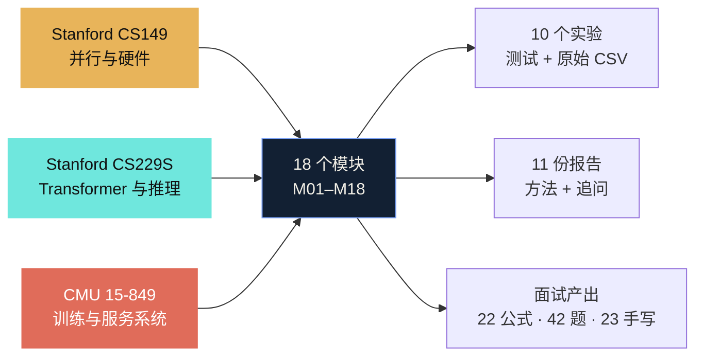
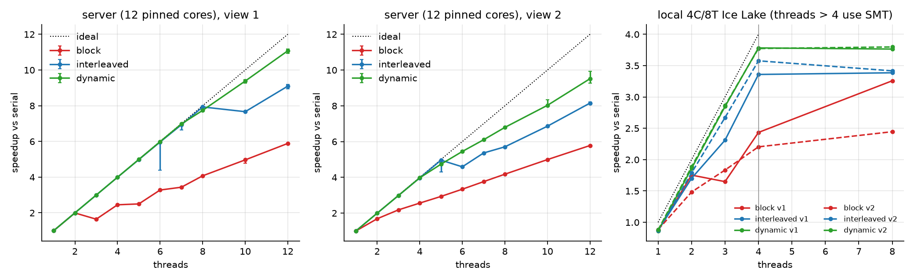
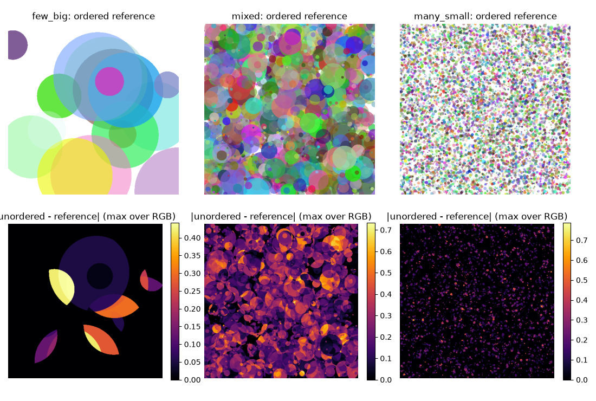
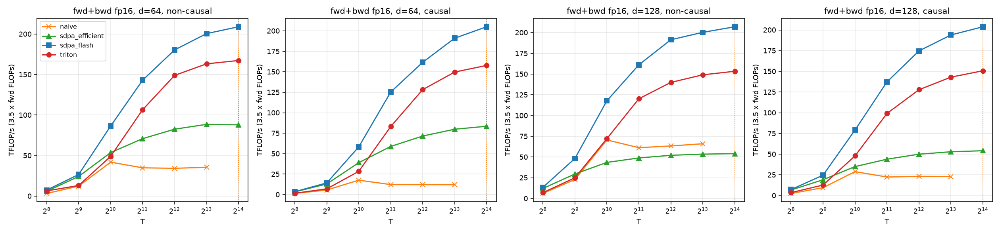
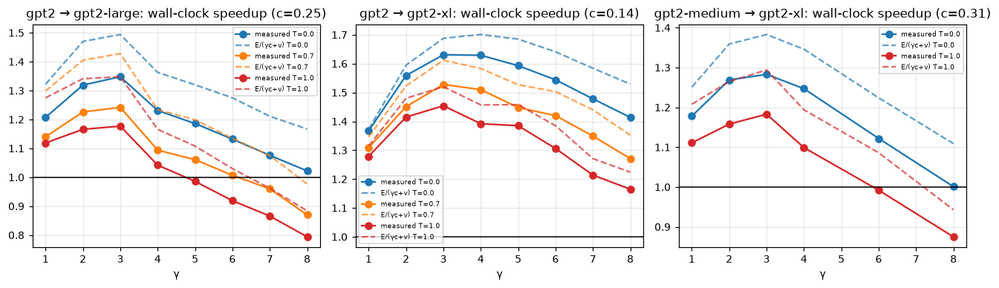
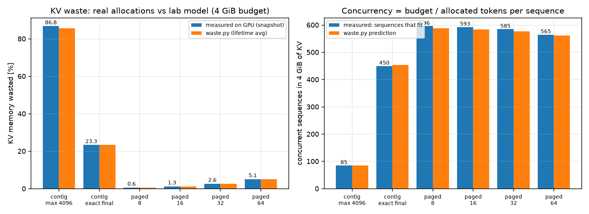
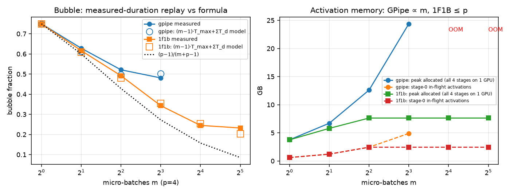

# MLSys-Infra

<p align="center">
  
</p>

**三门课，一条系统栈。** 面向面试的机器学习系统，材料来自：

- **Stanford CS149 · Parallel Computing（Fall 2024）**：性能模型、SIMD、调度、GPU、scan、GEMM、加速器。
- **Stanford CS229S · Systems for Machine Learning（Fall 2023）**：FlashAttention、KV cache、推测解码、训练与推理。
- **CMU 15-849 · Machine Learning Systems（Spring 2022）**：编译、分布式训练、显存、服务、压缩。

仓库把三门课合并为 18 个模块，按系统栈从硬件到服务排列。每个模块有中文笔记、可手推公式、面试追问链；
关键结论配有可运行实验、原始 CSV 和中文报告。作者 [ShaneLiu04](https://github.com/ShaneLiu04)，
与三所学校及课程团队无隶属关系；`solutions/` 为个人复现，正在修读这些课的同学不要将其作为作业提交。

## 快速开始

```bash
git clone https://github.com/ShaneLiu04/mlsys-infra.git
cd mlsys-infra
pip install -r requirements.txt
python notes/check_notes.py
```

GPU 部分另见 `requirements-gpu.txt`。

## 学习体系

三门课不是三份并列的笔记，而是同一条系统栈的三层：CS149 给出机器模型，CS229S 把模型用在 Transformer 上，
15-849 把模型拆到训练与服务系统里。



| 层 | 课程 | 你学到什么 | 本仓库产出 |
| --- | --- | --- | --- |
| 硬件与并行 | Stanford CS149 | roofline、SIMD、调度、GPU、scan、GEMM、systolic | M01–M10 · A1–A5 · 5 份报告 |
| 单卡算子 | Stanford CS229S | FlashAttention、KV cache、推测解码、训练 | M08、M15 · P1–P2 · 2 份报告 |
| 训练与服务系统 | CMU 15-849 | 编译、ZeRO、TP/PP、重计算、服务、压缩 | M10–M18 · 3 个复现 · 3 份报告 |

## 三门课程

### 1. Stanford CS149 · Parallel Computing

| 版本 | 讲者 | 官方入口 | 本仓库模块 | 实验 |
| --- | --- | --- | --- | --- |
| Fall 2024 | Kayvon Fatahalian, Kunle Olukotun | [CS149 Fall 2024](https://gfxcourses.stanford.edu/cs149/fall24) | M01–M10 | A1–A5 |

CS149 给出机器模型：性能与 roofline、SIMD 与多核、任务调度、局部性与一致性、GPU 存储层次、scan、GEMM、
专用加速器与 DSL。它回答「算得过来吗」，也是后面所有 kernel 与系统讨论的基线。

[](solutions/cs149/asst1-cpu-parallel/README.md)

*CS149 A1 · 12 核连续分块 5.89×、动态 11.1×；本机 4C/8T 受 SMT 影响。图源：`solutions/cs149/asst1-cpu-parallel/artifacts/figures/`。*

[](solutions/cs149/asst3-scan-render/README.md)

*CS149 A3 · 半透明混合不满足交换律；乱序写入在 mixed 场景约 93% 像素出错，16×16 图块 + exclusive scan 后与顺序参考逐位相等。*

- 12 核连续分块 `5.89×`、动态 `11.1×`；`false sharing` 让两个线程写同一 cache line 慢 `19×`。
- 8 宽 SIMD 一条慢 lane 利用率 `0.163`；AVX2 sqrt 只有标量 `0.72×`。
- Blelloch `2.10M` 对 Hillis–Steele `19.9M` 次加法；SGEMM `0.94→49.4 TFLOP/s`（cuBLAS `78%`）。
- 乱序渲染 `93%` 像素错，分块保序 `0`；rand1M `844→0.538 ms`。

入口：[M01–M10 笔记](notes/README.md) · [A1–A5 实验](solutions/README.md) · [5 份报告](reports/)

### 2. Stanford CS229S · Systems for Machine Learning

| 版本 | 讲者 | 官方入口 | 本仓库模块 | 实验 |
| --- | --- | --- | --- | --- |
| Fall 2023 | Azalia Mirhoseini, Simran Arora | [CS229S Fall 2023](https://cs229s.stanford.edu/fall2023/) | M08、M15 | P1–P2 |

CS229S 把机器模型用在 Transformer 上：FlashAttention 的 IO 复杂度、KV cache、推测解码、参数高效训练。
它回答「同一个模型在 GPU 上为什么快或慢」，把 roofline 落到 attention 与 decode 的 shape 上。

[](solutions/cs229s/project1-transformer-kernels/README.md)

*CS229S P1 · Triton FA 前向 224 TFLOP/s（FA2 217.9），T=8192 比朴素实现快 7.15×；图为前向+反向总吞吐，反向为 FA2 的 80%。图源：`solutions/cs229s/project1-transformer-kernels/artifacts/figures/`。*

[](solutions/cs229s/project2-kv-speculative/README.md)

*CS229S P2 · gpt2→gpt2-xl 贪心推测解码 1.63×；CPU 上同一算法只有 1.11–1.99×，验证不免费。*

- Triton FA 前向 `224 TFLOP/s`（FA2 `217.9`）；`T=8192` 比朴素 `7.15×`；反向 FA2 `80%`。
- HBM 流量模型只预测 `2×` 加速；差距来自朴素实现本身已跑满 `93%` 带宽。
- KV cache 在 `T=1024` 时 `12.8×`；GPT-2 small bf16 训练 MFU `0.447`。
- 推测解码接受 token 数与公式差 `≤4%`；GPU `1.63×`，CPU `1.11–1.99×`。

入口：[M08、M15 笔记](notes/README.md) · [P1–P2 实验](solutions/README.md) · [2 份报告](reports/)

### 3. CMU 15-849 · Machine Learning Systems

| 版本 | 讲者 | 官方入口 | 本仓库模块 | 实验 |
| --- | --- | --- | --- | --- |
| Spring 2022 | Zhihao Jia | [CMU 15-849](https://www.cs.cmu.edu/~zhihaoj2/15-849/) | M10–M18 | 三个论文复现 |

15-849 处理系统层：编译器与图优化、ZeRO/TP/PP、重计算与混合精度、PagedAttention 与 continuous batching、
量化与剪枝。它回答「放得下吗」和「传得过来吗」，把训练与推理的账算到显存和通信上。

[](solutions/cmu15849/serving-memory/README.md)

*15-849 服务 · KV 浪费 86.8%→1.3%，同一 4 GiB 预算并发 85→593（7.0×）；分页间接寻址 <1%。图源：`solutions/cmu15849/serving-memory/artifacts/figures/`。*

[](solutions/cmu15849/distributed-training/README.md)

*15-849 分布式 · 单卡 4-stage 重放：1F1B 气泡 0.343/0.245/0.233；GPipe 激活显存随 micro-batch 线性增长，1F1B 固定在约 7.6 GB。图源：`solutions/cmu15849/distributed-training/artifacts/figures/`。*

- `16 B/参数`实测 `16.00–16.32`；ZeRO 0–3 分片显存与公式差 `0.099%`；ZeRO-3 通信 `1.5×`。
- 1F1B 气泡 `0.343/0.245/0.233`，显存 `7.64 GB`；全量重计算 `+18.9%` 时间，batch `8→24`。
- KV 浪费 `86.8%→1.26%`，并发 `7.0×`；chunked prefill P99 `33.5→17.6 ms`。
- 融合省 `49%` 流量只省 `16%` 时间；W8A8 误差 `2.3%→10.2%`，LLM.int8 `0.49%`。

入口：[M10–M18 笔记](notes/README.md) · [三个复现](solutions/README.md) · [3 份报告](reports/)

## 十八模块

课程列按主线归属标注；逐讲出处与交叉贡献见 [CURRICULUM.md](CURRICULUM.md)。

| 模块 | 核心结论 | 课程 | 笔记 | 证据 |
| --- | --- | --- | --- | --- |
| M01 性能模型 | H100 拐点 989/3.35 ≈ 295 FLOP/B；逐元素加法只有 0.17，调 kernel 也突破不了带宽。 | CS149 | [M01](notes/module-01-performance-models.md) | [F2](interview/FORMULAS.md#f2-roofline-与拐点) |
| M02 多核、SIMD 与多线程 | 一组 lane 等最慢的那条；8 宽一条慢 lane，利用率 0.163。 | CS149 | [M02](notes/module-02-multicore-simd-threads.md) | [A1](solutions/cs149/asst1-cpu-parallel/README.md) |
| M03 并行编程与调度 | 12 核连续分块 5.89×，动态 11.1×；work stealing 满足 `T_P ≤ T1/P + O(T∞)`。 | CS149 | [M03](notes/module-03-parallel-programming-scheduling.md) | [A1](solutions/cs149/asst1-cpu-parallel/README.md) [A2](solutions/cs149/asst2-task-scheduler/README.md) |
| M04 局部性、通信、一致性与同步 | false sharing 让两个线程写同一 cache line 慢 19×；CAS 无锁栈要处理 ABA。 | CS149 | [M04](notes/module-04-locality-coherence-synchronization.md) | [A2](solutions/cs149/asst2-task-scheduler/README.md) [Q7–Q8](interview/QUESTION-BANK.md) |
| M05 GPU 架构与 CUDA | warp 是 32 线程的锁步单位；合并访问看 warp 内地址，bank conflict 看 32 个 bank；occupancy 是手段。 | CS149 | [M05](notes/module-05-gpu-architecture-cuda.md) | [Q9–Q11](interview/QUESTION-BANK.md) |
| M06 数据并行原语 | Blelloch work 2n，Hillis–Steele n log n；n=2²⁰ 时 2.10M 对 19.9M 次加法。 | CS149 | [M06](notes/module-06-data-parallel-primitives.md) | [A3](solutions/cs149/asst3-scan-render/README.md) |
| M07 矩阵乘与分块 | 方阵 bf16 强度 n/3；batch=1 GEMV 1 FLOP/B，只能到 H100 峰值的 0.3%。 | CS149 | [M07](notes/module-07-matmul-hardware-aware.md) | [A4](solutions/cs149/asst4-dnn-accelerator/README.md) |
| M08 Attention 与 FlashAttention | 不减 FLOPs，省 T×T 显存与多次 T² 读写；流量模型只预测 2× 加速，实测快 7.15×。 | CS229S | [M08](notes/module-08-attention-flashattention.md) | [P1](solutions/cs229s/project1-transformer-kernels/README.md) |
| M09 专用硬件与加速器 | 16×16 systolic 利用率 n=16 时 0.258，n=256 时 0.848；分块强度 63/124/241 FLOP/B。 | CS149 | [M09](notes/module-09-accelerators.md) | [A4](solutions/cs149/asst4-dnn-accelerator/README.md) |
| M10 ML 编译器与图优化 | 融合省中间结果的 HBM 读写；MLP epilogue 省 49% 流量但只省 16% 时间。 | 15-849 | [M10](notes/module-10-ml-compilers.md) | [故事 5](interview/PORTFOLIO.md#5-融合的收益就是字节比) |
| M11 框架与自动微分 | 反向模式按拓扑序累加梯度；训练 FLOPs ≈ 6ND。 | 15-849 | [M11](notes/module-11-frameworks-autodiff.md) | [F9](interview/FORMULAS.md#f9-参数量与训练-flops6nd) [15-849 编译](solutions/cmu15849/compiler-compression/README.md) |
| M12 数据并行与 ZeRO | ring all-reduce 每卡 2(p−1)/p·S；7B 8 卡 ZeRO 0–3 静态显存 112→38.5→26.25→14 GB。 | 15-849 | [M12](notes/module-12-data-parallel-zero.md) | [15-849 分布式](solutions/cmu15849/distributed-training/README.md) |
| M13 张量并行与流水线并行 | TP 每层 4 次 all-reduce，只能走 NVLink；PP 只传激活，可跨节点；气泡 (p−1)/(m+p−1)。 | 15-849 | [M13](notes/module-13-tensor-pipeline-parallel.md) | [F12–F13](interview/FORMULAS.md#f13-流水线气泡) |
| M14 显存优化 | 训练静态 16 B/参数；全量重计算 +33%，选择性重计算只重算 attention 的 T²。 | 15-849 | [M14](notes/module-14-memory-optimization.md) | [F10](interview/FORMULAS.md#f10-训练静态显存-16n-与-zero) [F14](interview/FORMULAS.md#f14-重计算的-n-方案) |
| M15 推理：KV cache 与推测解码 | prefill 吃算力，decode 吃带宽；Llama-3-8B 每 token KV 128 KB，batch=1 上限约 200 token/s。 | CS229S | [M15](notes/module-15-inference-kv-speculative.md) | [P2](solutions/cs229s/project2-kv-speculative/README.md) |
| M16 LLM 推理服务 | PagedAttention 每序列最多浪费 block−1 个 token；continuous batching 把调度粒度降到一个 decode 步。 | 15-849 | [M16](notes/module-16-llm-serving.md) | [15-849 服务](solutions/cmu15849/serving-memory/README.md) |
| M17 模型压缩 | 8/1024 个 50× 离群通道使 per-tensor W8A8 误差 2.3%→10.2%，LLM.int8 拉回 0.49%。 | 15-849 | [M17](notes/module-17-compression-quantization.md) | [故事 6](interview/PORTFOLIO.md#6-量化位宽越低越需要数据) |
| M18 MoE、集群与数据 | MoE 的 FLOPs 随 top-k 增长，显存随专家总数增长；每层两次 all-to-all。 | 15-849 | [M18](notes/module-18-architectures-moe-clusters.md) | [F21](interview/FORMULAS.md#f21-moe-的-all-to-all-通信量) |

## 实验索引

每个实验的 README 写明和原作业的差异，以及这些数字不能推出什么。带 GPU 的版本在 RTX 5090 上补测；
没有 GPU 的版本在 4 物理核 CPU 上可跑、可测。实验名链接到代码、测试、图和完整说明；
故事编号对应 [作品集](interview/PORTFOLIO.md) 的 12 条 STAR 故事。

| 课程 | 实验 | 它回答什么 | 关键结果 | 故事 |
| --- | --- | --- | --- | --- |
| CS149 | [A1 多核与 SIMD](solutions/cs149/asst1-cpu-parallel/README.md) | lane 发散与负载不均各损失多少 | 一条慢 lane 让 8 宽 SIMD 利用率降到 0.163；12 核连续 5.89×、动态 11.1× | 8 |
| CS149 | [A2 任务系统](solutions/cs149/asst2-task-scheduler/README.md) | 线程池该 spin 还是 sleep | sleep 池 launch 38.7 µs；空闲 spin 烧 11.96 核；2× 超订时带锁 spin 慢 766× | 9 |
| CS149 | [A3 scan 与渲染](solutions/cs149/asst3-scan-render/README.md) | work-efficient 与保序并行值多少 | Blelloch 2.10M 对 Hillis–Steele 19.9M 次加法；乱序 93% 像素错，分块保序 0；rand1M 844→0.538 ms | 7 |
| CS149 | [A4 加速器](solutions/cs149/asst4-dnn-accelerator/README.md) | 分块、systolic 与 roofline 怎么对上 | SGEMM 0.94→49.4 TFLOP/s（cuBLAS 78%）；16×16 systolic 利用率 0.258→0.848 | 10 |
| CS149 | [A5 大图 BFS](solutions/cs149/asst5-big-graphs/README.md) | 方向自适应 BFS 为什么有效 | RMAT hybrid 8 线程 6.58×，检查的边只有 top-down 的 9.1% | 11 |
| CS229S | [P1 attention 内核](solutions/cs229s/project1-transformer-kernels/README.md) | FlashAttention 省的是流量还是 FLOPs | Triton 前向 224 TFLOP/s（FA2 217.9）；T=8192 比朴素快 7.15× | 1 |
| CS229S | [P2 KV 与推测解码](solutions/cs229s/project2-kv-speculative/README.md) | 推测解码的加速从哪来 | 接受 token 数与公式差 ≤4%；gpt2→xl 贪心 1.63×；CPU 只有 1.11–1.99× | 2 |
| 15-849 | [分布式训练](solutions/cmu15849/distributed-training/README.md) | 16N 显存、ZeRO、1F1B 气泡 | 16 B/参数实测 16.00–16.32；ZeRO-3 通信 1.5×；气泡 0.343/0.245/0.233 | 4 |
| 15-849 | [服务与显存](solutions/cmu15849/serving-memory/README.md) | 分页 KV 与 continuous batching 的账 | KV 浪费 86.8%→1.26%，并发 7.0×；最差一步 P99 33.5→17.6 ms | 3 |
| 15-849 | [编译与压缩](solutions/cmu15849/compiler-compression/README.md) | 融合与量化的收益边界 | 融合省 49% 流量只省 16% 时间；W8A8 误差 2.3%→10.2%，LLM.int8 拉回 0.49% | 5 / 6 |

## 报告索引

10 份实验报告中文主体、保留英文术语，含方法、全部实验图的逐张解读、与理论模型的对照、面试追问（带常见错答）、
20 秒讲法、STAR 故事和局限；1 份 34 页综述给出 57 个面试追问框和 16 个白板估算框。
综述的 131 篇参考文献逐条核对过标题、年份与出处。

| 课程 | 报告 | 页数 | 代表性结果 |
| --- | --- | ---: | --- |
| 综述 | [面试知识综述（CCF-A 格式）](reports/survey/survey.pdf) | 34 | 131 篇参考文献，57 个面试追问框，16 个白板估算框 |
| CS149 | [A1 多核、SIMD、带宽与 GPU](reports/cs149-asst1/cs149_asst1_report.pdf) | 21 | 12 核连续块 5.89× / 动态 11.1×；AVX-512 双向量交错 18.3×；sqrt 每 8 个混 1 个慢的，AVX2 0.72×；saxpy 过 PCIe 只剩 52 GB/s |
| CS149 | [A2 任务系统（C++）](reports/cs149-asst2/cs149_asst2_report.pdf) | 22 | spin 0.78 µs、sleep 10.8 µs、spawn 53.3 µs；空闲 spin 烧 11.96 核；2× 超订时带锁 spin 慢 766×；false sharing 19× |
| CS149 | [A3 CUDA scan 与渲染器](reports/cs149-asst3/cs149_asst3_report.pdf) | 23 | saxpy kernel 1578 GB/s、端到端 53.8 GB/s；scan 2²⁸ 16.75→2.82→1.41 ms；rand1M 渲染 844→0.538 ms |
| CS149 | [A4 GEMM、卷积与 roofline](reports/cs149-asst4/cs149_asst4_report.pdf) | 24 | SGEMM 0.94→49.4 TFLOP/s（cuBLAS 78%）；WMMA fp16 177.8 TFLOP/s（86%）；分块流量模型与实测带宽差 2.3% |
| CS149 | [A5 大图 BFS](reports/cs149-asst5/cs149_asst5_report.pdf) | 18 | RMAT hybrid 8 线程 6.58×（三个种子 6.56–6.94×），检查的边只有 top-down 的 9.1%；scale 16→23 加速比 1.33×→12.2× |
| CS229S | [P1 FlashAttention 与训练](reports/cs229s-project1/cs229s_project1_report.pdf) | 23 | Triton 前向 224 TFLOP/s（FA2 217.9）；反向 FA2 的 80%；GPT-2 small bf16 MFU 0.447 |
| CS229S | [P2 KV cache 与推测解码](reports/cs229s-project2/cs229s_project2_report.pdf) | 20 | gpt2-xl decode 20.6→4.22 ms（KV + CUDA graph）；推测解码贪心 1.63×、采样 1.45×；卡方检验确认分布无偏 |
| 15-849 | [编译与压缩](reports/cmu15849-compiler-compression/compiler_compression_report.pdf) | 26 | RMSNorm 9.86×；W3 RTN ppl 65.9→GPTQ 37.2；Wanda 50% 稀疏 ppl 47.2 对幅值剪枝 538；2:4 稀疏 1.54× |
| 15-849 | [分布式训练](reports/cmu15849-distributed-training/distributed_training_report.pdf) | 22 | 16 B/参数实测 16.00–16.32；激活模型误差 ≤1.3%；774M bf16 MFU 70.2%；全量重计算 +18.9% 时间、batch 8→24；1F1B 气泡 0.343/0.245/0.233，显存固定 7.64 GB |
| 15-849 | [服务与显存](reports/cmu15849-serving-memory/serving_memory_report.pdf) | 21 | CUDA graph 2.16 ms 对带宽下限 0.65 ms；分页间接寻址 <1%；KV 浪费 86.8%→1.26%，并发 7.0×；chunked prefill P99 33.5→17.6 ms |

## 面试索引

| 文件 | 内容 | 数量 |
| --- | --- | ---: |
| [HARDWARE-NUMBERS.md](interview/HARDWARE-NUMBERS.md) | 十个数、存储层次、模型参数、本仓库实测基线 | — |
| [FORMULAS.md](interview/FORMULAS.md) | 公式、推导、口算检查、常见错答 | 22 |
| [SYSTEM-DESIGN.md](interview/SYSTEM-DESIGN.md) | D1–D6：70B 推理、70B 预训练、GRPO、多 LoRA、万卡容错、128K 上下文 | 6 |
| [PORTFOLIO.md](interview/PORTFOLIO.md) | STAR 故事、20 秒结论、白板推导、不能推出的结论 | 12 |
| [CODING.md](interview/CODING.md) | 参考实现与可直接运行的测试 | 23 |
| [QUESTION-BANK.md](interview/QUESTION-BANK.md) | 按系统栈分组，每题带常见错答 | 42 |
| [COURSE-QA.md](interview/COURSE-QA.md) | 18 讲的一句话答案 | 18 |
| [ENGINEERING.md](interview/ENGINEERING.md) | 「慢了 / OOM / 挂住了」的检查顺序 | — |

概念面每题先说结论，再说原因，最后补一个常见错答；估算面先报数字，再画框图，最后讲取舍。

## 怎么准备

| 面试形式 | 材料 | 目标 |
| --- | --- | --- |
| **概念面** 30–45 分钟 | [COURSE-QA](interview/COURSE-QA.md) → [QUESTION-BANK](interview/QUESTION-BANK.md) | 每题先说结论，再说原因，最后补一个常见错答 |
| **估算 / 设计面** 45–60 分钟 | [HARDWARE-NUMBERS](interview/HARDWARE-NUMBERS.md) 的十个数 → [FORMULAS](interview/FORMULAS.md) 的 F2、F10、F11、F15、F16 → [SYSTEM-DESIGN](interview/SYSTEM-DESIGN.md) | 20 分钟白板做完 D1 或 D2：先报估算，再画框图，最后讲取舍 |
| **手写代码面** 45–60 分钟 | [CODING](interview/CODING.md) 的 C1–C23 | 关掉参考实现限时写，跑对应测试，再对照 |

90 分钟路线：十个数 → F2/F10/F15/F16 → 岗位对应设计题（推理 D1，训练 D2）。

按岗位：训练 infra 读 M07、M11–M14、M18，讲故事 4/6；推理读 M05、M07、M08、M15–M17，讲故事 1/3；
算子/芯片读 M02、M04–M10，讲故事 1/7；通用 ML 工程读 M01、M08、M12、M15、M16。
完整路线见 [READING-ROADMAP](notes/READING-ROADMAP.md)。

## 复现

```bash
pip install -r requirements.txt
cd solutions/<course>/<lab>
python -m pytest -q tests
python scripts/run_experiments.py
```

GPU 部分另见 `requirements-gpu.txt`。全部测试与仓库检查：

```bash
python notes/check_notes.py
./scripts/run-all-tests.ps1    # Linux: scripts/run-all-tests.sh
./scripts/check-repo.ps1
```

当前 11 套测试、430 通过；14 个 GPU 测试在无 CUDA 时跳过，RTX 5090 上全部通过。
`check-repo.ps1` 检查 Markdown 链接、实验目录、报告（PDF、图、参考文献引用）和密钥。

白板估算可以用计算器复核：

```bash
python tools/mlsys_calc.py hw
python tools/mlsys_calc.py train-mem --params 7e9 --dp 8 --zero 3
python tools/mlsys_calc.py decode --model llama3-8b --gpu h100 --seq 4096 --batch 1
python tools/mlsys_calc.py spec --alpha 0.8 --gamma 4
```

实验图由各实验的 `scripts/plot_*.py` 从 `artifacts/raw/` 生成；封面由 `scripts/make_cover.py` 生成。

```text
.
├── notes/            18 讲（M01–M18）
├── interview/        8 份面试材料
├── solutions/        10 个实验（代码 / 测试 / CSV / 图）
├── reports/          11 份 PDF
├── tools/            白板估算计算器、采样
├── assignments/      官方 starter 镜像
├── scripts/          测试、仓库检查、封面
└── assets/           封面
```

## 数字边界

- **实测 vs 模型**：带「实测」的数字来自 RTX 5090 / Xeon 6459C 服务器，或 4 物理核 CPU；
  没有实测的 H100 时间、吞吐、时延来自 `tools/mlsys_calc.py` 的 roofline / α-β 模型，文中会标注。
- **ncu 的边界**：容器不开放 GPU 性能计数器，occupancy、bank conflict、DRAM 字节数是理论值或模型推算。
- **多卡与 vLLM**：只有单卡实测，多卡 NCCL 带宽未测；单卡上的「流水线」是按依赖串行重放；
  没有 vLLM 对照，用的是自写分页引擎。
- **官方材料**：建仓时 github.com 在公司网络下不可达，官方 starter（C++/ISPC/CUDA/NKI）未镜像；
  CS229S 的项目题面未公开，实验按课程主页描述独立实现。
- **用途**：这是个人笔记与复现，不是官方作业答案。正在修读这些课的同学不要把它当作作业提交。

更细的测试清单、数字边界和已知缺失在 [VERIFICATION.md](VERIFICATION.md)。

## 贡献

欢迎 issue / PR 指出数字、链接或实现错误。提交前运行 `./scripts/check-repo.ps1` 和
`./scripts/run-all-tests.ps1`（Linux：`scripts/run-all-tests.sh`）；贡献指南见 [CONTRIBUTING.md](CONTRIBUTING.md)。

## 许可

官方材料的版权归原作者，来源记在 [UPSTREAM.md](UPSTREAM.md)。笔记、面试材料、工具、脚本和实验代码使用
[MIT License](LICENSE)。
