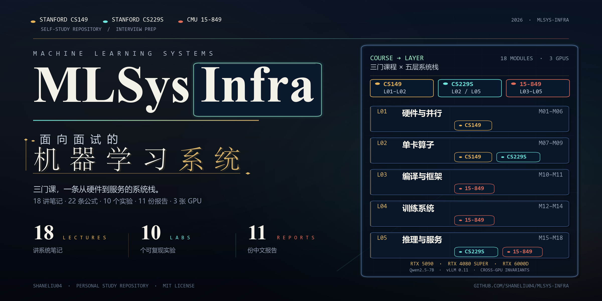
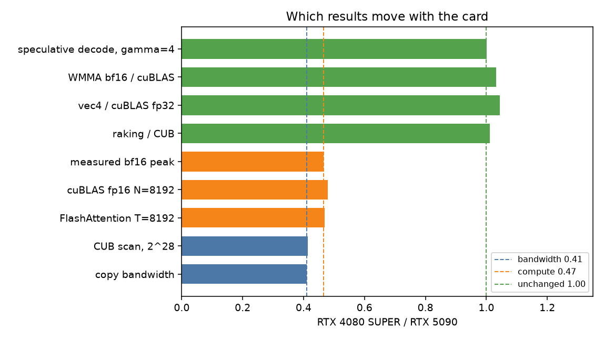
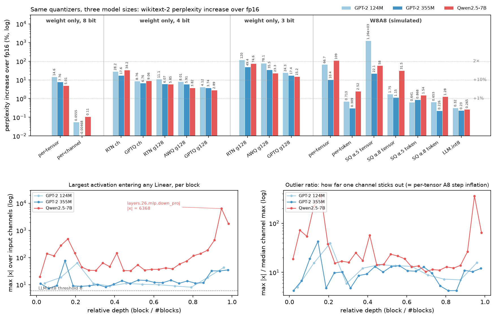
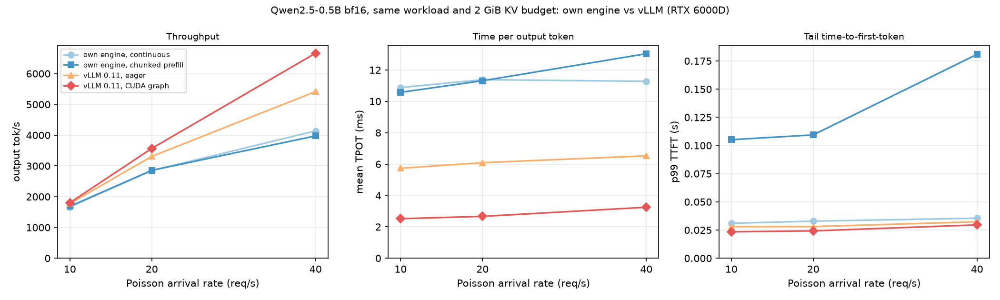

# MLSys-Infra

<p align="center">
  
</p>

我准备 MLSys 面试的时候，把 Stanford CS149 Parallel Computing（Fall 2024）、Stanford CS229S Systems for Machine Learning（Fall 2023）和 CMU 15-849 Machine Learning Systems（Spring 2022）三门课合成了这一条路线。不是按课程分章，而是按系统栈从下往上：硬件与并行、单卡算子、编译与框架、训练系统、推理与服务、效率与集群。这样排的好处是，面试官问「这个数从哪来」时，你能顺着栈往下找到那个 kernel、那条 all-reduce 或者那次显存分配。

每个实验我先在 4 核 CPU 上写一个能跑、能对拍的版本，把机制弄清楚，再上 RTX 5090、RTX 4080 SUPER 和 RTX 6000D，用 C++ / CUDA / Triton 看结论还成不成立。`solutions/*/artifacts/raw/` 里是原始 CSV 和 JSONL；[claims.json](claims.json) 把正文里 20 条关键数字对回文件，改数时会一起检查。[solutions/](solutions/README.md) 是我自己的实现，不是官方答案；正在修这三门课的同学不要拿它交作业。作者 ShaneLiu04，和三所学校及课程团队没有隶属关系。

## 时间不多的话

明天就面试：背 [HARDWARE-NUMBERS.md](interview/HARDWARE-NUMBERS.md) 的十个数，默写 [公式卡](interview/FORMULAS.md) 的 F2、F10、F15、F16，再做一道和岗位对应的 [设计题](interview/SYSTEM-DESIGN.md)（推理 D1，训练 D2）。先把结论说出口，再补推导。

有一个周末：按「三门课和 18 个模块」的表从上往下走。每行先自己说一遍，说不清再打开笔记里的「白板估算」和「面试追问链」。准备两个 [作品集](interview/PORTFOLIO.md) 故事：推理 1 和 3，训练 4 和 6，算子/芯片 1 和 7。

想真正学会：从 M01 开始读，每读完一讲就去跑对应的实验，看自己推出来的数和实测差多少。差在哪里通常比「对上了」更值得记。

手写代码面看 [CODING.md](interview/CODING.md)，23 道题都有参考实现和能直接跑的测试。「慢了 / OOM / 挂住了」的检查顺序在 [ENGINEERING.md](interview/ENGINEERING.md)。白板估算可以用计算器复核：

```bash
python tools/mlsys_calc.py hw
python tools/mlsys_calc.py train-mem --params 7e9 --dp 8 --zero 3
python tools/mlsys_calc.py decode --model llama3-8b --gpu h100 --seq 4096 --batch 1
python tools/mlsys_calc.py spec --alpha 0.8 --gamma 4
```

## 先说最新一轮：三张卡、7B 和 vLLM

三张卡、Qwen2.5-7B 的量化、vLLM 0.11 的对照，是最近补的三组。下面的数都能在 [artifacts/cross_gpu/](artifacts/cross_gpu/comparison.md) 和各实验的 `artifacts/raw/rtx6000d/` 里找到原件。

### 跨卡：哪些数没跟着卡走

同一批实验在三张卡上各跑了一遍。我关心的不是谁快，而是哪些比值不随卡变。拷贝带宽之比、bf16 GEMM 峰值之比和 1 是三个参照；一个指标离谁近，就归到哪一类。

| 指标 | RTX 5090 | RTX 4080 SUPER | RTX 6000D | 4080S / 5090 | 6000D / 5090 | 归类 |
| --- | ---: | ---: | ---: | ---: | ---: | --- |
| 拷贝带宽 | 1522 GB/s | 626 GB/s | 1278 GB/s | 0.41 | 0.84 | 带宽 |
| CUB scan（2²⁸） | 1521 GB/s | 630 GB/s | 1278 GB/s | 0.41 | 0.84 | 带宽 |
| FlashAttention T=8192 | 214.9 TFLOP/s | 100.8 | 92.8 | 0.47 | 0.43 | 算力 / 带宽 |
| cuBLAS fp16 GEMM N=8192 | 222.3 TFLOP/s | 106.7 | 142.7 | 0.48 | 0.64 | 算力 |
| 实测 bf16 GEMM 峰值 | 236.3 TFLOP/s | 109.9 | 228.7 | 0.47 | 0.97 | 算力（burst） |
| 自写 raking / CUB | 0.497 | 0.503 | 0.499 | 1.01 | 1.00 | 与卡无关 |
| vec4 / cuBLAS fp32 | 0.755 | 0.788 | 0.808 | 1.04 | 1.07 | 与卡无关 |
| WMMA bf16 / cuBLAS bf16 | 0.779 | 0.805 | 0.897 | 1.03 | 1.15 | 与卡无关 |
| 推测解码 gpt2→xl γ=4 贪心 | 1.629 | 1.631 | 1.660 | 1.00 | 1.02 | 与卡无关 |

GEMM / FlashAttention 行是 TFLOP/s，拷贝 / scan 行是 GB/s，最后四行的三列是无量纲比值。



*4080 SUPER / 5090 的比值。绿色是「与卡无关」，橙色是算力，蓝色是带宽。图源：`artifacts/cross_gpu/comparison.png`。*

FlashAttention 和 cuBLAS 的比值贴着算力比，CUB scan 贴着带宽比；raking / CUB、vec4 / cuBLAS、WMMA / cuBLAS 和推测解码都在 1 附近。换一张带宽只有四成的卡，验证多个 token 的代价几乎没变。

6000D 的 228.7 TFLOP/s 我一开始也信了。后来用 8 秒的 sustained 探针重跑，稳定在 141–145；30 次 2048³ 的 burst 采样里，快段和慢段交替，228.7 正好落在快段里。不是过热，也不是功耗墙，nvidia-smi 没有降频原因；再往下的机制没有 ncu 权限，查不清。所以这张卡算 roofline 我用 143，不用 228.7。4080 的 `peaks.json` 里还有两个字段是 5090 的规格值，我没改历史记录，表里用的是实测值。

### 7B 上，权重和激活分了家

同一套量化器从 GPT-2 换到 Qwen2.5-7B，结论不是「7B 更难量化」一句话，而是权重和激活走了两个方向：4-bit / 3-bit 权重量化随规模变容易，8-bit 激活量化随规模变难。

| 方法（相对 fp16 的 ppl 增幅） | GPT-2 124M | GPT-2 355M | Qwen2.5-7B |
| --- | ---: | ---: | ---: |
| W8 逐张量 / 逐通道 | +14.6 / +0.06% | +7.8 / -0.005% | +5.0 / +0.11% |
| W4 g128 GPTQ | +4.1% | +3.7% | +2.9% |
| W3 g128：RTN / AWQ / GPTQ | +120 / +78 / +24% | +49 / +36 / +17% | +75 / +23 / +15% |
| W8A8 逐张量 / 逐 token | +67 / +0.71% | +10 / +0.31% | +109 / +2.5% |
| LLM.int8 | +0.32% | +0.23% | +0.27% |



*同一套量化器在三个模型上的 ppl 增幅；下排是每层最大激活与离群比。图源：`solutions/cmu15849/compiler-compression/artifacts/figures/gpu_quant_scale.png`。*

W4 g128 GPTQ 从 +4.1% 降到 +2.9%，W3 GPTQ 从 +24% 降到 +15%。但 W8A8 逐张量从 355M 的 +10% 涨到 7B 的 +109%。原因在激活：Qwen 的 `layers.26.mlp.down_proj` 输入里有一个通道 |x| = 6368，是该层通道最大值中位数的 358 倍；逐张量步长被它决定，其余通道只剩几个量化级。逐 token 激活和 LLM.int8 分别把误差拉回 +2.5% 和 +0.27%；LLM.int8 的代价是平均 700 列、最多 18702 列走 fp16。

GPTQ 在 7B 上第一次跑崩，报 `leading minor of order 18004 is not positive-definite`；1% 阻尼的 fp32 Hessian 被离群通道撑得条件数太大。改成 float64 Cholesky，失败时把阻尼放大 10 / 100 倍重试，三个配置共 967 s。

这套数只说明 Qwen2.5-7B 一个模型；perplexity 是 HF ctx 1024，和 llama.cpp 的 ctx 512 不能直接比；W8A8 是 fp16 GEMM 的精度模拟，不是端到端 int8 速度。

### vLLM 差在调度和下发

对照是在 RTX 6000D 上做的，Qwen2.5-0.5B，同一长度分布、同种子、同一 2 GiB KV 预算。vLLM 0.11 的 V1 对长 prefill 分块，所以最接近的自写策略是 chunked。

| λ（req/s） | 自写 continuous（tok/s / TPOT） | 自写 chunked | vLLM eager | vLLM CUDA graph |
| ---: | --- | --- | --- | --- |
| 10 | 1666 / 10.9 ms | 1685 / 10.6 ms | 1778 / 5.7 ms | 1804 / 2.5 ms |
| 20 | 2849 / 11.4 ms | 2857 / 11.3 ms | 3310 / 6.1 ms | 3569 / 2.7 ms |
| 40 | 4140 / 11.3 ms | 3977 / 13.0 ms | 5417 / 6.5 ms | 6666 / 3.2 ms |

每格是 output tok/s / mean TPOT。



*Qwen2.5-0.5B bf16，同一长度分布 / Poisson 到达（同种子）、同一 2 GiB KV 预算；vLLM 0.11 eager 与 CUDA graph。图源：`solutions/cmu15849/serving-memory/artifacts/figures/rtx6000d/vllm_compare.png`。*

λ=10 时吞吐差不多（1666 对 1804 tok/s），差别全在 TPOT：10.9 对 2.5 ms。λ=40 时 vLLM 吞吐 1.61×（4140 到 6666），TPOT 11.3 对 3.2 ms。把 8.1 ms 拆开，约 5 ms 是 Python 调度和 kernel 下发，3.3 ms 是 CUDA graph；这和 [serving 报告](solutions/cmu15849/serving-memory/README.md) 里的成本模型（每迭代 9.15 ms 固定开销）对得上。TTFT 也差：自写 chunked 在 λ=40 时 p99 181 ms，vLLM 30 ms，块大小和调度顺序都没调好。

这组只测了 0.5B、单卡、前缀缓存关闭；大模型上 GEMM 时间变长，下发开销占比会小得多，差距会收窄。

## 三门课和 18 个模块

三门课各管一层，但我不按课程分章。CS149 给机器模型：roofline、SIMD、调度、GPU、scan、GEMM、加速器；CS229S 把它用在 Transformer 上：FlashAttention、KV cache、推测解码；15-849 把模型拆到训练和服务里：编译、ZeRO、TP/PP、重计算、PagedAttention、量化。顺序就是硬件 → 单卡算子 → 编译 → 训练 → 推理 → 效率与集群。

| 课程 | 版本 | 主线 | 实验 | 报告 |
| --- | --- | --- | --- | --- |
| [Stanford CS149 Parallel Computing](https://gfxcourses.stanford.edu/cs149/fall24) | Fall 2024 | 硬件、并行、GPU、scan、GEMM、加速器 | A1–A5 | 5 份 |
| [Stanford CS229S Systems for Machine Learning](https://cs229s.stanford.edu/fall2023/) | Fall 2023 | Transformer、FlashAttention、KV cache、推测解码 | P1–P2 | 2 份 |
| [CMU 15-849 Machine Learning Systems](https://www.cs.cmu.edu/~zhihaoj2/15-849/) | Spring 2022 | 编译、分布式训练、显存、服务、压缩 | 三个论文复现 | 3 份 |

合并理由和每讲出处写在 [CURRICULUM.md](CURRICULUM.md)。下面按系统栈看每层要先会算什么；完整的 18 讲索引在 [notes/README.md](notes/README.md)。

| 层 | 模块 | 你先要会算的账 | 先看 |
| --- | --- | --- | --- |
| 硬件与并行 | M01–M06 | 295 FLOP/B 拐点；一条慢 lane 利用率 0.163；12 核 5.89× / 11.1×；scan 2.10M 对 19.9M | M01、M02、M05，A1、A3 |
| 单卡算子 | M07–M09 | GEMM 强度 n/3；batch=1 GEMV 1 FLOP/B；LDS.128 换到 49.4 TFLOP/s；systolic 0.848 | M07、M09，A4、P1 |
| 编译与框架 | M10–M11 | 融合省 49% 流量只省 16% 时间；训练 FLOPs ≈ 6ND | M10、M11，编译 |
| 训练系统 | M12–M14 | ring all-reduce 2(p−1)/p·S；ZeRO 112→14 GB；1F1B 气泡 0.343→0.233；16 B/参数 | M12–M14，分布式 |
| 推理与服务 | M15–M16 | KV 128 KB/token；batch=1 约 200 token/s；KV 浪费 86.8→1.26%；vLLM 1.61× | M15、M16，P2、服务 |
| 效率与集群 | M17–M18 | W8A8 逐张量 +109%；W3 GPTQ +15%；MoE 每层两次 all-to-all | M17、M18，编译 |

## 十个实验，十个问题

每个实验的 README 都写了和原作业的差异，以及这些数字不能推出什么。实验名链接到代码、测试、图和完整说明；故事编号对应 [PORTFOLIO.md](interview/PORTFOLIO.md) 的 12 条 STAR 故事。

| 实验 | 它回答什么 | 可以引用的一句 | 故事 |
| --- | --- | --- | --- |
| [CS149 A1 多核与 SIMD](solutions/cs149/asst1-cpu-parallel/README.md) | lane 发散和负载不均各损失多少 | 4 worker 连续块 2.93×、交错 3.93×；一条慢 lane 让 8 宽 SIMD 利用率降到 0.163 | 8 |
| [CS149 A2 任务系统](solutions/cs149/asst2-task-scheduler/README.md) | 线程池该 spin 还是 sleep | sleep 池每次 launch 38.7 µs，新建线程 3169 µs；异步任务图 259→152 ms | 9 |
| [CS149 A3 scan 与渲染](solutions/cs149/asst3-scan-render/README.md) | work-efficient 和保序各值多少 | 乱序 93% 像素错，分块保序 0；小圆场景测试少 167× | 7 |
| [CS149 A4 加速器](solutions/cs149/asst4-dnn-accelerator/README.md) | 分块、systolic 和 roofline 怎么对上 | tile 128/256/512 强度 63/124/241 FLOP/B，PSUM 315；systolic 0.258→0.848 | 10 |
| [CS149 A5 大图 BFS](solutions/cs149/asst5-big-graphs/README.md) | 方向自适应 BFS 为什么有效 | RMAT hybrid 8 线程 6.58×，检查的边只有 top-down 的 9.1% | 11 |
| [CS229S P1 attention 内核](solutions/cs229s/project1-transformer-kernels/README.md) | FlashAttention 省的是流量还是 FLOPs | 前向/反向与 torch 差 4.9e-15；流量比朴素少 2.00×（因果 3.7–4.0×） | 1 |
| [CS229S P2 KV 与推测解码](solutions/cs229s/project2-kv-speculative/README.md) | 推测解码的加速从哪来 | KV cache T=1024 时 12.8×；接受 token 与公式差 ≤4%；CPU 0.98–1.99× | 2 |
| [15-849 分布式训练](solutions/cmu15849/distributed-training/README.md) | 16N 显存、ZeRO、1F1B 气泡 | ZeRO 0–3 与单进程差 2.9e-16；ZeRO-3 通信 1.5×；气泡 0.273，交错 0.158 | 4 |
| [15-849 服务与显存](solutions/cmu15849/serving-memory/README.md) | 分页 KV 与 continuous batching 的账 | 实测 KV 浪费 86.8→1.26%，并发 7.0×；vLLM 0.11 λ=40 1.61× | 3 |
| [15-849 编译与压缩](solutions/cmu15849/compiler-compression/README.md) | 融合与量化的收益边界 | 融合省 49% 流量只省 16% 时间；Qwen2.5-7B W8A8 +109%、LLM.int8 +0.27%、W3 GPTQ +15% | 5 / 6 |

## 十一份报告

每份中文主体、保留英文术语，含方法、逐张图的解读、与模型对照、面试追问、20 秒讲法、STAR 故事和局限。页数是最近一版 PDF 的页数。

| 报告 | 页数 | 读完带走一句 |
| --- | ---: | --- |
| [面试知识综述（CCF-A 格式）](reports/survey/survey.pdf) | 36 | 131 篇参考文献，57 个面试追问框，16 个白板估算框，把十八讲串成一篇能从头上读下去的文章 |
| [CS149 A1 多核、SIMD、带宽与 GPU](reports/cs149-asst1/cs149_asst1_report.pdf) | 22 | 12 核连续切块 5.89×、动态 11.1×；一条慢 lane 能让 AVX2 掉到 0.72×，比标量还慢 |
| [CS149 A2 任务系统（C++）](reports/cs149-asst2/cs149_asst2_report.pdf) | 24 | 自旋池唤醒只要 0.78 µs，但空转时烧掉 11.96 个核；2× 超订时带锁自旋慢 766× |
| [CS149 A3 CUDA scan 与渲染器](reports/cs149-asst3/cs149_asst3_report.pdf) | 25 | saxpy 的 kernel 有 1578 GB/s，过了 PCIe 端到端只剩 53.8 GB/s；保序渲染把 rand1M 从 844 ms 降到 0.538 ms |
| [CS149 A4 GEMM、卷积与 roofline](reports/cs149-asst4/cs149_asst4_report.pdf) | 26 | SGEMM 从 0.94 调到 49.4 TFLOP/s，是 cuBLAS 的 78%；6000D 的 228.7 是 burst，持续 141–145 |
| [CS229S P1 FlashAttention 与训练](reports/cs229s-project1/cs229s_project1_report.pdf) | 25 | FA 224.5@32768、214.9@8192，和 FA2 的 217.9 持平；GPT-2 small bf16 训练 MFU 0.447 |
| [CS229S P2 KV cache 与推测解码](reports/cs229s-project2/cs229s_project2_report.pdf) | 21 | KV cache 加 CUDA graph 把 gpt2-xl 一步从 20.6 ms 降到 4.22 ms；推测解码再快 1.63×，卡方检验确认分布没偏 |
| [15-849 编译与压缩](reports/cmu15849-compiler-compression/compiler_compression_report.pdf) | 30 | 融合的加速跟着流量走，RMSNorm 9.86×；Qwen2.5-7B 上 W8A8 逐张量 +109%，LLM.int8 拉回 +0.27% |
| [15-849 分布式训练](reports/cmu15849-distributed-training/distributed_training_report.pdf) | 23 | 每个参数 16 字节，实测 16.00–16.32；全量重计算多花 18.9% 时间，batch 从 8 放到 24 |
| [15-849 服务与显存](reports/cmu15849-serving-memory/serving_memory_report.pdf) | 22 | 小模型 decode 先卡在 CPU 派发；分页把 KV 浪费从 86.8% 降到 1.26%，并发 7.0× |
| [CS149 A5 大图 BFS](reports/cs149-asst5/cs149_asst5_report.pdf) | 19 | RMAT 上 hybrid BFS 8 线程 6.58×，检查的边只有 top-down 的 9.1%；网格和链上并行反而慢两个数量级 |

引用数字之前，先看对应实验 README 的「不能推出的结论」。有些数是 RTX 5090 上测的，有些是用 H100 参数算的模型，混着讲容易被追问穿。

## 面试材料

| 文件 | 内容 | 数量 |
| --- | --- | ---: |
| [HARDWARE-NUMBERS.md](interview/HARDWARE-NUMBERS.md) | 十个数、三张卡的实测基线、存储层次、模型参数 | — |
| [FORMULAS.md](interview/FORMULAS.md) | 公式、推导、口算检查、常见错答 | 22 |
| [SYSTEM-DESIGN.md](interview/SYSTEM-DESIGN.md) | 70B 推理、70B 预训练、GRPO、多 LoRA、万卡容错、128K 上下文 | 6 |
| [PORTFOLIO.md](interview/PORTFOLIO.md) | STAR 故事、20 秒结论、白板推导、不能推出的结论 | 12 |
| [CODING.md](interview/CODING.md) | 参考实现和能直接跑的测试 | 23 |
| [QUESTION-BANK.md](interview/QUESTION-BANK.md) | 按系统栈分组，每题带常见错答 | 42 |
| [COURSE-QA.md](interview/COURSE-QA.md) | 18 讲的一句话答案 | 18 |
| [ENGINEERING.md](interview/ENGINEERING.md) | 「慢了 / OOM / 挂住了」的检查顺序 | — |

概念面先说结论，再说原因，最后补一个常见错答。估算面先报数字，再画框图，最后讲取舍。

## 怎么跑

```bash
pip install -r requirements.txt
pip install -e .
cd solutions/<course>/<lab>
python -m pytest -q tests
python scripts/run_experiments.py
```

GPU 部分另见 `requirements-gpu.txt`。全部测试和仓库检查：

```bash
python notes/check_notes.py
./scripts/run-all-tests.ps1    # Linux: scripts/run-all-tests.sh
./scripts/check-repo.ps1
```

本机完整矩阵 430+ 项；14 个 GPU 测试在无 CUDA 时跳过，RTX 5090 上全部跑过。GitHub CI 在 2 核 runner 上设置 `MLSYS_MAX_THREADS=2`，并跳过纯 `spinning` 的 Python 压力用例；完整的 1/3/8 线程矩阵在本机和 GPU 服务器上跑。`check-repo.ps1` 检查 Markdown 链接、实验目录、报告、[claims.json](claims.json) 对原始 JSONL 的数字和密钥。跨卡表和 claims 可以单独重算：

```bash
python scripts/compare_hw.py
python scripts/check_claims.py
```

实验图由各实验的 `scripts/plot_*.py` 从 `artifacts/raw/` 生成；封面由 `scripts/make_cover.py` 生成。

## 找不到东西的时候

| 想找 | 打开 |
| --- | --- |
| 三门课怎么合并、每个模块对应哪几讲 | [CURRICULUM.md](CURRICULUM.md) |
| 一讲的推导、白板估算和追问链 | [notes/README.md](notes/README.md)，从 M01 到 M18 |
| 公式、设计题、作品集、手写题、常见错答 | [interview/README.md](interview/README.md) |
| 某个实验的代码、测试、图和结论 | [solutions/README.md](solutions/README.md) |
| 十份实验报告和一份综述 | [reports/](reports/) |
| 三张卡的比值、统一计时、数字回查 | [artifacts/cross_gpu/](artifacts/cross_gpu/comparison.md)、[mlsys_harness/](mlsys_harness/compare.py)、[claims.json](claims.json) |
| 白板估算计算器、采样参考实现 | [tools/mlsys_calc.py](tools/mlsys_calc.py) |
| 官方题面和 starter | [assignments/README.md](assignments/README.md)，来源记在 [UPSTREAM.md](UPSTREAM.md) |
| 写作规范、实验 README 模板、提交前检查 | [templates/WRITING.md](templates/WRITING.md)、[CONTRIBUTING.md](CONTRIBUTING.md) |
| 进度、已知缺失、测试清单 | [PROGRESS.md](PROGRESS.md)、[VERIFICATION.md](VERIFICATION.md) |

## 这些数字的边界

6000D 的 228.7 TFLOP/s 是 30×2048³ 的 burst 采样；持续 8 秒是 141–145。roofline 和跨卡比值都用 143，不用 228.7。FlashAttention 的 0.43 倍比算力比 0.61 还低一截，机制没有 ncu 权限，没查清。

4080 SUPER 的 `peaks.json` 里，`spec_bf16_flops` 和 `spec_bw` 仍是 5090 的规格值；实测的 `peak_bf16_flops` 和 `peak_copy_bw` 是这张卡自己的，表里用后者。

7B 量化只覆盖 Qwen2.5-7B 一个模型；perplexity 协议是 HF ctx 1024，和 llama.cpp 的 ctx 512 不能直接比；W8A8 是 fp16 GEMM 的精度模拟，不是端到端 int8 速度。

vLLM 对照只测了 Qwen2.5-0.5B、单卡、前缀缓存关闭；大模型上 GEMM 时间变长，调度和下发的差距会收窄。

还有两件事要提前说清楚：容器不开 GPU 性能计数器，occupancy、bank conflict、DRAM 字节数是理论值或模型推算；多卡 NCCL 带宽没测，单卡上的「流水线」是按依赖串行重放。官方 starter 没镜像，CS229S 的题面也没公开，[solutions/](solutions/README.md) 不是官方作业答案。

## 许可

官方材料的版权归原作者，来源记在 [UPSTREAM.md](UPSTREAM.md)。笔记、面试材料、工具、脚本和实验代码使用 [MIT License](LICENSE)。欢迎 issue / PR 指出数字、链接或实现错误，提交前跑一遍 `scripts/check-repo.ps1` 和 `scripts/run-all-tests.ps1`；文档风格在 [templates/WRITING.md](templates/WRITING.md)，贡献约定在 [CONTRIBUTING.md](CONTRIBUTING.md)。
