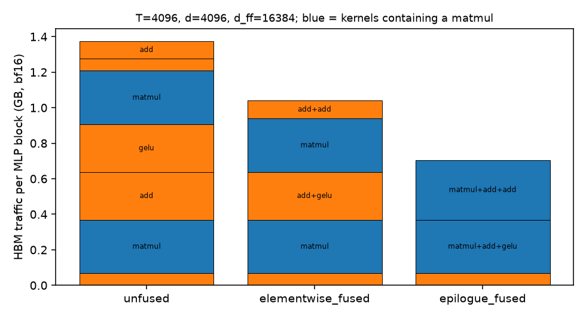
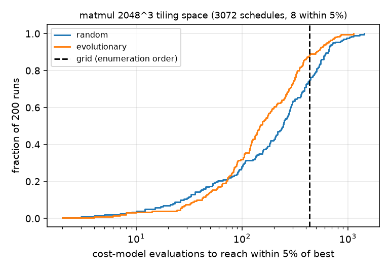
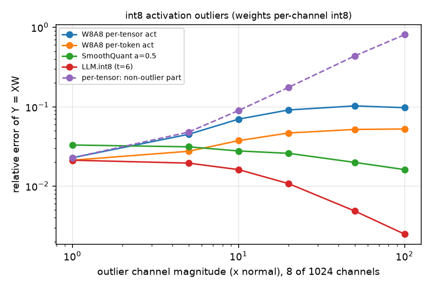
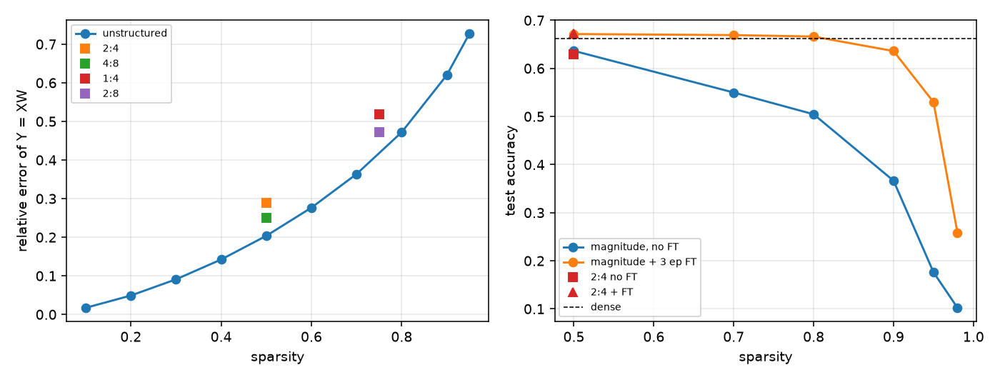
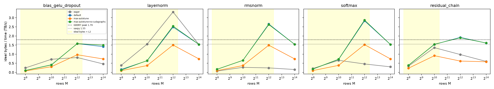
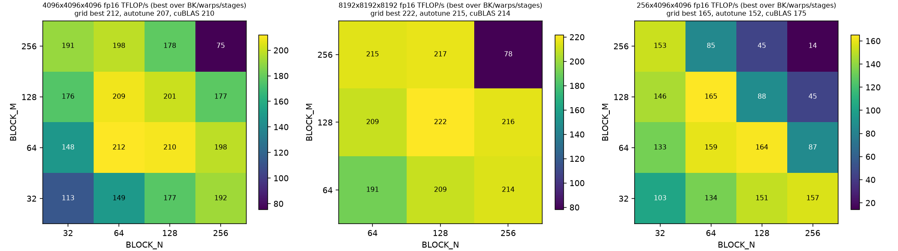
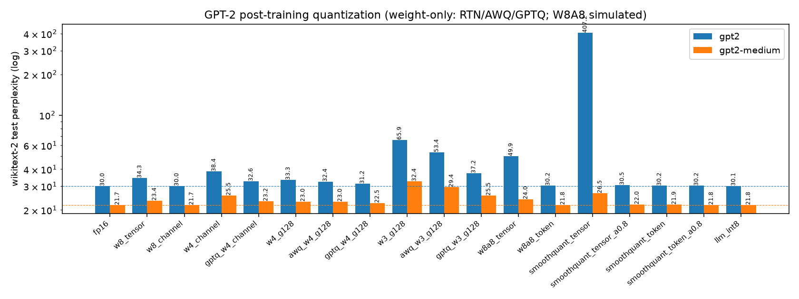
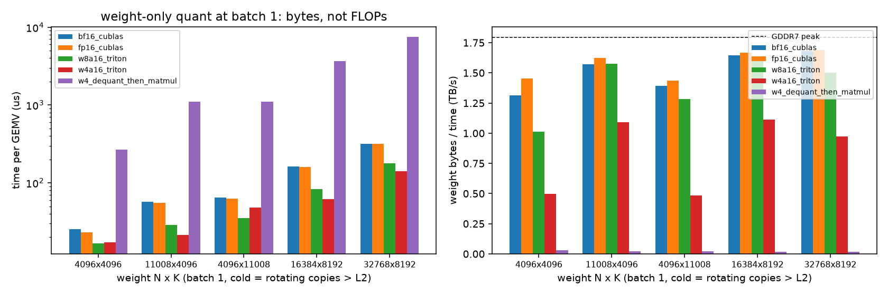
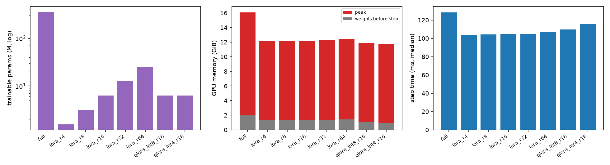
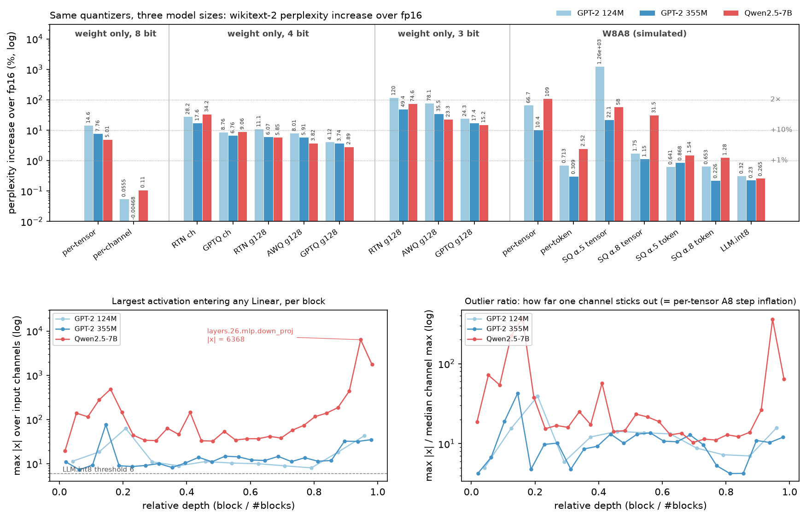

# 15-849 编译与压缩：自动微分、图 IR 与融合、调度搜索、量化、剪枝、LoRA

这个目录想回答两个面试里常被混在一起的问题。第一，编译器的算子融合（把几个算子合成一个 kernel，省掉中间结果的显存读写）到底能省多少时间？
第二，量化（用低位整数表示权重或激活）的误差主要来自哪里，各种方法又是怎么对付它的？
最重要的发现分别是：融合省下的流量远多于省下的时间，因为大 GEMM 是计算受限的，融合只救得了那些访存受限的小 kernel；
量化的敌人是动态范围，少数离群值决定了整张表的步长，而且这个问题在 7B 模型上比 GPT-2 严重得多。

CMU 15-849（Spring 2022）是论文研讨课，没有编程作业。本目录是其必读论文的最小复现，不是官方作业。
CPU 部分（下文前半）在 4 物理核 / 8 逻辑核的 Windows Server 上运行。其中 HBM 流量、kernel 时间与调度代价都是模型输出，
参数来自 `tools/mlsys_calc.py` 的 H100，不是 GPU 上的测量；量化、剪枝、LoRA 的误差与精度则是 CPU 上的真实计算。
GPU 部分（[跳到 GPU 实测](#gpu-实测rtx-5090)）在 RTX 5090 上测量了这些模型对应的真实现象。

完整报告（中文，含推导与面试问答）：[compiler_compression_report.pdf](../../../reports/cmu15849-compiler-compression/compiler_compression_report.pdf)

## 一句话结论

Transformer 的 MLP 块把 bias、GeLU 和残差融进 GEMM 的 epilogue（矩阵乘写回结果前顺手做的逐元素操作）后，HBM 流量降了 49%，
但 roofline 时间只降 16%，因为两个 GEMM 是计算受限的。

量化方面，8/1024 个 50× 的激活离群通道，就让 per-tensor W8A8 的误差从 2.3% 涨到 10.2%；
LLM.int8 能把它降到 0.49%，SmoothQuant 降到 2.0%。GPTQ 只在输入有相关性时才有用（3.5% 对 RTN 的 25.3%）。

## 对应论文

| 论文 | 实现 | 简化 |
| --- | --- | --- |
| 自动微分（框架模块；Baydin 综述、PyTorch autograd） | `autodiff.py`：numpy 张量反向模式，迭代拓扑序，add/mul/matmul/relu/exp/log/sum/softmax-CE，广播求和 | 无高阶导、无 in-place |
| TVM / XLA 图层优化 | `graph_ir.py`：常量折叠、CSE、逐元素融合、GEMM epilogue 融合、解释器 | 单输出融合组；LayerNorm 不融合 |
| TASO (Jia 2019) | `merge_shared_matmuls`：X@W1, X@W2 → slice(X@[W1\|W2]) | 只实现这一条替换，无代价驱动的搜索 |
| Halide / TVM / Ansor | `schedule_search.py`：(循环序, tm, tn, tk) 空间 + 缓存模型；grid / random / 进化搜索 | 单 SM 解析代价模型，无学习型代价模型，无多级分块 |
| Deep Compression (Han 2016) | 剪枝 + k-means 16 中心权重共享 | 无 Huffman 编码 |
| LLM.int8 / SmoothQuant / GPTQ | absmax int8/int4（per-tensor/channel/group128）、混合分解、α=0.5 平滑、Cholesky 误差补偿 | 量化后反量化在 fp64 中模拟；GPTQ 无分组、无 act-order |
| NVIDIA 2:4 / 幅值剪枝 | 非结构化 vs N:M；小 MLP 剪枝 ± 微调 | 教师网络合成数据 |
| LoRA (Hu 2021) | `LoRALinear`：B=0 初始化、α/r 缩放、合并 | 单层 |

## 怎么跑

```powershell
cd solutions/cmu15849/compiler-compression
python -m pytest -q tests          # 29 passed + 4 skipped（无 CUDA 时跳过 GPU kernel 测试），约 9 s
python scripts/run_experiments.py  # 约 65 s（剪枝与 LoRA 8 进程并行）
```

## 结果

### 自动微分（`autodiff_check.csv`）

后面的图 IR 和剪枝微调都依赖自己写的反向传播，所以先验证它。两层 MLP 加 softmax-CE 上，梯度与 torch 的最大差 ≤5.6e-17，
与中心差分的最大差 ≤2.3e-10。因为拓扑序是迭代而不是递归求的，5000 层的链式乘法反向也不会爆栈（有测试覆盖）。

### 图融合（T=4096, d=4096, d_ff=16384, bf16，`fusion_totals.csv`，`fusion_kernels.csv`）

这一节回答：一个 MLP 块融合到什么程度，流量和时间各省多少。所有 pass 前后，解释器输出的最大差为 0（融合）或 1.7e-18（matmul 合并），
见 `graph_pass_checks.csv`，所以融合没有改变计算结果。

| 变体 | kernel 数 | HBM 流量 | 非 GEMM 流量 | roofline 时间 |
| --- | ---: | ---: | ---: | ---: |
| 不融合 | 7 | 1.376 GB | 0.772 GB | 1342 µs |
| 逐元素融合（add+gelu、add+add） | 5 | 1.040 GB（−24%） | 0.436 GB | 1242 µs（−7.5%） |
| + GEMM epilogue | 3 | 0.705 GB（−49%） | 0.067 GB | 1132 µs（−16%） |

流量和时间的降幅差这么多，原因在 GEMM。每个 GEMM 要 556 µs 而且是计算受限的，两个加起来占总时间的 83%；
融合省下的只是那些访存受限的小 kernel，它们本来就只占一小部分时间。



蓝色是含 matmul 的 kernel，橙色是逐元素 kernel。从左到右，橙色块一层层被并进蓝色块里，柱子明显变矮；
但蓝色部分的高度始终不变，而时间主要花在蓝色部分上，这就是流量降一半、时间只降 16% 的原因。

TASO 式的 QKV 合并（Llama-3-8B，`qkv_merge.csv`）也是同样的道理。T=4096 时，三个投影共用一次输入读取，GEMM 流量从 201.3 降到 134.2 MB，
但时间不变（208 µs），因为它计算受限。T=1（decode）时流量几乎没变（50.37→50.35 MB），只省了 2 次 kernel 启动。

### 调度搜索（2048³ GEMM，单 H100 SM：7.49 TFLOP/s、25.4 GB/s、228 KB，`schedule_search.csv`，`schedule_top.csv`）

同一个矩阵乘，循环顺序和分块大小（合称 schedule）选得不同，速度可以差几个数量级。TVM/Ansor 这类编译器要在很大的空间里找好的 schedule，
这一节看几种搜索方法要试多少次才能找到。

空间里有 3072 个调度，只有 8 个在最优的 5% 以内。最优的是 ijk / 256×256×64，5.99 ms，即 2.87 TFLOP/s，只有峰值的 38%（计算下限是 2.29 ms）。
它到不了峰值，是因为 C 块的算术强度 tm·tn/(tm+tn)=128 FLOP/B，仍低于 ridge 295。最差的 4×4×4 分块要 3023 ms。

| 方法 | 达到 5% 以内所需评估次数（中位 / P90，200 次） |
| --- | --- |
| grid（按枚举顺序） | 434（确定性） |
| random | 244 / 649 |
| 进化（锦标赛+交叉+变异） | 147.5 / 496 |

进化搜索比随机快约 1.65×（按中位数）。grid 的 434 完全取决于枚举顺序，并不说明这种方法好或坏。



这是 200 次运行的累积分布：曲线越靠左，越少的评估次数就能找到好调度。进化曲线的大部分都在随机曲线左边，
但在最左端两者交叉，因为运气好时随机采样也能很早撞上；grid 只有一条竖线，因为它每次都一样。

### 权重量化（1024×1024，`quant_weight.csv`）

量化的误差取决于步长，而步长由一组数里的最大值决定。所以真正要问的是：一个 scale 管多大范围，权重分布有没有重尾。

| 方案 | 高斯权重 | Student-t(4) 权重 |
| --- | ---: | ---: |
| int8 per-tensor | 1.13% | 20.6% |
| int8 per-channel | 0.79% | 1.97% |
| int8 group128 | 0.65% | 1.11% |
| int4 per-tensor | 20.6% | 97.2% |
| int4 per-channel | 14.3% | 32.1% |
| int4 group128 | 11.7% | 19.3% |
| k-means 16 中心（4 bit，整表共享） | 11.0% | 25.0% |

表里是输出 Y=XW 的相对误差，与权重本身的误差相差不到 0.1 个百分点。重尾分布让 per-tensor 失效：整张表只有一个 scale，
一个极大值就把步长撑大了。k-means 在高斯权重上略胜 group128，在重尾权重上输给它，因为 group128 每 128 个权重就多一个 scale，能跟着局部范围调整。

### 激活离群（8/1024 通道，权重 per-channel int8，`quant_outliers.csv`）

大模型的激活里常有少数几个通道比其他通道大几十倍。这一节在 1024 个通道里放 8 个离群通道，逐步调大它们的倍数，看各种方法的误差怎么变。

| 离群倍数 | per-tensor 激活 | per-token 激活 | SmoothQuant α=0.5 | LLM.int8（阈值 6） | per-tensor 下非离群部分 |
| ---: | ---: | ---: | ---: | ---: | ---: |
| 1 | 2.28% | 2.12% | 3.29% | 2.12% | 2.28% |
| 20 | 9.11% | 4.67% | 2.59% | 1.08% | 17.5% |
| 50 | 10.2% | 5.17% | 1.99% | 0.49% | 43.6% |
| 100 | 9.73% | 5.24% | 1.61% | 0.25% | 80.8% |

有一个意外：整体 ‖Y‖ 的误差只涨到约 10% 就饱和了。原因是离群通道同时主导了 ‖Y‖ 本身，相对误差的分母也跟着变大；
真正被毁掉的是普通通道的贡献，它的误差到了 80.8%。per-token 量化只能把误差减半，因为离群是按通道出现的，而不是按 token。
另外，没有离群时 SmoothQuant 反而略差（3.29% 对 2.28%），因为它把一部分难度挪给了本来好好的权重。



紫色虚线（普通通道的误差）随离群倍数一路上升，而蓝线（整体误差）很快走平，两者分开的那段就是「整体指标掩盖了损坏」。
红线（LLM.int8）和绿线（SmoothQuant）反而随离群变大而下降：离群越明显，越容易被拆出去或平滑掉。

### GPTQ vs RTN（int4 per-channel，512×512，2048 校准 / 2048 测试 token，`gptq.csv`）

GPTQ 用输入的二阶统计量 H=XᵀX，把已量化列的舍入误差补偿到还没量化的列上；RTN 是直接四舍五入。
这里调节输入的谱衰减（衰减越大，输入各维之间相关性越强），看 GPTQ 什么时候有用。

| 输入谱衰减 | RTN 测试误差 | GPTQ 测试误差 | GPTQ 校准误差 |
| ---: | ---: | ---: | ---: |
| 0（各向同性） | 26.4% | 28.2% | 24.7% |
| 0.5 | 26.1% | 13.7% | 12.8% |
| 1.0 | 25.3% | 3.5% | 3.5% |

各向同性输入下，GPTQ 在校准集上略好，在测试集上反而更差。这时 H≈cI，没有可利用的相关性，补偿只是在拟合校准样本的采样噪声。
另外 GPTQ 的权重误差总是更大（0.28–0.39 对 0.26），因为它优化的是输出，不是权重本身。

### 剪枝（`pruning_matrix.csv`，`pruning_mlp.csv`）

剪枝要回答两件事：同样的稀疏度下，结构化的 N:M 稀疏比非结构化差多少；微调能救回多少精度。

在 1024² 的重尾矩阵上，输出误差是：非结构化 50% 为 20.4%，2:4 为 29.0%，4:8 为 25.1%；非结构化 90% 为 62.0%。
结构约束越松（4:8 比 2:4 松），误差越接近非结构化。
小 MLP 上（教师网络，10 类，稠密 66.2%，稠密再训 3 轮 67.0%）的结果如下：

| 方法 | 稀疏度 | 不微调 | 微调 3 轮 |
| --- | ---: | ---: | ---: |
| 幅值 | 0.5 | 63.6% | 67.1% |
| 幅值 | 0.8 | 50.5% | 66.6% |
| 幅值 | 0.9 | 36.6% | 63.6% |
| 幅值 | 0.95 | 17.6% | 53.0% |
| 2:4 | 0.5 | 62.9% | 67.2% |



左图中，结构化稀疏的方块都落在非结构化曲线上方，即同样稀疏度下误差更大，这是换取硬件可加速付出的代价。
右图中，微调后的曲线在 0.8 之前几乎贴着稠密基线，过了 0.9 才陡降，而不微调的曲线从一开始就往下走：
中等稀疏度下，剪掉的信息大多能靠剩下的权重重新学回来。

### LoRA（`lora_fit.csv`，`lora_params.csv`）

LoRA 冻结原权重 W，只训练一个低秩增量 BA。这里先验证两条性质：初始化时不改变模型，训练完能无损合并回 W。
初始输出与基座的最大差是 0；合并后输出的最大差是 3.3e-15。

然后看秩够不够用。d=256、真实 ΔW 的秩是 8，训练 1500 步：r=4 时误差 0.434，接近 Eckart–Young 给出的下界 0.424（秩 4 能达到的最好结果）；
r=8 时误差降到 0.044，可训参数是 4096，只有全量 65,536 的 6.25%。
放到 Llama-3-8B 上，r=8 只挂 q、v 时是 3.41M 参数（0.042%）；r=16 挂全部线性层是 41.9M（0.52%）。

## 面试讲法

20 秒结论：融合省的是访存受限 kernel 的 HBM 往返；大 GEMM 计算受限时，端到端收益远小于流量收益（−49% 流量，−16% 时间）。
量化的敌人是动态范围：重尾权重要细粒度的 scale，按通道出现的激活离群要么拆出去（LLM.int8），要么挪到权重上（SmoothQuant）。
GPTQ 用 H=XᵀX 把舍入误差推给还没量化的列，只有输入有相关性时才有收益。

白板上可以写这几行：
- 融合省的字节 = 每个被消掉的中间张量 ×2（写+读）：bias→GeLU 的 [T, d_ff] 与 bias→残差的 [T, d]，2·2·(T·d_ff+T·d) = 0.336 GB（测试断言）。
- GEMM 分块强度：C 常驻、A/B 流过时 ≈ tm·tn/(tm+tn)（bf16 每元素 2 B，2 FLOP/MAC）；受限于 SRAM：2(tm·tk+tk·tn+tm·tn) ≤ 228 KB。
- SmoothQuant：s_j = max|X_j|^α / max|W_j|^(1−α)，XW = (X·diag(s)⁻¹)(diag(s)·W) 精确成立。
- LoRA：参数 r(d_in+d_out)，ΔW = (α/r)·BA，B=0 保证初始等价。

**不能推出的结论**：
- 不能把 −16% 当成真实加速。模型里没有计算与访存的重叠，没有 L2，epilogue 也没有额外的寄存器压力。
- 不能说 per-token 能解决离群。它只把误差减半（5.17% 对 10.2%）。
- 不能用 2:4 在 MLP 上的结果说明它在 LLM 上无损。教师任务很简单，而且这里有 3 轮微调。
- 调度搜索的结论只在本代价模型内成立；真实的 Ansor 依赖学习型代价模型与实测。

追问：
1. 为什么 FlashAttention 不能靠通用的逐元素融合得到？softmax 有行归约，需要用 online softmax 改写算法，这不是图层面的替换能做到的。
2. W4A16 与 W8A8 选哪个？decode 访存受限，选 W4A16，读权重的字节减半；大 batch 的 prefill 计算受限，选 W8A8，用上 int8 tensor core。
3. 2:4 的加速从哪来？稀疏 tensor core 跳过一半的 MAC，元数据每 4 个元素只需 2 bit；非结构化稀疏在 GPU 上很难兑现成加速。

## GPU 实测（RTX 5090）

CPU 部分的流量和时间都是模型算出来的。这一部分到真实 GPU 上检查：融合的加速是不是真等于字节比，代价模型能不能给 Triton 的分块排序，
量化和剪枝在真实 GPT-2 上的 perplexity 怎么变，LoRA 又省了哪部分显存。

机器是 RTX 5090（sm_120，170 SM，32 GB GDDR7 1.79 TB/s，96 MB L2，共享内存每 block 99 KB），PyTorch 2.8.0+cu128、Triton 3.4.0、transformers 5.21。
原始结果在 `artifacts/raw/gpu/*.jsonl`；派生数字（加速比、Spearman 相关、实验室模型在 5090 参数下的预测）在 `artifacts/raw/gpu/summary_gpu.json`。
详细分析见[报告 PDF](../../../reports/cmu15849-compiler-compression/compiler_compression_report.pdf)。

```bash
# 服务器（每步各自持有 GPU 锁，taskset 2 核）
CORES=47,48 bash gpu/run_gpu.sh            # chains mlp triton dynamic matmul qspeed quant_gpt2 quant_gpt2m prune_ppl prune_speed lora
python scripts/plot_gpu.py                 # 本地，从 raw 文件画 16 张图
python -m pytest -q tests                  # 本地 29 passed + 4 skipped（CUDA）；服务器 33 passed
```

| 问题 | 关键结果 | 原始文件 |
| --- | --- | --- |
| Q1 融合（访存受限链，16384×4096 bf16） | `torch.compile` 加速 = eager/融合字节比：RMSNorm 9.86×（字节比 10.0×），softmax 5.05×（5.0×），残差链 2.68×（2.60×）；融合后 1.41–1.61 TB/s | `fusion_chains.jsonl` |
| Q1 MLP（T=4096, d=1024） | eager 419.4 µs，default 414.4 µs，max-autotune-no-cudagraphs 356.8 µs（−15%，编译 0.59→6.45 s）；实验室图 IR 预测 435.7 / 338.1 µs | `fusion_mlp.jsonl` |
| Q1 工程代价 | max-autotune 的 CUDA graph 输入拷贝让 RMSNorm 慢 2.08×（364.0 vs 174.9 µs）；10 个序列长度：静态 8 个图 4.46 s，automatic 2 个图 0.99 s，`mark_dynamic` 1 个图 0.54 s | `fusion_chains.jsonl`, `fusion_dynamic.jsonl` |
| Q2 Triton matmul 网格（192 配置） | 8192³：网格最优 221.5 TFLOP/s（128×128×32）vs cuBLAS 214.3 vs autotune 214.7；M=256 时 cuBLAS 175.0 > 网格 165.0 > autotune 152.3；代价模型 Spearman ρ：实验室模型 0.65/0.36/0.10，波次 roofline 0.26/0.21/0.72 | `matmul_search.jsonl` |
| Q3 量化 ppl（GPT-2 124M / 355M，fp16 29.96 / 21.72） | W8 per-channel 29.98 / 21.72；W4 g128 RTN 33.27 → GPTQ 31.20；W3 g128 RTN 65.92 → AWQ 式 53.35 → GPTQ 37.24；W8A8 per-tensor 49.94，per-token 30.18，LLM.int8 30.06；SmoothQuant α=0.5 407.25，α=0.8 30.49 | `quant_ppl_gpt2*.jsonl` |
| Q3 速度 | M=8192：bf16 226.9、FP8 456.2、int8 679.4 TOP/s；batch-1 GEMV 16384×8192：bf16 163.0 µs，W8 82.5 µs，W4 62.2 µs，先反量化再 matmul 3688 µs | `quant_speed.jsonl` |
| Q4 剪枝（GPT-2 124M，一次性） | 50%：幅值 538.35 ppl，Wanda 47.21；2:4：幅值 735.95，Wanda 116.38；2:4 cuSPARSELt 大 GEMM 1.54–1.58×，M≤2048 更慢（~445 µs 下限）；CUTLASS 后端不支持 sm_120 | `prune_*.jsonl` |
| Q5 LoRA（GPT-2 355M，150 步） | 峰值显存：全量 16.07 GiB，LoRA r=16 12.17，int8 基座 11.91，int4 基座 11.77；步时 128.4 / 104.8 / 109.6 / 115.5 ms；val loss 2.891 / 2.874 / 2.876 / 2.914；合并后 logits 最大差 0.0045（最大值 340.6） | `lora_ft.jsonl` |

融合的加速就是字节比。大尺寸下，每条链的 Inductor 加速与 eager/理想字节比相差不到 7%，融合后的版本都顶在约 1.53 TB/s 的带宽墙上。



纵轴是「理想字节数 ÷ 时间」，也就是有效带宽。行数大时，融合版本的线都收敛到同一条水平虚线附近，说明它们已经被显存带宽卡住，
再融合也没有空间了；eager 的线则低得多，差距正好是它多读写的那些中间张量。
黄色区域里理想字节小于 96 MB 的 L2，「带宽」超过了 GDDR7 的峰值，这是 L2 命中，不是 bug。

分块地形与代价模型。256×256 的 tile 在三个形状上都最差，一是寄存器溢出，二是 C 块太少、填不满 SM；最优 tile 则随形状变化。
复用型的实验室模型在方阵上排得还行，在 M=256 上失效；波次 roofline 模型恰好相反。没有一个解析模型能通吃，所以 Ansor 才用学习型模型加实测。



三张热力图里最亮的格子位置各不相同，所以不存在一个通用的最优 tile；只有右上角的 256×256 在三张图里都是最暗的一格。

量化的位宽越低，越需要数据。int3 时 GPTQ 把 RTN 的 65.92 拉回 37.24；而 SmoothQuant 的 α 选错了，比不平滑还差。



图里两根最高的柱子最值得看：w3_g128 的 RTN 和 α=0.5 的 per-tensor SmoothQuant。前者说明 3 bit 下不看数据的四舍五入已经不够用；
后者说明平滑系数是要按模型调的超参数，选错会把激活的难度过量地推给权重。逐通道 8 bit 权重量化的柱子则和 fp16 几乎一样高。

batch 1 下，weight-only 量化按字节加速。大矩阵上 W8 快 1.8–2.0×，接近理论的 2×；W4 快 2.3–2.7×，理论是 3.76×，差距来自解包 int4 的开销。
如果不把反量化融合进 kernel，先反量化再 matmul，会慢 10–23×。



右图把时间换算成「权重字节 ÷ 时间」：bf16、fp16 和 W8 都接近显存峰值，说明 batch 1 的 GEMV 纯粹在读权重，所以字节少一半时间就少一半；
W4 的带宽明显更低，就是解包开销；先反量化再 matmul 的紫色柱几乎贴着零，因为它要先把完整的 fp16 权重写出来再读一遍。

LoRA 省的是优化器状态。全量微调与 LoRA 的峰值显存差 3.97 GiB，正好是 fp32 梯度加 AdamW 的两个矩；
剩下约 10.7 GiB 是激活，所以 rank 从 4 加到 64，峰值只涨 0.35 GiB。



左图的可训参数差了一两个数量级，中图的峰值显存却只差一截，而且各个 LoRA 配置几乎一样高：显存的大头是激活，可训参数的多少只影响梯度和优化器状态那一小块。

GPU 部分不能推出的结论：W8A8、SmoothQuant 和 LLM.int8 都是精度模拟（实际跑的是 fp16 GEMM），没有端到端的 int8 速度；GPT-2 的离群远弱于 6.7B 以上的模型；
AWQ 是简化版，GPTQ 没有 act-order；LoRA 只训了 150 步、单种子，0.01 量级的 loss 差在噪声范围内；cuSPARSELt 那个约 445 µs 的下限可能是软件路径的问题。

## 换到 7B：Qwen2.5-7B 上的同一套量化（RTX 6000D）

GPT-2 的激活离群远弱于 6.7B 以上的模型，所以 GPT-2 上的结论不一定能推到大模型。为此我把同一份 `gpu/quant_llm.py` 原样跑在 Qwen2.5-7B 上
（bf16 载入，wikitext-2 test 29.9 万 token，校准 128 × 1024 token）。原始结果在 `artifacts/raw/rtx6000d/quant_ppl_Qwen2.5-7B.jsonl`，
图与汇总由 `scripts/plot_qwen7b.py` 生成（`quant_scale_summary.csv`）。



上半部分是三个模型在各种方法下的 perplexity 涨幅，下半部分是每一层输入激活的最大值，以及它比该层典型通道大多少倍。
Qwen 的红线在网络后部有一个尖峰，那就是下面要说的第 26 层 `down_proj`；GPT-2 的两条线一直低得多、也平得多。

| 方法 | GPT-2 124M | GPT-2 355M | Qwen2.5-7B（fp16 7.639） |
| --- | ---: | ---: | ---: |
| W8 逐张量 / 逐通道 | +14.6% / +0.06% | +7.8% / −0.005% | +5.0% / +0.11% |
| W4 g128：RTN / AWQ / GPTQ | +11.1 / +8.0 / +4.1% | +6.1 / +5.9 / +3.7% | +5.9 / +3.8 / +2.9% |
| W3 g128：RTN / AWQ / GPTQ | +120 / +78 / +24% | +49 / +36 / +17% | +75 / +23 / +15% |
| W4 逐通道：RTN / GPTQ | +28 / +8.8% | +18 / +6.8% | +34 / +9.1% |
| W8A8 逐张量 / 逐 token | +67 / +0.71% | +10 / +0.31% | **+109** / +2.5% |
| SmoothQuant α=0.5 / 0.8（逐张量） | +1260 / +1.8% | +22 / +1.2% | +58 / +32% |
| SmoothQuant α=0.5 / 0.8（逐 token） | +0.64 / +0.65% | +0.87 / +0.23% | +1.5 / +1.3% |
| LLM.int8（阈值 6） | +0.32% | +0.23% | **+0.27%** |

规模变大时，权重量化变容易，激活量化却变难。W4 g128 GPTQ 的涨幅从 +4.1% 降到 +2.9%，W3 GPTQ 从 +24% 降到 +15%；
而 W8A8 逐张量从 GPT-2 355M 的 +10% 涨到 7B 的 +109%。上图解释了原因：Qwen 第 26 层 `mlp.down_proj` 的输入里有一个通道 |x| = 6368，
是该层各通道最大值中位数的 358 倍。逐张量量化的激活步长由它决定，其余通道只剩下几个量化级可用。

7B 上各方法的排序被拉开了。W3 g128 时 RTN +75%、AWQ +23%、GPTQ +15%；GPT-2 上 AWQ 与 RTN 的差距没这么大。
AWQ 是按激活幅度缩放通道的，在离群明显的模型上才有东西可缩放。

SmoothQuant 逐张量救不了 7B：α=0.8 仍有 +32%。离群值 6368 太大，平滑把难度挪给权重之后，权重也装不下了；改成逐 token 激活再加平滑，才回到 +1.3%。
LLM.int8 用混合精度把 |x| > 6 的列留在 fp16，+0.27% 是全部 W8A8 方法里最好的。它的代价是平均 700 列、最多 18702 列（某一层几乎整层）走 fp16。

GPTQ 在 7B 上需要 float64 的 Cholesky 分解。我第一次运行时在 `down_proj`（18944 维输入）上报了「leading minor of order 18004 is not positive-definite」：
加了 1% 阻尼的 fp32 Hessian 被离群通道撑得条件数太大，分解失败。现在的 `gptq_quantize` 改用 float64 分解，失败时把阻尼放大 10 / 100 倍重试。
三个 GPTQ 配置各跑了 967 s，AWQ 是 473–566 s。

不能推出：perplexity 的测量协议是 HF 的 ctx 1024，与 edge-deploy 里 llama-cpp-7b 用的 llama-perplexity ctx 512 不同，两边的数字不能直接比；
W8A8 全部是精度模拟（fp16 GEMM）；这里只有一个 7B 模型，离群通道的位置与幅度是 Qwen2.5 的特性。

## 文件

```text
compiler-compression/
├── code/compkit/        autodiff, graph_ir, schedule_search, quantization, pruning, lora
├── gpu/                 common, triton_kernels（融合 RMSNorm/bias+GELU、分块 matmul、W8/W4 GEMV）,
│                        fusion_bench, matmul_search, llm_utils, quant_llm（GPTQ/AWQ/SmoothQuant/LLM.int8）,
│                        quant_speed, prune_bench, lora_ft, run_gpu.sh
├── tests/               33 个用例（test_gpu.py：7 个 CPU 可跑的算法测试 + 4 个 CUDA kernel 测试）
├── scripts/run_experiments.py, plot_gpu.py
└── artifacts/raw/*.csv, summary.json；artifacts/raw/gpu/*.jsonl, summary_gpu.json；artifacts/figures/*.png
```
