# 15-849 分布式训练：all-reduce、张量并行、ZeRO、流水线、重计算

CMU 15-849（Spring 2022）是论文研讨课，没有编程作业。本目录是其必读论文的最小复现，
不是官方作业。分两部分：

- **CPU 部分**（4 物理核 / 8 逻辑核的 Windows Server）：多卡集群时间是 α-β / 事件模型的输出，参数取自
  `tools/mlsys_calc.py` 的 H100（NVLink 单向 450 GB/s），α=5 µs 为假设值，**不是 GPU 上的测量**；真实测量只有 gloo CPU all-reduce。
- **GPU 部分**（下文「GPU 实测」，单卡 RTX 5090）：把单卡能测的模型逐个对上实测——16 B/参数实测 16.00–16.32，
  激活显存模型误差 ≤1.3%，774M bf16 MFU 70.2%，全量重计算 +18.9% 时间换 batch 8 → 24，1F1B 气泡与在途激活。
  多卡通信（NCCL、NVLink）没有条件测，仍以模型为准。

完整报告：[distributed_training_report.pdf](../../../reports/cmu15849-distributed-training/distributed_training_report.pdf)

## 一句话结论

小消息看 α（树 / halving-doubling 比 ring 快 2.3×），大消息看 β（ring 与 halving-doubling
同为 2(P−1)/P·S，但在物理环上 halving-doubling 因链路争用慢 3×）；ZeRO-3 用 1.5× 通信
换 1/P 显存；1F1B 不减少气泡，只把在途激活从 m 压到 ≤p；重计算在异构链上 DP 比 √n 少 27% 重算。

## 对应论文

| 论文 | 实现 | 简化 |
| --- | --- | --- |
| Ring / Rabenseifner all-reduce（NCCL、Horovod 背景） | `collectives.py`：naive、ring RS+AG、递归减半-倍增、二项树；真实搬 numpy 数组，逐 rank 计字节与步数 | 单端口全双工；无流水分块；两种拓扑（交换机 / 物理环） |
| Megatron-LM (Shoeybi 2019) | `tensor_parallel.py`：列并行→行并行 MLP、按头切分 attention，显式 `f`/`g` 算子 | 单进程模拟 T 个分片；无 sequence parallel |
| ZeRO (Rajbhandari 2020) | `zero.py`：stage 0–3，ring reduce-scatter / all-gather，分片 Adam | fp64 代替混合精度；无 bucket、无通信重叠 |
| GPipe / PipeDream (1F1B) / Megatron 交错 | `pipeline.py`：离散事件模拟，固定每卡算子序 | 通信零开销；tb=2tf 均匀 |
| Chen 2016 √n、Checkmate | `checkpointing.py`：链上 no-ckpt / √n / 预算约束 DP，torch `checkpoint` 验证 | 单层级分段模型，非 Checkmate 的 MILP |
| torch.distributed | `gloo_bench.py`：2/4 进程 gloo all_reduce 实测 | 本机 CPU，`file://` 初始化 |

## 怎么跑

```powershell
cd solutions/cmu15849/distributed-training
python -m pytest -q tests          # 无 GPU：78 passed, 2 skipped（71 个 CPU 用例 + 7 个 GPU 代码的 CPU 用例；2 个 CUDA 用例 skip）
python scripts/run_experiments.py  # 约 25–55 s，写 artifacts/raw/*.csv 与 artifacts/figures/*.png
```

## 结果

### all-reduce（P=8，`allreduce_sweep.csv`）

所有算法求和与 fp64 参考一致（int64 测试逐位相等；fp32 最大误差 1.8e-6，来自求和顺序）。
模拟器计出的时间与闭式公式一致（测试 `rel_tol=1e-12`），ring 的闭式即 `mlsys_calc.ring_allreduce_time`。

| 算法 | 步数 | 1 KB 时间 | 1 GB 时间（交换机） | 1 GB 时间（物理环） | 1 GB 每 rank 发送 |
| --- | ---: | ---: | ---: | ---: | ---: |
| naive（root 汇聚+广播） | 14 | 70.0 µs | 33.5 ms | 33.5 ms | 7.52 GB（root） |
| ring | 14 | 70.0 µs | 4.25 ms | 4.25 ms | 1.88 GB |
| halving-doubling | 6 | 30.0 µs | 4.21 ms | 12.56 ms | 1.88 GB |
| 二项树 | 6 | 30.0 µs | 14.3 ms | 14.3 ms | 3.22 GB |

ring 超过树的交叉点约 4.27 MB；物理环上超过 halving-doubling 约 5.18 MB；交换机拓扑上
ring 永远不严格快于 halving-doubling（`summary.json`）。P=64、1 KB 时 ring 630 µs，树 60 µs
（`allreduce_vs_P.csv`）——ring 的 2(P−1)α 是大规模集群上 NCCL 引入 tree 的原因。

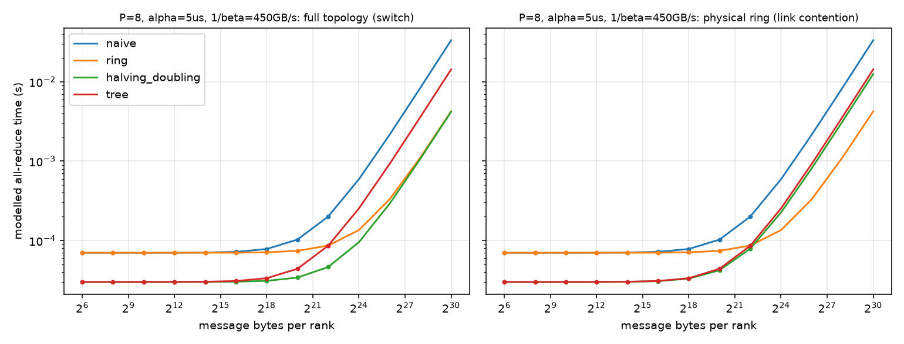

gloo 实测（`gloo_allreduce.csv`，20 次取 min）：world=2 时 1 KB 0.40 ms、16 MB 25.8 ms；
world=4 时 1 KB 1.52 ms、16 MB 23.3 ms。按 ring 公式拟合 α≈181/232 µs，等效带宽 0.97/1.42 GB/s。
中位数在 4–16 MB 处比 min 大 2×，本机有其他进程，噪声大；拟合只说明数量级。

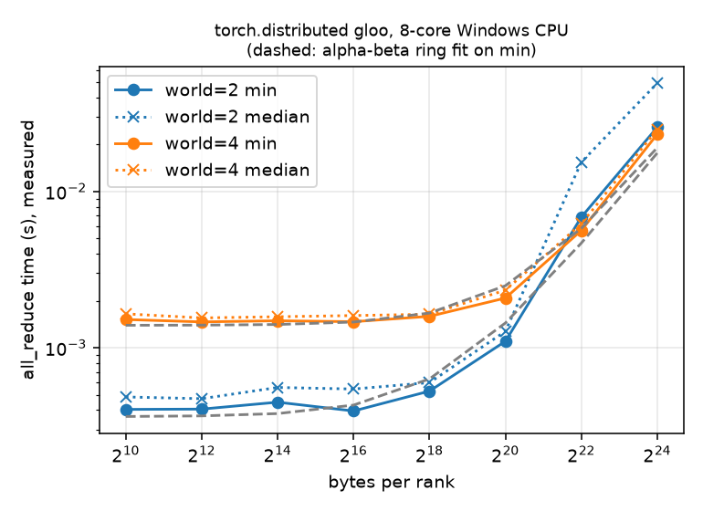

### 张量并行（`tp_equivalence.csv`，`tp_comm_llama3_8b.csv`）

T∈{1,2,4,8}，MLP 与 attention 的前向、输入梯度、参数梯度与未切分模块最大差 ≤8.9e-16（fp64）。
每个块前向 1 次、反向 1 次 all-reduce，消息 = b·s·h 个元素，与 T 无关。
Llama-3-8B、batch 1、bf16：每层 4 次 all-reduce；TP=8、seq=8192 时每次 67.1 MB、
0.331 ms，32 层每步通信 42.4 ms（模型值）。

### ZeRO（P=4，20 步，`zero_stages.csv`，`zero_paper_scale.csv`）

| stage | 与单进程最大差 | 每 rank 常驻字节 | 相对 DP | 每步通信相对 DP |
| ---: | ---: | ---: | ---: | ---: |
| 0 | 2.9e-16 | 43,136 | 1.000 | 1.0 |
| 1 | 2.9e-16 | 26,960 | 0.625 | 1.0 |
| 2 | 2.9e-16 | 18,872 | 0.4375 | 1.0 |
| 3 | 2.9e-16 | 10,784 | 0.25 | 1.5 |

fp64 下 params:grads:m:v = 1:1:1:1，比例应为 1、(2+2/P)/4、(1+3/P)/4、1/P，实测吻合。按论文混合精度
（2+2+12 字节/参数）、Ψ=7.5B、N_d=64，`mlsys_calc` 给出 120 / 31.4 / 16.6 / 1.88 GB，与 ZeRO 论文图 1 一致。

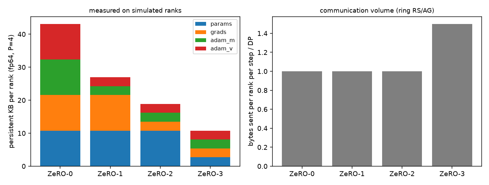

### 流水线（`pipeline_bubble.csv`，`pipeline_peak_activations.csv`）

模拟气泡与 (p−1)/(m+p−1) 一致到 1e-12；交错 v=2 与 `mlsys_calc.pipeline_bubble(p,m,v)` 一致。

| p | m | GPipe / 1F1B 气泡 | 交错 v=2 气泡 | 设备 0 在途激活 GPipe / 1F1B / 交错 |
| ---: | ---: | ---: | ---: | --- |
| 4 | 8 | 0.273 | 0.158 | 8 / 4 / 5.5 |
| 8 | 8 | 0.467 | 0.304 | 8 / 8 / 8 |
| 8 | 32 | 0.179 | 0.099 | 32 / 8 / 11.5 |

意外但符合论文：交错调度气泡减半，但设备 0 在途激活比 1F1B 多（p=8,m=32：11.5 vs 8）。

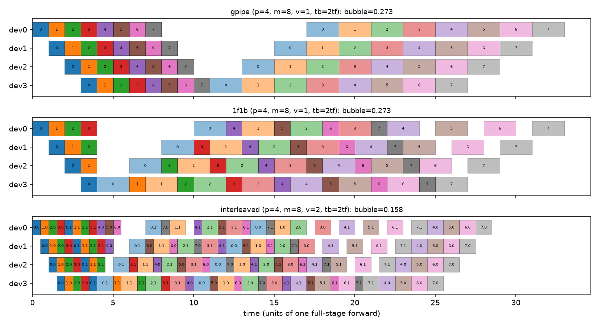

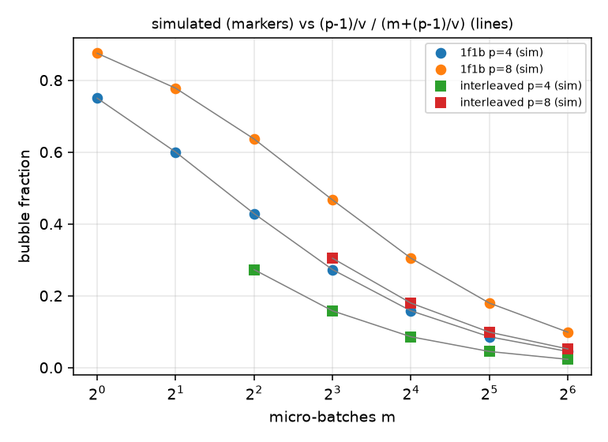

### 重计算（`ckpt_frontier.csv`，`ckpt_torch.csv`）

均匀 64 层：不 checkpoint 峰值 64、重算 0；√n（每 8 层）峰值 15、重算 56；DP 的最低峰值也是 15，
说明此模型下 √n 已在 Pareto 前沿上。异构 32 层（大小、代价 ∈[1,8]）：同预算 53 下 √n 重算 117，DP 重算 85。

torch 16 层 Linear+Tanh（d=256，batch 64，fp32），梯度与不 checkpoint **逐位相等**：

| 每段层数 | 峰值保存激活（层数单位） | 前后向中位时间相对不 ckpt |
| ---: | ---: | ---: |
| 不 ckpt | 17 | 1.00 |
| 2 | 10 | 1.73 |
| 4 | 8 | 1.52 |
| 8 | 10 | 1.39 |
| 16 | 17 | 1.34 |

4 层一段 = √16，峰值最低，与模型预测（4 段输入 + 4 层重算）一致。CPU 小层上 Python
钩子与 checkpoint 调用开销占主导，时间比远高于理论的 ~1.33×，不能外推到 GPU。

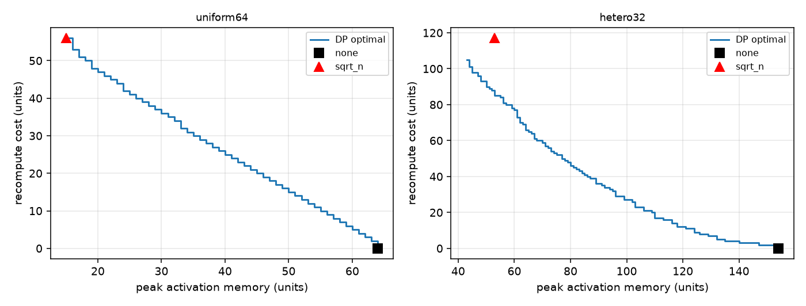

## GPU 实测（单卡 RTX 5090，32 GB）

完整报告：[distributed_training_report.pdf](../../../reports/cmu15849-distributed-training/distributed_training_report.pdf)。
代码在 `gpu/`（`gpt.py` 自写 GPT-2 + checkpoint 模式，`train_bench.py` 六个子命令），原始结果在
`artifacts/raw/gpu/*.jsonl`，图由 `scripts/plot_gpu.py` 生成到 `artifacts/figures/gpu_*.{png,pdf}`。
单卡上无法测多卡通信：ZeRO 用真实的扁平分片张量测每 rank 显存，通信用实测 PCIe/D2D 带宽参数化 α-β 模型；
流水线 4 个 stage 在同一张卡上按 1F1B/GPipe 的串行化顺序执行真实 kernel，CUDA event 计时后按依赖重放。

| 实验 | 关键实测 | 与模型对照 |
| --- | --- | --- |
| A1 静态显存（GPT-2 124M/355M/774M） | fp32、AMP、bf16+fp32 master：16.00–16.32 B/参数；纯 bf16：8.01–8.31 | 16N / 8N 规则，误差 ≤2% |
| A1 激活（b×s 扫描） | 124M AMP 斜率 536,843 B/token，355M 1,093,862 | `L·36·sbh + 4bsV` 模型 532,804 / 1,085,764（差 <1%） |
| A1 MFU（774M，b=4，s=1024） | 纯 bf16 70.2%（28.2k tok/s），AMP 65.3%，fp32 23.7% | 分母 209.5 TFLOP/s 名义；实测 GEMM 峰值 238.7 |
| A2 重计算（774M AMP，b=8，s=1024） | 每块全量：激活 16.88→3.35 GB，步时间 ×1.189，最大 batch 8→24（吞吐 28.9k→24.7k tok/s）；只 MLP：×1.093、激活 9.13 GB | 理论 4/3；MLP 节省 7.749 GB vs 逐张量模型 7.739 GB |
| A3 ZeRO 分片（774M，N_d=8） | 每 rank 12.384 / 4.260 / 2.905 / 1.548 GB，与公式最大差 0.099%；分片 AdamW 逐位相等 | (2+2+12)Ψ 分片公式 |
| A3 通信参数 | PCIe pinned 56.5 GB/s，D2D 1518 GB/s，单卡 ring α≈7 µs/launch | N_d=8 PCIe 上 DP 47.97 ms、ZeRO-3 71.96 ms |
| A4 流水线（355M，p=4，b=4，s=512） | 1F1B m=8/16/32 气泡 0.343/0.245/0.233，峰值 7.64 GB 与 m 无关；GPipe m=8 气泡 0.481、24.40 GB，m=16 OOM | 均衡公式 (p−1)/(m+p−1) 低估；按实测各级时间的不均衡模型 0.354/0.254/0.203 |

主要结论：16 字节/参数在三种精度布局下都成立（混合精度省的是激活与带宽，不是静态显存）；激活公式需按
flash attention 的真实保存张量计数（AMP 36、纯 bf16 32 字节/sbh），误差才降到 1% 以内；
1F1B 不减少气泡，只把在途 micro-batch 压到每级 [4,3,2,1]；最后一级多了 LM head，各级不均衡使 m 增大时
气泡停在约 0.23，而不是公式的 0.086。

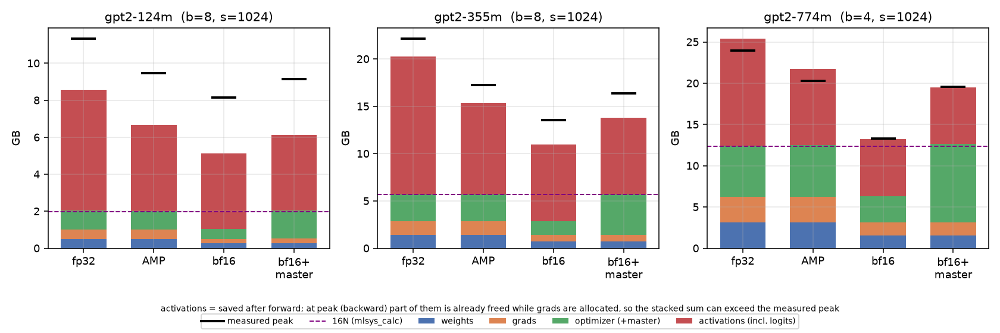

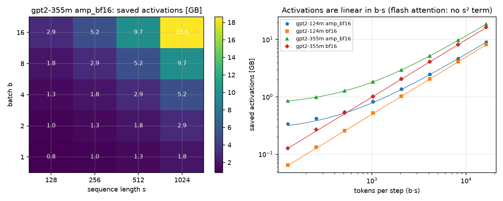

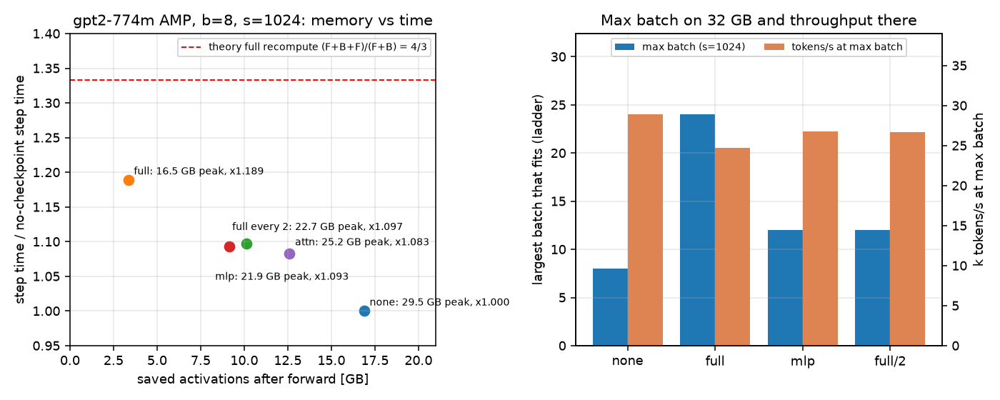

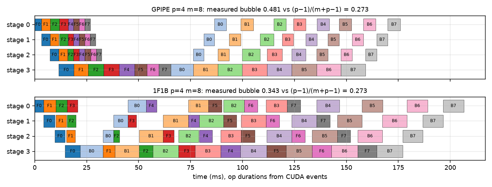

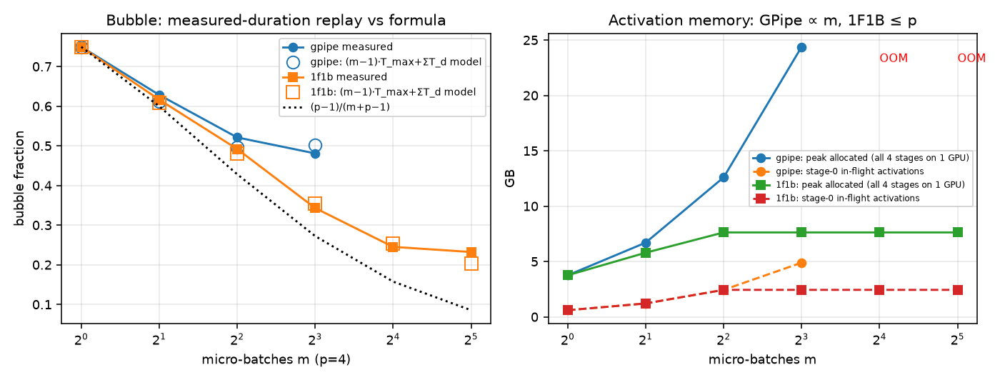

复现（需 CUDA；`--quick` 为小规模冒烟）：

```bash
cd solutions/cmu15849/distributed-training
python gpu/train_bench.py hw && python gpu/train_bench.py memory && python gpu/train_bench.py actsweep
PYTORCH_CUDA_ALLOC_CONF=expandable_segments:True python gpu/train_bench.py recompute
python gpu/train_bench.py zero && python gpu/train_bench.py pipeline
python scripts/plot_gpu.py
```

## 面试讲法

**20 秒结论**：all-reduce 时间 = 步数·α + 每 rank 字节·β；ring 字节最优 2(P−1)/P·S 但步数 2(P−1)，
所以小消息用树、大消息用 ring。ZeRO-1/2 通信不变、显存降；ZeRO-3 多一次参数 all-gather，
通信 1.5×。流水线气泡 (p−1)/(m+p−1)，1F1B 只省激活，交错才省气泡。

**白板**：
- ring：RS 走 P−1 步、每步 S/P；AG 再 P−1 步 → 2(P−1)α + 2(P−1)/P·Sβ。
- Megatron MLP：A 列切 → GeLU 无需通信 → B 行切 → 一次 all-reduce；反向在输入处再一次。
- ZeRO 每步：DP = RS+AG = 2Ψ；ZeRO-3 = AG(前向) + AG(反向) + RS(梯度) = 3Ψ。

**不能推出的结论**：
- 不能说「halving-doubling 总比 ring 好」：交换机拓扑上带宽项相同，物理环上它慢 3×。
- 不能用本机 gloo 带宽（~1 GB/s）推 NVLink；α=5 µs 也是假设，交叉点 4 MB 随 α/β 线性移动。
- 不能说「1F1B 气泡更小」：均匀算子下两者气泡完全相同（p=4,m=8 都是 0.273）。
- CPU 上 checkpoint 1.5× 时间开销不代表 GPU；GPU 上主要是 +1 次前向 FLOPs。

**追问**：
1. 为什么 TP 一般限制在单机 8 卡？——每层 4 次 b·s·h 的 all-reduce 在关键路径上，跨机 IB 带宽约为 NVLink 的 1/9。
2. ZeRO-3 和 FSDP 的通信能与计算重叠吗？——能，按层预取下一层的 all-gather；总量 1.5× 不变，暴露时间取决于每层计算是否盖得住。
3. 交错流水线的代价？——p2p 次数 ×v，且在途激活增加（表中 5.5 vs 4）。

## 文件

```text
distributed-training/
├── code/disttrain/   collectives, tensor_parallel, zero, pipeline, checkpointing, gloo_bench
├── gpu/              gpt.py, train_bench.py（RTX 5090 实测）
├── tests/            80 个用例（gloo 用例超时/失败则 skip；test_gpu_training.py 中 CUDA 用例无 GPU 时 skip）
├── scripts/run_experiments.py, plot_gpu.py
└── artifacts/raw/*.csv, summary.json, raw/gpu/*.jsonl；artifacts/figures/*.png, gpu_*.{png,pdf}
```
