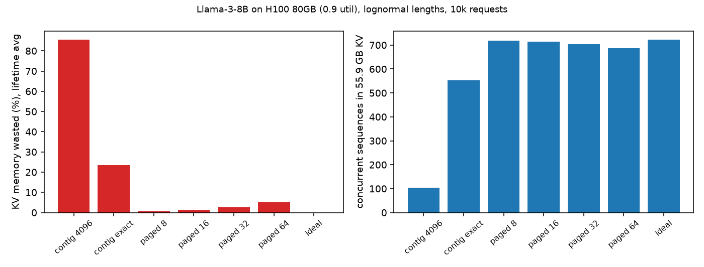
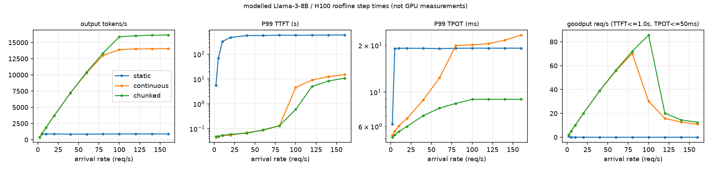
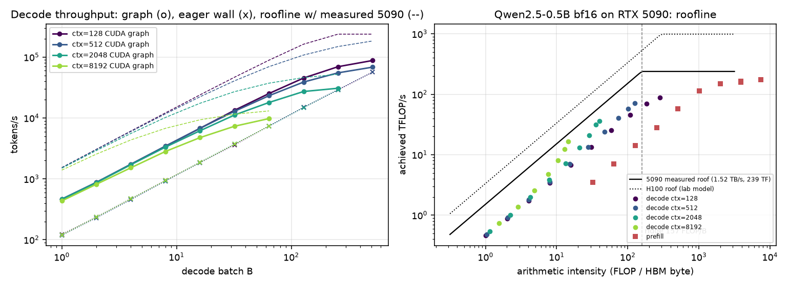
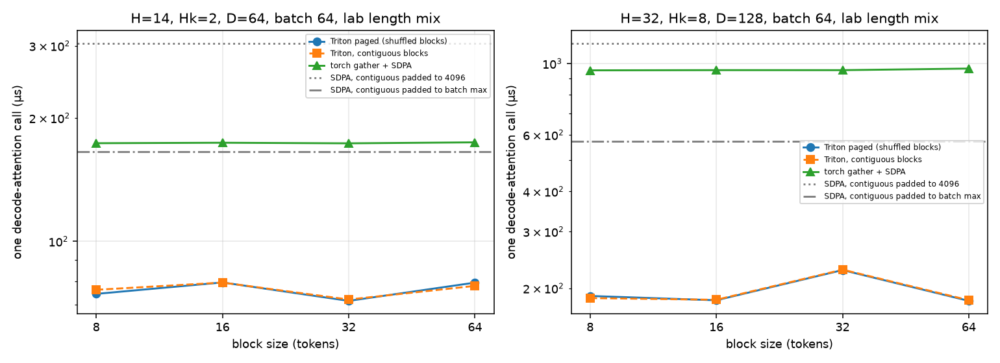
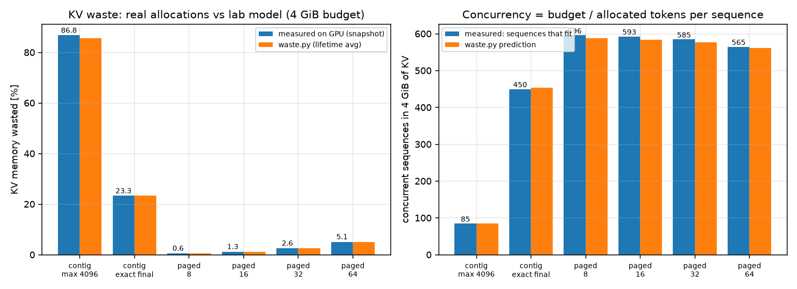
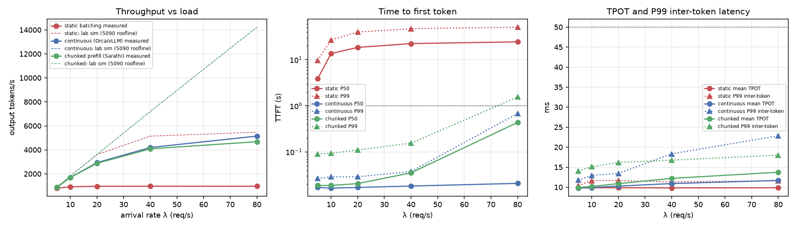
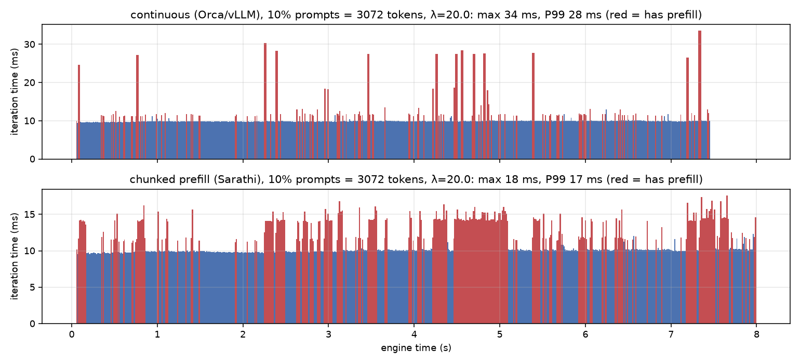
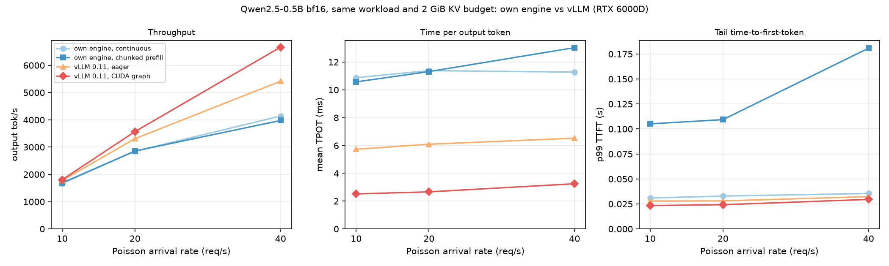

# 15-849 服务与显存：PagedAttention、iteration-level 调度、chunked prefill

这个目录想回答：一张卡同时服务多少条请求，是由什么决定的？调度方式又会怎样影响吞吐和延迟？
我先在 CPU 上用 roofline 模型模拟 Llama-3-8B 在 H100 上的服务，再在 RTX 5090 上写了一个真实的小引擎去验证。
最重要的发现是：服务的容量瓶颈是 KV cache 的显存，按最大长度预留会浪费 85% 以上，分页把浪费压到 1% 左右，并发因此提高 6.9 倍；
有了分页，才能每一步都重新组批，吞吐提高一个数量级以上。真实引擎还揭示了模型漏掉的东西：小模型的 decode 先被 CPU 派发卡住，最后才轮到显存带宽。

CMU 15-849（Spring 2022）是论文研讨课，没有编程作业。本目录是按课程方向补的最小复现，不是官方作业；
vLLM、Sarathi 晚于这门课，但推理岗面试默认要会。分两部分：

- CPU 部分（4 物理核 / 8 逻辑核的 Windows Server）：模型与硬件参数来自 `tools/mlsys_calc.py`（Llama-3-8B、H100 SXM 80GB），
  **调度器里的时间是 roofline 模型输出，不是 GPU 测量**。没有建模 kernel launch、CPU 调度和采样开销，所以绝对延迟偏乐观。
- GPU 部分（下文「GPU 实测」，RTX 5090 + Qwen2.5-0.5B bf16）：在真实引擎上验证同一批结论，并测出模型漏掉的东西。
  小模型 decode 受 CPU 派发限制（CUDA graph 2.16 ms，带宽下限 0.65 ms）；分页的间接寻址开销 <1%；KV 浪费从 86.8% 降到 1.26%，
  并发提高 7.0×；chunked prefill 把长 prompt 下的 P99 卡顿从 33.5 ms 压到 17.6 ms。

完整报告：[serving_memory_report.pdf](../../../reports/cmu15849-serving-memory/serving_memory_report.pdf)

## 一句话结论

按最大长度把 KV 连续预留出来，会浪费 85.6%，80GB 的 H100 只能同时放 104 条序列。改成分页（block=16）之后只浪费 1.25%，能放到 714 条。容量差在这里，不在算力上。

有了分页，调度才能按步来。iteration-level 调度是每一步都允许请求加入和离开，饱和吞吐从 0.89k 提到 14.0k tok/s。chunked prefill 再把长 prompt 切成块，和 decode 混在同一步里，最长的一次迭代从 121 ms 降到 9.2 ms，饱和吞吐再到 16.2k tok/s。

## 对应论文

| 论文 | 实现 | 简化 |
| --- | --- | --- |
| vLLM / PagedAttention (Kwon 2023) | `block_manager.py`：定长块、块表、refcount、fork + copy-on-write、swap out/in（组内保持共享）、recompute 抢占；按块表 gather 的注意力与逐块 online-softmax 版本 | 单层单 query；CPU 块池大小固定；无前缀缓存 |
| vLLM 论文 §3 显存浪费分析 | `waste.py`：最大长度预留 / 已知最终长度 / 分页 {8,16,32,64} 的生命周期平均浪费与并发数 | 只算内部碎片与预留；外部碎片未模拟 |
| Orca (Yu 2022) | `scheduler.py::simulate_continuous(chunked=False)`：每次迭代重新组批，新请求整段 prompt 与 decode 混在一步 | 无 selective batching 细节；max 8192 prefill token/步 |
| Sarathi-Serve (Agrawal 2024) | `chunked=True`：每步 512 token 预算，先 decode 再填 prefill 块 | 固定块大小，无动态预算 |
| FasterTransformer 式静态批 | `simulate_static`：按最长 prompt 填充，跑到最长输出结束 | 批大小受 4096 预留上限约束 |

调度模拟里的步时间用 `mlsys_calc.roofline_time` 计算：权重每步读一次，每个上下文 token 的 KV 读一次，
FLOPs = 2N·token + 4·L·d·(query,上下文)对。纯 decode 时它与 `mlsys_calc.decode_step_time` 一致（有测试）。

## 怎么跑

```powershell
cd solutions/cmu15849/serving-memory
python -m pytest -q tests          # 无 GPU：23 passed, 4 skipped（20 个 CPU 用例 + 3 个 GPU 代码的 CPU 用例；4 个 Triton 用例 skip）
python scripts/run_experiments.py  # 约 15 s（8 进程并行扫描），写 artifacts/raw 与 artifacts/figures
```

## 结果

### 显存浪费（10k 请求，`kv_waste.csv`，`summary.json`）

decode 时每条序列都要把自己的 KV cache 留在显存里，所以显存能装下多少条序列的 KV，就决定了能同时服务多少请求。
这一节比较几种分配方式各浪费多少。

请求长度用对数正态分布生成：prompt ~ LogNormal(ln256, 1.0)，截断到 [8,3072]；output ~ LogNormal(ln128, 0.9)，截断到 [4,1024]；
且 prompt+output ≤ 4096。实测 prompt 均值 415、P99 2583，output 均值 187、P99 1019。
每个 token 的 KV 是 131,072 B，权重 16.06 GB，KV 预算 = 0.9×80 GB − 权重 = 55.9 GB，相当于 426,784 个 token。

| 方案 | 生命周期平均浪费 | 每序列平均占用 token | 并发序列数 |
| --- | ---: | ---: | ---: |
| 连续，按 4096 预留 | 85.6% | 4096 | 104 |
| 连续，预知最终长度 | 23.5% | 771 | 553 |
| 分页 block=8 | 0.59% | 594 | 718 |
| 分页 block=16 | 1.25% | 598 | 714 |
| 分页 block=32 | 2.56% | 606 | 704 |
| 分页 block=64 | 5.07% | 622 | 686 |
| 理想（逐 token） | 0 | 590 | 723 |

即使「预知最终长度」也会浪费 23.5%。原因是生成过程中长度从 prompt 一路涨到终值，按终值一次预留的话，前期那部分空间一直空着。
分页则是用到哪分到哪，浪费只剩每条序列最后一个块没填满的部分。



左右两张图是同一件事的两面：左边的浪费一旦降下来，右边的并发数就跳上去。从连续预留到分页是一个台阶式的变化，
而分页内部 block 从 8 到 64 的差别相比之下很小，所以 block 大小可以按 kernel 的需要来选，不必为省显存压到最小。

### 调度（3000 请求，Poisson，`scheduler_sweep.csv`；SLO：TTFT ≤ 1 s 且 TPOT ≤ 50 ms，事先固定）

显存能装下的请求多了，还要调度器能把它们及时编进批里。这一节在不同到达率 λ 下比较三种调度，
指标包括吞吐、TTFT（首 token 延迟）、TPOT（每个输出 token 的延迟）和 goodput（满足 SLO 的请求吞吐）。

| 指标 | static | continuous (Orca) | chunked (Sarathi) |
| --- | ---: | ---: | ---: |
| 饱和吞吐（λ=160） | 891 tok/s（4.8 req/s） | 14,050 tok/s（75.8 req/s） | 16,156 tok/s（87.2 req/s） |
| 峰值 goodput | 0.97 req/s（λ=2） | 70.2 req/s（λ=80） | 85.7 req/s（λ=100） |
| λ=100 时 P99 TTFT | 583 s | 4.58 s | 0.595 s |
| λ=160 时 P99 TPOT | 19.1 ms | 23.3 ms | 8.97 ms |
| 最长单次迭代 | 5,448 ms | 121 ms | 9.2 ms |

static 批处理在 λ=2 时 SLO 达标率就只有 47.7%（TTFT 均值 1.47 s），因为它要按最长 prompt 填充 prefill，还要等整批跑完才能接新请求。
50 ms 的 TPOT SLO 对 continuous 在本模型里从来不是约束，goodput 的崩塌全部来自 TTFT 排队。
chunked 的优势体现在 TPOT 的尾部（9 对 23 ms）和更晚饱和。满预算下所有运行的抢占次数都是 0。



static 的蓝线在每张图上都是一条几乎水平的线，吞吐极低、TTFT 从一开始就很高，说明它的问题和负载无关，是批处理方式本身。
continuous 和 chunked 在低负载时重合；负载升高后 continuous 的 P99 TPOT 先往上走，因为整段 prefill 混进 decode 步会把那一步拉长，
chunked 把 prefill 切成小块，TPOT 曲线就平缓得多。最右边的 goodput 图里，两者都在 TTFT 开始排队的那个 λ 处骤降。

### KV 压力与抢占（λ=60，`kv_pressure.csv`）

前面是 KV 预算充足的情形。如果把预算压小，调度器就要抢占（把正在跑的请求踢出去，之后重算它的 prefill）。

| KV 预算 | continuous 抢占 / goodput | chunked 抢占 / goodput |
| ---: | ---: | ---: |
| 55.9 GB | 0 / 55.7 | 0 / 56.4 |
| 6.55 GB | 73 / 6.9 | 39 / 51.1 |
| 3.28 GB | 309 / 1.9 | 286 / 2.2 |

6.55 GB 时，continuous 因为抢占要重算 26,480 个 prefill token，goodput 掉到 6.9 req/s；chunked 只抢占了 39 次，goodput 还有 51.1。

## GPU 实测（单卡 RTX 5090，Qwen2.5-0.5B bf16）

CPU 部分的所有时间都来自 roofline，而 roofline 不知道 CPU 派发、kernel 数量和间接寻址的代价。
这一部分写了一个真实引擎，看这些被忽略的东西有多大。

完整报告：[serving_memory_report.pdf](../../../reports/cmu15849-serving-memory/serving_memory_report.pdf)。
代码在 `gpu/`：`qwen.py` 从 safetensors 自写 Qwen2 前向（展平不规则的 token 批，用 attention 回调；fp32 下与 HF logits 最大差 1.5e-4、argmax 100% 一致）；
`paged_attn.py` 是 Triton 写的分页 decode kernel；`engine.py` 是带分页 KV、iteration-level 调度和 chunked prefill 的真实引擎；`serve_bench.py` 有五个子命令。
原始结果在 `artifacts/raw/gpu/*.jsonl`，图由 `scripts/plot_gpu.py` 生成（`srv_*.{png,pdf}`），同时用实测的 5090 参数重跑 lab 调度模拟器做对照。

| 实验 | 关键实测 | 与模型对照 |
| --- | --- | --- |
| B1 decode | CUDA graph B=1 2.16 ms/步，eager 恒为 8.2–9.0 ms（CPU 下发）；步时间翻倍的 batch：ctx 128/512/2048/8192 → 512/256/128/64 | 带宽 roofline 0.65 ms，graph 实测是模型的 2.7–3.3 倍；拐点模型 266,846/ctx |
| B1 prefill | 8192 token 173.9 TFLOP/s（实测 GEMM 峰值 238.7 的 73%）；512 token 仅 57.1 TFLOP/s | ≳2k token 才计算受限 |
| B2 分页 kernel | 随机物理块 vs 按序块表时间差 <1%；比 torch gather 快 2.2–10.7×，比预留 4096 的 SDPA 快 3.3–6.9×；32/8/128、B=256 有效带宽 1039 GB/s | block 8–64 时间差 ±15%，无单调趋势 |
| B2 浪费（4 GiB） | 按 4096 预留 86.8%（并发 85）；分页 block=16 1.26%（并发 593，7.0×）；变长分配 reserved/allocated 平均 1.68 | `waste.py` 85.6% / 1.25%，差 ≤1.2 个百分点；(b−1)/2 token/序列 |
| B3 引擎 vs static | static 饱和于 5.36 req/s（TTFT P50 13.7–24.5 s）；continuous λ=40 时 23.2 req/s、TTFT P99 38 ms | 闭式 static 容量 5.53 req/s；continuous 容量为 static 的 7.5–15× |
| B3 chunked prefill | 10% prompt=3072 token、λ=20：逐请求最大卡顿 P99 33.5→17.6 ms，长 prompt TTFT 34→110 ms，吞吐 −2.6%；lab 短 prompt 分布下无收益 | Sarathi 命题在长 prompt 下成立 |
| B3 成本模型 | 引擎迭代 = 9.15 ms + 1.03 × roofline | lab 模型斜率对、缺 ~9 ms/迭代固定开销（中位数低估 12.2×） |

从这张表能读出几条结论。小模型 decode 的瓶颈依次是 CPU 下发、kernel 数量，最后才是 HBM 带宽。
分页的间接寻址几乎是免费的，浪费模型在真实分配下也精确成立。continuous batching 的优势在真实 GPU 上同样成立。
chunked prefill 则是一笔交换：用长 prompt 的 TTFT 去换 decode 的尾延迟。它还强依赖「带前缀的 prefill 块」的 attention 实现：
用布尔掩码的 SDPA 会退回 math 路径，每块多花 5.8 ms（这个版本保留为 `engine_chunked_maskedsdpa.jsonl` 消融）。



左图里 CUDA graph 的实线始终在 roofline 虚线下方，小 batch 时差距最大，那段差距就是 CPU 派发和每个 kernel 的固定开销；
eager 的点线更低，几乎贴着一条斜率为 1 的直线，说明它的步时间根本不随 batch 变，完全被 CPU 下发卡住。
右图里 decode 的点都在 ridge 左边的斜坡下方，prefill 的点则要到很高的强度才接近平顶。



两种块排列（打乱的物理块和按序的块）的曲线几乎重合，这就是「间接寻址几乎免费」；它们都远低于 torch gather 和预留 4096 的 SDPA，
因为分页 kernel 只读真正存在的 token，不需要先把 KV 拷成连续的再算。block 大小在 8 到 64 之间上下波动，没有单调趋势。



蓝柱（GPU 实测）和橙柱（`waste.py` 预测）几乎等高，说明 CPU 部分的浪费模型可以直接拿来估真实分配。



左图的实测吞吐在低负载时贴着 lab 模拟器的虚线，负载上去后明显低于虚线，差距主要来自模拟器缺的那约 9 ms 每迭代固定开销；
static 依旧是一条贴底的平线。



这张图最直观地展示了 chunked prefill 在做什么。每根竖线是一次迭代，红色表示这一步里有 prefill。
上面的 continuous 大部分迭代约 10 ms，但长 prompt 进来时会冒出一根很高的红色尖刺，那一步里所有正在 decode 的请求都被卡住；
下面的 chunked 把同样的 prefill 切碎，摊到很多步里，红色变多了，但每一根都矮得多。

复现（需 CUDA；模型放在 `$HF_HOME/hub/models--Qwen--Qwen2.5-0.5B/snapshots/main`）：

```bash
cd solutions/cmu15849/serving-memory
python gpu/serve_bench.py verify && python gpu/serve_bench.py roofline
python gpu/serve_bench.py paged && python gpu/serve_bench.py waste
for p in static continuous chunked; do python gpu/serve_bench.py engine --policy $p --rates 5,10,20,40,80; done
for p in continuous chunked; do python gpu/serve_bench.py engine --policy $p --rates 10,20 --long-frac 0.1; done
python scripts/plot_gpu.py
```

### 对照 vLLM 0.11（RTX 6000D，同一负载，`engine_vllm_*.jsonl`、`vllm_compare.csv`）

自写引擎离生产级系统还有多远？`gpu/vllm_bench.py` 用同一个 Qwen2.5-0.5B bf16、同样的长度分布与 Poisson 到达（同一种子）、同样 2 GiB 的 KV 预算、
最多 128 条序列、8192 批 token，并把输出强制到采样长度。vLLM V1 总是对长 prefill 分块，所以最接近它的自写策略是 `chunked`。



中间那张 TPOT 图最能说明问题：四条线几乎都是水平的，按实现分成清楚的三层，差距在任何负载下都在；
左图的吞吐差距则要到高负载才拉开，因为低负载时大家都只是在服务到达的请求。

| λ（req/s） | 自写 continuous tok/s / TPOT | 自写 chunked | vLLM eager | vLLM CUDA graph |
| ---: | --- | --- | --- | --- |
| 10 | 1666 / 10.9 ms | 1685 / 10.6 ms | 1778 / 5.7 ms | 1804 / 2.5 ms |
| 20 | 2849 / 11.4 ms | 2857 / 11.3 ms | 3310 / 6.1 ms | 3569 / 2.7 ms |
| 40 | 4140 / 11.3 ms | 3977 / 13.0 ms | 5417 / 6.5 ms | 6666 / 3.2 ms |

λ = 10 时吞吐差不多（1666 对 1804），因为负载还没压满，差别全在每 token 的延迟上：TPOT 是 10.9 对 2.5 ms，差 4.3 倍。
到 λ = 40，vLLM 的吞吐是自写的 1.61 倍：每一步更快，同样的到达率下排队更少、批更满。

这 8.1 ms 的 TPOT 差可以拆开。vLLM eager 是 6.5 ms，自写是 11.3 ms，其中约 5 ms 是 Python 调度和逐 kernel 下发的差距，
也就是上面成本模型里「每迭代 9.15 ms 固定开销」的一部分；CUDA graph 再省 3.3 ms。
所以 0.5B 模型 decode 的瓶颈按顺序是调度与下发、kernel 数、带宽，与 B1 的结论一致。

尾部 TTFT 上，自写 chunked 在 λ = 40 时 p99 是 181 ms，vLLM 是 30 ms。vLLM 的分块预算和调度顺序让新请求更快拿到首 token，自写版本的块大小没有调过。

不能推出：这是 0.5B 模型、单卡、随机 token 的提示（前缀缓存关闭）。大模型上 GEMM 时间变长，下发开销的占比会小得多，差距会收窄。

```bash
<vllm venv>/bin/python gpu/vllm_bench.py --rates 10,20,40 && <vllm venv>/bin/python gpu/vllm_bench.py --rates 10,20,40 --eager
python scripts/plot_vllm.py --card rtx6000d
```

vLLM 0.11 要求 transformers < 5。venv 如果继承了系统的 transformers 5.x，会在 `all_special_tokens_extended` 处报错，需要在 venv 里单独装 4.x。

## 面试讲法

20 秒结论：KV cache 是 serving 的容量瓶颈。连续预留浪费 85%，分页把浪费压到块尾（每条序列约 block/2），
并发提升 6.9×（104→714）。有了分页才能做 iteration-level 调度；再用 chunked prefill 把 prefill 拆进 decode 步。
decode 是访存受限的，捎带一点 prefill 的计算几乎免费，同时消除了 prefill 造成的 decode 卡顿。

白板上可以写这几行：
- KV/token = 2·L·n_kv·d_head·bytes = 2·32·8·128·2 = 128 KiB；并发 ≈ 预算 / (平均活跃长度)。
- 分页浪费 ≈ (block/2)/平均长度：16/2/590 ≈ 1.4%（实测 1.25%）。
- 步时间 = max(2N·tok/peak, (W + KV)/bw)；decode batch=256、ctx=512 时 9.9 ms，仍是访存受限（`step_time_model.csv`）。

**不能推出的结论**：
- 不能把 16k tok/s 当成真实 H100 的吞吐。模型假设 100% 的峰值算力与带宽，调度开销为零。
- chunked 吞吐更高，来自 roofline 的 max(计算, 访存) 假设，即混合步里计算和访存完美重叠；真实 kernel 重叠不完美，增益会变小。
- 不能说 block 越小越好。block=8 浪费最少，但真实 kernel 的 gather 粒度与块表开销会变差，这里没有建模。
- 满预算下抢占为 0，所以不能用它说明 swap 与 recompute 谁更好；本实验只实现了 recompute 的调度路径。

追问：
1. swap 还是 recompute？短序列重算比走 PCIe 搬运便宜，因为 prefill 计算受限、吞吐高；长序列或 beam 组共享多时 swap 更划算。
2. beam search 怎么省显存？fork 时共享 prompt 的块，写入时 copy-on-write 只复制最后一块（测试里 3 个分支只多用 1 块）。
3. prefill/decode 分离（PD 分离）解决什么？chunked 仍然让两者抢同一张卡；分离后可以各自按 TTFT/TPOT 配置并行度，代价是要传输 KV。

## 文件

```text
serving-memory/
├── code/servesim/   block_manager, workload, waste, scheduler
├── gpu/             qwen, paged_attn (Triton), engine, serve_bench（RTX 5090 实测）
├── tests/           27 个用例：refcount、CoW、swap、无泄漏、注意力逐位相等、请求守恒、抢占；
│                    test_gpu_serving.py：块表划分、gather/Triton 与参考一致、三种策略贪心 token 一致（无 CUDA 时 Triton 用例 skip）
├── scripts/run_experiments.py, plot_gpu.py
└── artifacts/raw/*.csv, summary.json, raw/gpu/*.jsonl；artifacts/figures/*.png, srv_*.{png,pdf}
```
