# CS149 Asst1：多核、SIMD、带宽与 GPU 对照（C++ / AVX-512 / CUDA）

这个实验想回答一个朴素的问题：给程序开了 12 个核、用上 16 宽的 SIMD，为什么它常常快不了 12 倍或 16 倍？
CS149 Fall 2024 Assignment 1「Analyzing Parallel Program Performance on a Quad-Core CPU」用六个小程序各暴露一种原因。
我从实测里得到的结论是：决定加速比的通常不是核数和向量宽度，而是四件事——工作量分得匀不匀、同一个向量里的 lane
是否走同一条路、内层循环是否被依赖链卡住、数据能不能及时从内存送进来。处理好这几件事，Mandelbrot 在 12 核上能从
5.89× 做到 11.1×；处理不好，SIMD 甚至比标量还慢。

六个 program 全部用 C++17 重写（`cpp/`）。ISPC 的 gang（一组同时执行同一段代码的 SIMD lane）和 task（交给线程池调度的独立工作块）
用 AVX2/AVX-512 intrinsics 和原子计数器线程池手写。另外用 CUDA（`gpu/a1_gpu.cu`）在 RTX 5090 上回答同样的问题。
为了让对比可信，编译时关掉了乘加融合（`-ffp-contract=off` / `-fmad=false`），因此所有 SIMD、多线程和 GPU 结果都与标量参考逐位相等。

完整报告（22 页，中文，含面试追问）：[`reports/cs149-asst1/cs149_asst1_report.pdf`](../../../reports/cs149-asst1/cs149_asst1_report.pdf)。

平台：

| | 服务器（主平台） | 本机（四核对照） |
| --- | --- | --- |
| CPU | 2 × Xeon Gold 6459C（Sapphire Rapids），cgroup 16 CPU，固定绑 socket 0 的 12 个空闲物理核 | Ice Lake 虚拟机，4 核 8 线程 |
| GPU | RTX 5090（sm_120，32 GB GDDR7） | 无 |
| 统计 | 3 轮独立实验的中位数，图中误差棒为最小–最大 | 单轮 |

服务器是多租户的，所以下文只比较同一条件下的相对快慢。

## 一句话结论

加速比打折，通常是下面几件事里的一件。后面每个 program 一节再展开。

工作量经常分不匀。Mandelbrot 图像中间几行最贵，按连续块把行平分给 12 个线程只有 5.89×；改成动态分块（做完一块再去领下一块）之后是 11.1×。

一个向量要等最慢的那条 lane。sqrt 的输入如果每 8 个元素里放 1 个慢的，AVX2 只有 0.72×，比标量还慢。AVX-512 上更干净：全部慢、每 8 个一个慢、每 16 个一个慢，三种输入的耗时几乎一样，96.8、96.8、97.3 ms。

Mandelbrot 的内层循环是一条依赖链，每一步都要等上一步，核里留下大量空闲的发射槽。所以 SMT（超线程）几乎能把一个核当两个用。单线程里交错推进两组 16 lane 向量，AVX-512 从 11.2× 提到 18.3×，超过了向量宽度本身。

带宽也会先到顶。saxpy 单线程的 DRAM 带宽是 23 GB/s，12 线程是 173 GB/s。streaming store 省掉了 write-allocate（写之前先把目标 cache line 读进来），DRAM 区间因此 +35%；线程跑到另一个 socket 上则 −30%。

只并行最重的那段不够。K-means 只并行最重的阶段只有 2.1×；三个阶段都并行，再做循环交换和向量化，是 11.7×。

GPU 也不是处处都更快。Mandelbrot 比最好的 12 核版本再快 60–100×；saxpy 一旦要过 PCIe，端到端只有 52 GB/s，比 CPU 还慢。

## 怎么跑

```bash
cd solutions/cs149/asst1-cpu-parallel
python scripts/build_cpp.py                    # g++ -O3 -march=native -ffp-contract=off，产物在 cpp/bin
python -m pytest -q tests                      # 含 test_cpp.py：六个 program 的正确性
python scripts/run_cpp_experiments.py --platform server --cores 0,1,2,3,4,6,10,11,14,16,19,23 --smt-offset 64
bash gpu/run_gpu.sh                            # 需要 CUDA；写 artifacts/raw/gpu/*.jsonl
python scripts/plot_cpp.py                     # 写 artifacts/figures/cpp_*.png|pdf
```

原始指标在 `artifacts/raw/cpp/<platform>/*.jsonl`（`server`、`server_r2`、`server_r3` 是 3 轮，`server16` 是 16 核，`local4c` 是本机）
和 `artifacts/raw/gpu/*.jsonl`。

## 结果

### prog1：负载均衡

prog1 用多线程画 Mandelbrot。每个像素要迭代多少次差别很大，所以「把行平均分给线程」并不等于把工作平均分了。

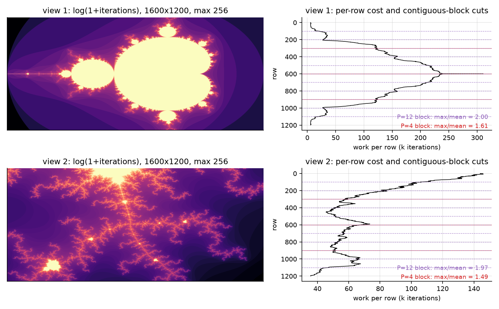

左边是每个像素的迭代数，右边是每行的工作量，以及按 4 线程和 12 线程等分时连续块的切分线。view 1 的中间几行跑满 256 次迭代，
上下边缘却很便宜。12 等分时最重的一块是平均值的 2.00 倍，整个程序都要等这一块算完，所以连续块划分的加速比上限只有 6×。

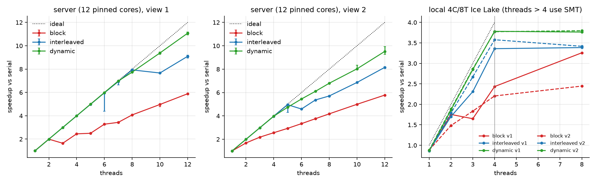

这张图比较三种划分：连续块（block）、隔行（interleaved，相邻的行轮流交给不同线程）和动态分块（dynamic）。连续块的曲线明显偏低，而且不单调：

| 线程 | view1 block | view1 interleaved | view1 dynamic | view2 block | view2 dynamic |
| ---: | ---: | ---: | ---: | ---: | ---: |
| 2 | 1.99 | 2.00 | 2.00 | 1.68 | 1.99 |
| 3 | **1.64** | 2.99 | 3.00 | 2.18 | 2.98 |
| 8 | 4.07 | 7.93 | 7.74 | 4.17 | 6.79 |
| 12 | 5.89 | 9.10 | **11.08** | 5.78 | 9.52 |

最反直觉的是 3 线程比 2 线程还慢。三等分时，中间那一块恰好独揽了 Mandelbrot 集的主体，另外两个线程很快做完，只能干等。
隔行把贵的行打散给所有线程，工作量均衡了；但它仍是静态划分，只要有一个核被服务器上的其他租户抢占，所有线程都得等它。
动态分块让先做完的线程去领新活，这两个问题一起解决了。

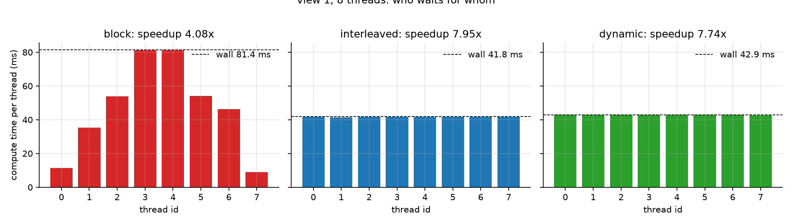

这是 8 线程时每个线程实际的计算时间，虚线是墙钟。它把上面的道理画了出来：墙钟由最慢的那个线程决定，其他线程算得再快也没用。

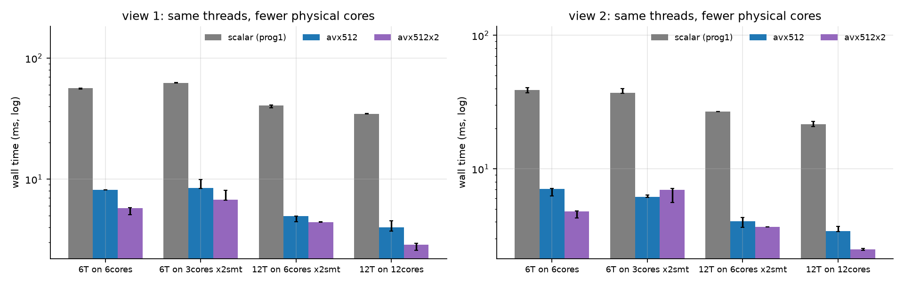

这张图把同样数量的线程放到更少的物理核上，看 SMT 能补回多少。标量版本里，6 个线程挤进 3 个核只比铺在 6 个核上慢 11%。
这说明内核大部分时间在等依赖链上一步的结果，同一个核上的两个硬件线程可以互相填空。
紫色的双向量交错版已经在单线程内填掉了这些空闲发射槽，所以它从 SMT 得到的收益最少（view 2 上慢 45%）。
换句话说，**SMT 与 ILP（指令级并行）争夺的是同一批空闲槽**，两者的收益不能相乘。

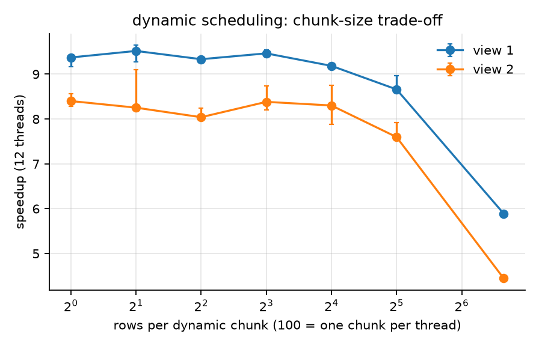

动态分块每块该切多少行？这张图扫了块大小：1–16 行基本持平，说明在这个范围内调度开销还显不出来；到 100 行时每个线程只领到一块，退化成了连续块划分。

读这张图要注意一点：它整体比线程扫描图低约 18%。原因是它直接在刚唤醒的 12 个核上运行，而线程扫描跑到 12 线程时核已经预热
（我推测是频率爬升，没有用计数器验证）。同一张图内的比较不受影响。

### prog2：fake vector intrinsics 与 lane 利用率

prog2 用课程给的 fake vector intrinsics（用普通 C++ 模拟向量指令，并记录每条指令启用了几个 lane）实现 clampedExp。
它的用处是让人直接数出 lane 利用率：所有被执行的 lane 里，有多少在做有用的事。

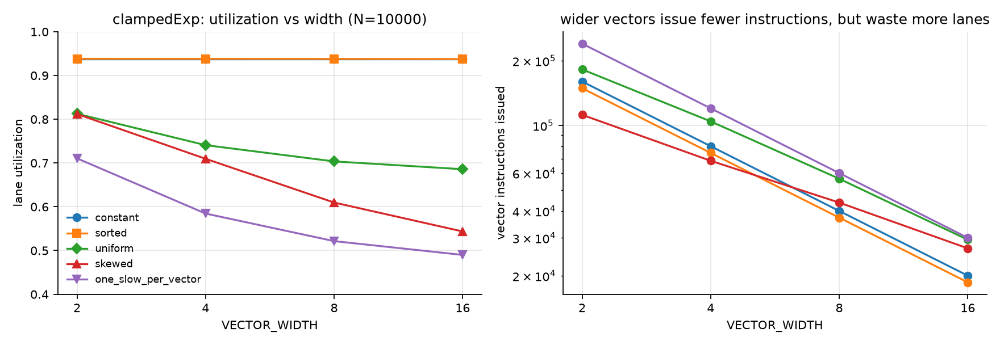

左图是利用率随向量宽度的变化，右图是发出的向量指令数。两张图合起来看：向量越宽，指令越少，但浪费的 lane 越多。

| 指数分布 | W=2 | W=4 | W=8 | W=16 |
| --- | ---: | ---: | ---: | ---: |
| uniform（官方） | 0.812 | 0.741 | 0.704 | 0.686 |
| constant | 0.938 | 0.938 | 0.938 | 0.938 |
| sorted | 0.938 | 0.938 | 0.938 | 0.937 |
| one_slow_per_vector | 0.711 | 0.584 | 0.521 | 0.490 |

利用率随宽度下降，是因为一个向量要循环到组内最大的指数才能结束。宽度越大，组内最大指数越接近 9，其他 lane 陪着空转的时间越长。
即使所有指数相同（constant），利用率也只有 15/16，因为 clamp 那条 `vmove` 一个 lane 都不启用。
把输入排序后，相近的指数落进同一个向量，利用率回到 0.938，这对应 GPU 上按工作量重排数据的做法。
另外，`arraySum` 的指令数是 1 + 2N/W + 2·log2 W，实测与公式完全一致。

### prog3：SIMD gang、ILP 与 task

prog3 用 ISPC 风格的 SIMD gang 画 Mandelbrot，再用 task 把工作分到多个核上。这里要回答两个问题：SIMD 实际拿到了向量宽度的几成？task 该切多少个？

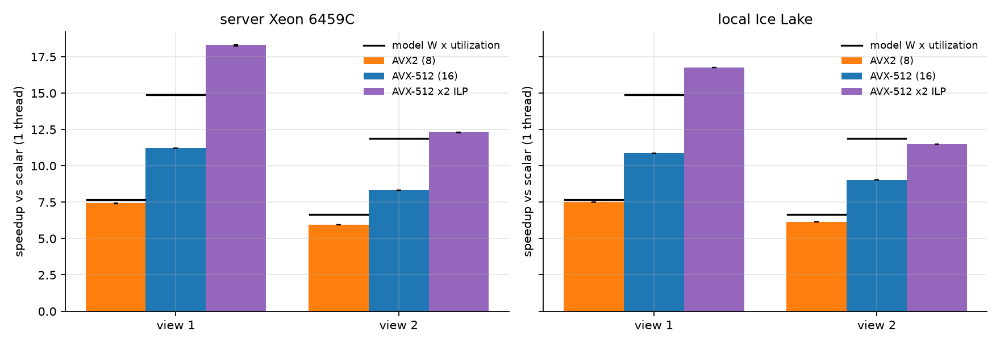

图里把实测加速比和模型「W × 利用率」（只考虑发散时能达到的上限）画在一起，服务器上的数字如下：

| | 标量 ms | AVX2 | AVX-512 | AVX-512 ×2 交错 | 模型 8·U8 / 16·U16 |
| --- | ---: | ---: | ---: | ---: | ---: |
| view 1 | 332.2 | 7.42× | 11.21× | **18.30×** | 7.66 / 14.9 |
| view 2 | 185.9 | 5.96× | 8.31× | **12.31×** | 6.65 / 11.9 |

AVX2 接近模型，说明 8 宽时瓶颈就是发散。AVX-512 却远低于模型：16 个 lane 让每一步同时处理的像素变多了，但依赖链没有变短，每一步仍要等上一步的结果。
所以在单线程里同时推进两组独立的向量，让一组等待时另一组在算，view 1 的加速比就超过了 16×。

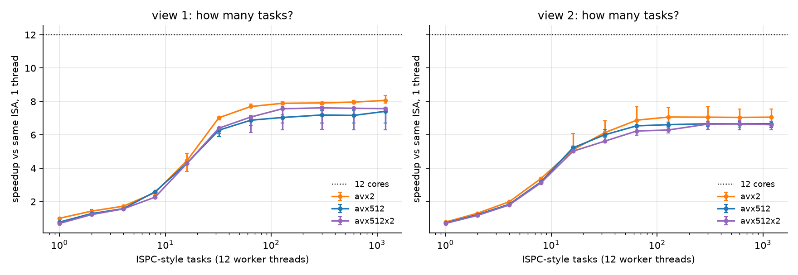

固定 12 个工作线程、改变 task 数。task 数等于核数时，每个核拿一块连续区域，又回到了 prog1 连续块的不均衡；task 数到 64 个以上，任务切得足够细，曲线进入平台。

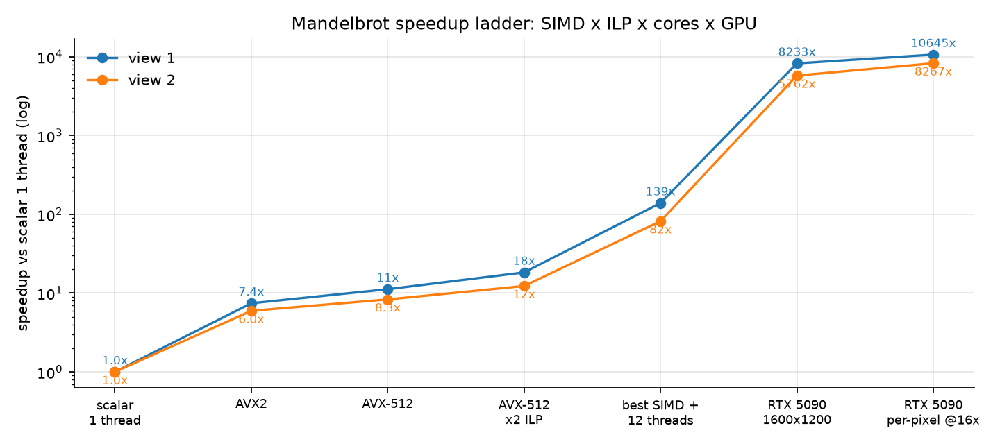

把前面的手段叠起来就是这条加速阶梯：SIMD、ILP 和 12 核相乘，view 1 上约 139×；RTX 5090 在此基础上再快约 60–80×。

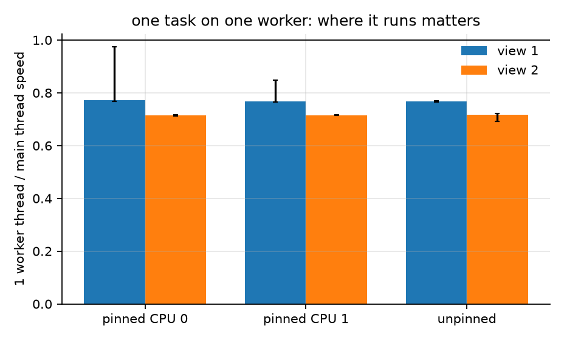

这张图记录的是一个测量陷阱。我发现 1 个 task 在新建的工作线程上跑，比直接在主线程上跑慢约 23%。
第一个怀疑是绑核，但无论绑在 CPU 0、别的核还是不绑核，结果都一样，这个假设被否定了；它和上面 chunk 图的「冷核」现象一致。
两种视角都正好多出 8.9 ms（38.6 对 29.7 ms，31.3 对 22.4 ms）。工作量差 1.3 倍，多出的时间却相同，
所以这是每次 launch 一个加性的固定代价，而不是按比例变慢。
本机 4 核对照中只有绑在 CPU 0 时变慢（0.75 / 0.90），其他核和不绑核为 0.92–1.00，可见这是服务器宿主机特有的现象。
A2 进一步用 CPU 时间把它定位为「执行变慢」，而不是「在等待」。

### prog4：Newton sqrt 的最好与最坏输入

prog4 用 Newton 法求 sqrt，每个元素的迭代次数取决于输入值。作业要求构造让 SIMD 加速最好和最差的输入，这正好用来检验上面「最慢的 lane 决定向量耗时」的说法。

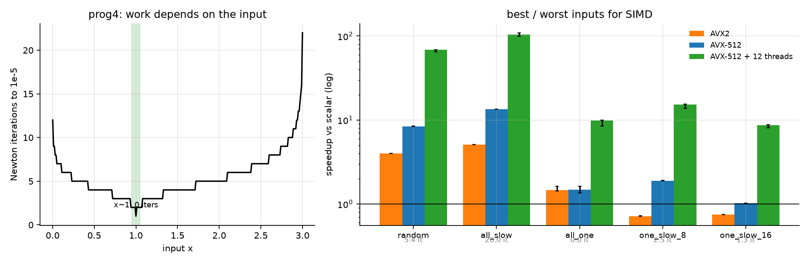

左图是迭代次数随输入的变化（x 接近 1 时几乎不用迭代），右图是各种输入下的加速比：

| 输入 | 平均迭代 | 标量 ms | AVX2 | AVX-512 | AVX-512 + 12 线程 |
| --- | ---: | ---: | ---: | ---: | ---: |
| random | 5.35 | 742.7 | 3.98× | 8.36× | 68.5× |
| all_slow（最好） | 20.0 | 1305.5 | 5.09× | **13.48×** | **104.1×** |
| one_slow_8（最坏） | 2.50 | 183.3 | **0.72×** | 1.89× | 15.2× |
| one_slow_16 | 1.25 | 99.0 | 0.75× | 1.02× | 8.6× |

最好的输入是全部都慢：每个 lane 的工作量相同，没有发散，每个元素的计算量也足够大。
最坏的输入是每 8 个元素放 1 个慢的：每个 AVX2 向量都要陪那一个慢 lane 跑满迭代，有用的工作只占八分之一。
这样即使理想情况也只能和标量打平，实测还要更慢一些。

### prog5：saxpy 带宽

saxpy 每个元素搬 12 字节、只做 2 次浮点运算，几乎没有计算可言，所以它测的是内存层次每一级能给多少带宽。

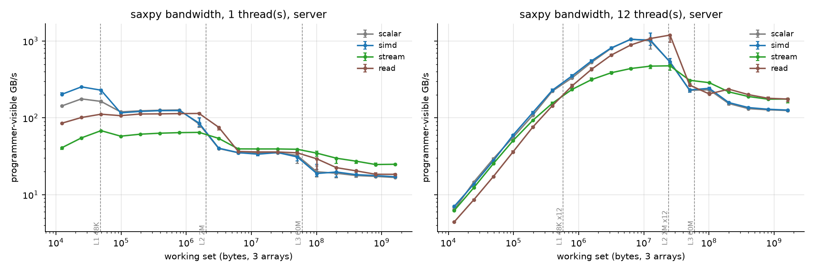

横轴是工作集大小，能清楚地看到每离开一级缓存，带宽就掉一个台阶。单线程时 L1 约 229 GB/s，L2 125，L3 35，到 DRAM 只剩 18 GB/s。
12 线程在 12.6 MB 时超过 1 TB/s，因为这个工作集正好落在 12 个核各自的 L2 里（12 × 2 MB）。
最左端 12 线程反而很低：问题太小，不值得并行。
streaming store 会绕过缓存直接写内存。在 DRAM 区间它快 35%，约等于 16/12，正好是省掉 write-allocate 那次读的比例；在缓存区间它反而慢 3 倍。

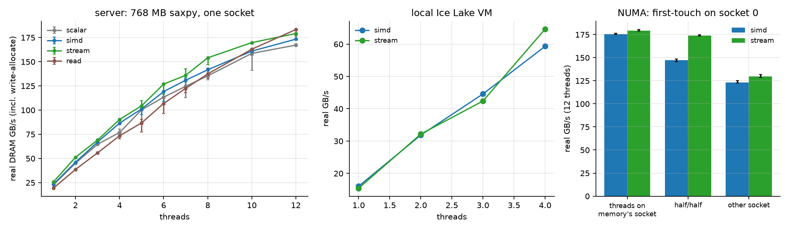

这张图看的是 DRAM 的真实带宽，也就是把 write-allocate 那次读也算上。1 线程 23 GB/s，12 线程 173 GB/s，曲线还没有饱和。
单核吃不满内存是 Little 定律的结果：带宽约等于在途请求量除以访存延迟，而一个核能同时挂起的缓存缺失有限。
右边是 NUMA 对照。数据按 first-touch（第一次写入时，页面分配到写入线程所在 socket 的内存）放在 socket 0，
线程却全部放在 socket 1 时，每次访问都要跨 socket，带宽降到 123 GB/s（−30%）。

### prog6：K-means profiling

prog6 给的是一份能跑但很慢的 K-means，任务是先 profile 找到热点再优化。它最适合拿来讲 Amdahl 定律：只优化最重的那一段，剩下的串行部分很快成为瓶颈。

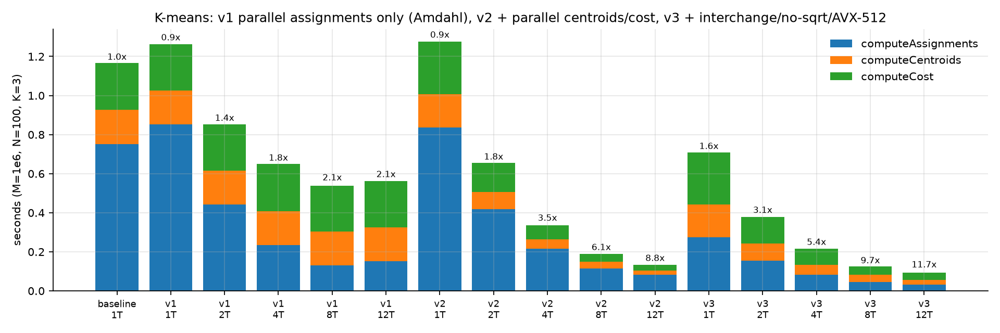

柱子按 computeAssignments、computeCentroids、computeCost 三个阶段堆叠。v1 只压短了第一段，另外两段原封不动，所以总时间降不下去；
v2 把三段都并行之后，柱子才整体变矮。

| 版本 | 改动 | 1 线程 | 12 线程 |
| --- | --- | ---: | ---: |
| baseline | 官方结构：k 外层、sqrt、串行 | 1.163 s | — |
| v1 | 并行 computeAssignments | 0.92× | 2.07×（Amdahl 上限 2.8×） |
| v2 | + centroids / cost 按点并行，线程私有部分和 | 0.92× | 8.82× |
| v3 | + 循环交换、平方距离、AVX-512 | 1.64× | **11.72×** |

v3 的 1 线程已经快了 1.64×，这部分来自单核上的改写（循环交换让访存连续，平方距离省掉 sqrt，再加向量化），和并行无关。
所有版本的聚类分配都与 baseline 完全一致。

### GPU 对照（RTX 5090）

同样的问题搬到 GPU 上，有的消失了，有的换了一种样子出现。

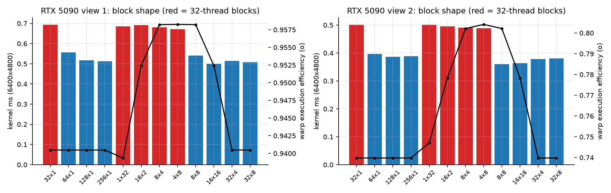

这张图比较不同的线程块形状。2D block 让一个 warp 覆盖一小块方形区域，相邻像素迭代数相近，所以 warp 效率更高（8×4：0.958，32×1：0.940）。
但只有 32 个线程的 block（红色）受每个 SM 能驻留的 block 数上限限制，occupancy 不足。8×8 和 16×16 最快。

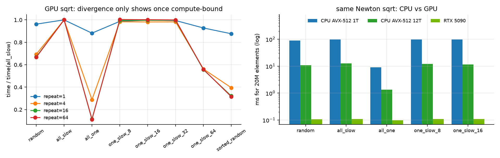

sqrt 在 GPU 上对所有输入都约 0.1 ms，达到 1.54 TB/s：它受带宽限制，计算上的发散被访存时间盖住了。
让每个元素重复求解 64 次，把它变成计算受限之后，发散就显出来了：one_slow_8/16/32 与 all_slow 同为 5.03 ms，因为 warp 宽 32，
只要 32 个线程里有一个慢的，整个 warp 就一样慢；one_slow_64 约为一半；排序后的 random 快 2.1 倍。

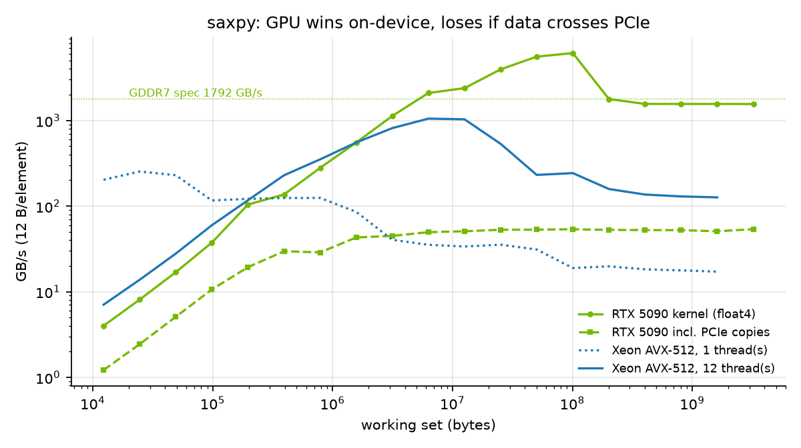

saxpy 在显存上有 1.55 TB/s，落在 L2 里有 6.1 TB/s；但算上 PCIe 拷贝，端到端只有 52 GB/s，低于 CPU 12 线程的 130 GB/s。
所以数据如果本来就在主存里，为一次 saxpy 搬到 GPU 并不划算。
另一个对照是 K-means 的 assignment：数据从 AoS 改成 SoA 后，相邻线程读相邻地址，访存可以合并，时间从 3.74 ms 降到 1.43 ms。

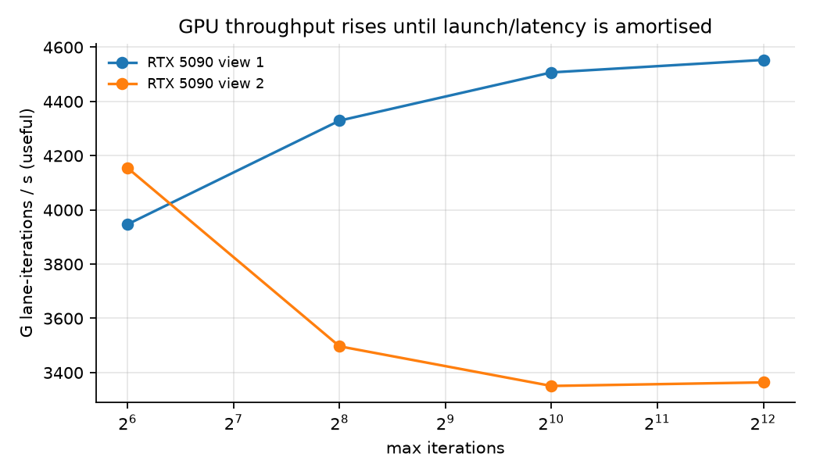

这张图把 Mandelbrot 的最大迭代数调大，看 GPU 每秒完成多少次有用的 lane 迭代。迭代数小时，launch 和访存延迟摊不开；迭代数变大后吞吐随之上升。

## 面试讲法（C++/GPU 版）

**20 秒**：并行加速有三个杀手。一是负载不均，连续块 5.9×，动态分块 11.1×。二是 SIMD 发散，每 8 个元素混 1 个慢的，AVX2 就比标量还慢。
三是带宽，saxpy 单核 23 GB/s，12 核 173 GB/s，要过 PCIe 时只剩 52 GB/s。另外 Mandelbrot 受延迟限制，SMT 和 ILP 都能接近翻倍，但二者不能相乘。

**追问**（详见报告第 11 节）：3 线程为什么比 2 线程慢？SIMD 为什么能超过 W？怎样构造 SIMD 比标量慢的输入？write-allocate 是什么？
K-means 为什么只有 2×？task 数设多少？GPU 发散和 CPU 发散有何不同？什么时候不该上 GPU？

**不能推出的结论**：
- 不能把「冷核」与「预热」两组数据混在一张图里比较；本文同一张图内条件一致。
- 不能说 AVX-512 慢是因为降频：双向量交错版同样是 512 bit，却快 1.6 倍。
- 不能把多租户服务器上的绝对数字当作这颗 CPU 的规格，只看同条件下的相对关系。

## 文件（C++/GPU 版）

```text
cpp/common/common.h              # 计时、绑核（Linux/Windows）、线程、JSON 行输出
cpp/topology/                    # Windows 拓扑查询
cpp/prog1_mandelbrot_threads/    # block / interleaved / dynamic
cpp/prog2_vecintrin/             # cs149intrin.h（fake intrinsics + logger）与 clampedExp / arraySum
cpp/prog3_mandelbrot_simd/       # AVX2 / AVX-512 / AVX-512 ×2 gang，ISPC 式 task
cpp/prog4_sqrt/                  # 标量 / AVX2 / AVX-512 / 线程池，五种输入
cpp/prog5_saxpy/                 # scalar / simd / stream / read，常驻自旋线程池
cpp/prog6_kmeans/                # baseline 与 v1–v3
gpu/a1_gpu.cu, gpu/run_gpu.sh    # CUDA：mandel / sqrt / saxpy / kmeans
scripts/build_cpp.py, run_cpp_experiments.py, plot_cpp.py
tests/test_cpp.py
```

---

## 附录：Python/numpy 版（早期实现）

这是 C++ 版之前的第一版实现。官方 starter 是 C++/ISPC，当时离线拿不到，所以我用 Python 重写了五个程序的核心问题。
它能讲清负载均衡和发散的道理，但墙钟里混着解释器和 numpy 调用的开销，数字只能看相对大小。

对应 CS149 Fall 2024 Assignment 1「Analyzing Parallel Program Performance on a Quad-Core CPU」，替代做法如下：

- prog1 用进程池代替 `std::thread`，因为 Python 线程会被 GIL 串行化；
- prog2/3/4 用「gang 宽度 W 的 lane 掩码模型」计算 SIMD 利用率，并用 numpy 的「掩码执行 vs 活跃集压缩」实测发散的代价；
- prog5 用 numpy 和 torch 的 saxpy 测有效带宽。

机器是 8 逻辑处理器的 Windows Server（WMI 报告 4 核 × 2 超线程，虚拟机拓扑，物理拓扑不确定），Python 3.12、numpy 2.5、torch 2.6 CPU。
测量期间机器上还有其他任务在跑：4 个 worker 以内的数字稳定，5–8 个 worker 的单点有明显抖动。

### 一句话结论

负载不均：Mandelbrot 按连续块静态分配时，中间块的计算量是边缘块的 3.7 倍（8 worker 时 0.2333 s 对 0.0627 s），
所以 4 worker 只有 2.93×；改成隔行分配是 3.93×，动态分块是 3.76×。

SIMD 发散：每个 W=8 的 gang 只要有一个慢 lane，利用率就降到 0.163。numpy 的掩码执行相当于 gang 宽度等于整个数组长度，
在「每 16 个元素 1 个慢」的输入上和「全部慢」一样贵（353 对 356 ns/元素）；压缩活跃集后降到 29.4 ns。

带宽：saxpy 在 DRAM 区间单线程 14.3 GB/s，8 线程只到 47.8 GB/s，约 3 线程后基本饱和；12 MB 的工作集在 8 线程下可达 101 GB/s。

### 对应官方作业

| 官方部分 | 本目录实现 | 因 CPU/Python 而不同之处 |
| --- | --- | --- |
| prog1 mandelbrot_threads | `mandelbrot.py` + `parallel.py`：静态连续块、隔行、动态分块（16 行一块），1–8 个进程；记录每个 worker 的计算时间 | 进程不是线程：要 pickle 结果、要 IPC；内核是 numpy 向量化 + 每次迭代压缩活跃集，不是标量 C++ |
| prog2 vector intrinsics（CS149 fake intrinsics、`_cs149_cntbits`） | `simd.py::gang_utilization`：给定每元素迭代数，按 W 宽 gang 计算利用率 | 是模型，不是指令级模拟；不实现 clamp/exp 那道题 |
| prog3 ISPC（gang、task） | 同上模型用在 Mandelbrot 迭代数上；多核部分见 prog1 | 没有 ISPC 编译器；ISPC task ≈ 本目录的动态分块 |
| prog4 sqrt（Newton 法，输入决定迭代数） | `simd.py::sqrt_iterations` 完全照搬 starter 的迭代与阈值；输入模式 uniform / all_fast / all_slow / one_slow_per_gang | 官方要求构造让 ISPC 加速比最好/最差的输入，这里用模型算加速比，再用 numpy 掩码执行实测 |
| prog5 saxpy（带宽受限） | `saxpy.py`：numpy 两遍、torch 融合单遍（`torch.add(y, x, alpha=a)`），数组 4 KB–768 MB，线程 1–8 | 用 torch 内部线程和 numpy 分块线程代替 ISPC task |

### 怎么跑

```powershell
cd solutions/cs149/asst1-cpu-parallel
python -m pytest -q tests          # 15 passed
python scripts/run_experiments.py  # 约 3 分钟，写 artifacts/raw/*.csv 与 artifacts/figures/*.png
```

### 结果

#### 先修一个测量陷阱：numpy 内核对块大小敏感（`artifacts/raw/mandel_block_size.csv`）

我的第一版实验在这里栽了跟头，所以先讲它。同一幅 view1（1600×1200，256 次迭代）串行计算，只改每次 numpy 调用处理的行数：

| 每次调用行数 | 像素数 | 串行 s |
| ---: | ---: | ---: |
| 2 | 3200 | 2.6249 |
| 10 | 16000 | 1.2881 |
| 40 | 64000 | 1.2014 |
| 160 | 256000 | 1.5155 |
| 1200（整幅） | 1920000 | 3.6508 |

块太小时，每次迭代约 10 个 numpy 调用的固定开销占主导；块太大时，临时数组放不进 cache，每次迭代都要走内存。
第一版实验没有控制这一点，结果出现了「view2 用 8 个 worker 加速 21 倍」的超线性假象：并行时每个 worker 分到的块更细，单像素反而更便宜。
现在所有调度都按约 16384 像素一块（`BLOCK_POINTS`）切分，只比较行怎么分给 worker。

#### prog1：静态块 vs 隔行 vs 动态（`artifacts/raw/mandel_speedup.csv`，`mandel_work_imbalance.csv`）

加速比相对于进程内串行（view1 1.2776 s，view2 2.9102 s），每个配置取 3 次中最好的一次。静态与隔行用 barrier 保证每块落在不同的进程上。

| 视图 | worker | 静态块 | 隔行 | 动态（16 行） | 静态块：按迭代数算的理想上限 |
| --- | ---: | ---: | ---: | ---: | ---: |
| view1 | 2 | 1.999 | 1.976 | 1.893 | 1.995 |
| view1 | 3 | 2.098 | 2.936 | 2.846 | 1.664 |
| view1 | 4 | 2.931 | 3.929 | 3.76 | 2.481 |
| view1 | 8 | 4.967 | 4.081 | 5.072 | 4.14 |
| view2 | 4 | 3.713 | 4.147 | 4.063 | 3.428 |
| view2 | 8 | 4.981 | 5.313 | 6.058 | 6.854 |

和 C++ 版一样，view1 静态块 3 worker 只比 2 worker 快一点（2.098 对 1.999），因为中间那块包含了整个 Mandelbrot 集主体；按迭代数算，最重的块是平均的 1.80 倍。

实测的静态块比「按迭代数算的理想上限」还好（4 worker 2.931 对 2.481）。原因是每个像素还有与迭代数无关的固定开销（坐标生成、压缩），这部分让真实工作量比迭代数更均匀。
view2 本身比较均匀（4 worker 时最重块是平均的 1.167 倍），三种调度差距不大。

8 worker 隔行在 view1 只有 4.081，看起来像隔行出了问题。其实 8 个隔行块按迭代数几乎完全均衡（最重/平均 = 1.003），
只是其中一个 worker 用了 0.2922 s，其他约 0.16 s（`mandel_task_times.csv`）。这是外部负载拖慢了它，不是工作量不均。
动态分块对此不敏感，这正是动态调度的第二个好处。

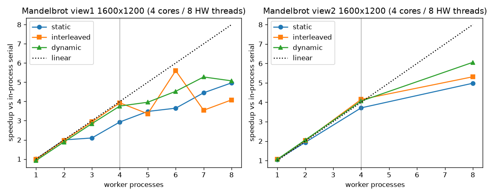

加速比曲线：隔行和动态在 4 worker 以内都贴近理想线，静态块明显偏低；超过 4 个 worker 后各条曲线都开始抖，这与机器上同时跑着其他任务一致。

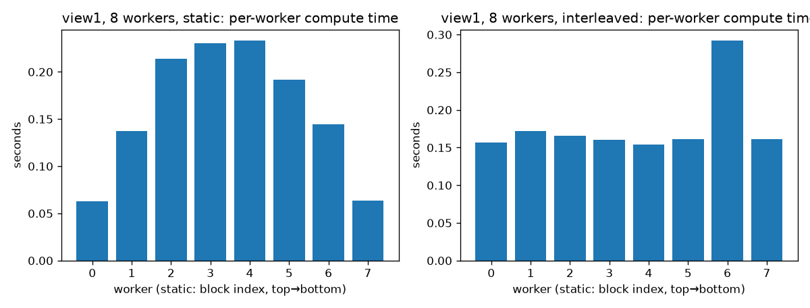

8 worker 时每个 worker 的计算时间，左边静态块，右边隔行。静态块里负责图像中部的几个 worker 明显更高，墙钟由它们决定；
隔行的柱子本应一样高，那根突出的就是上面说的被外部负载拖慢的 worker。

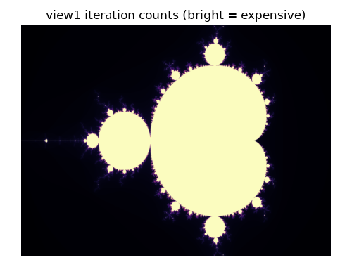

view1 的迭代数分布，贵的像素集中在图像中部，这就是静态连续块不均衡的根源。

#### prog2/3/4：SIMD 利用率模型（`artifacts/raw/simd_utilization.csv`）

这一节不跑 SIMD，而是用模型回答：给定每个元素的工作量，W 宽的 gang 会浪费多少 lane？
每个 lane 的工作量记为迭代数 + 1（最后一次判断）。利用率 = 有效 lane-迭代 / Σ(W × gang 内最大值)，模型加速比 = W × 利用率。

| 输入 | W=2 | W=4 | W=8 | W=16 | W=8 模型加速比 |
| --- | ---: | ---: | ---: | ---: | ---: |
| mandel view1（行内相邻像素成 gang） | 0.9897 | 0.9762 | 0.957 | 0.9295 | 7.656 |
| mandel view2 | 0.9945 | 0.9874 | 0.9784 | 0.9672 | 7.827 |
| sqrt uniform（0.001 + 2.998·rand） | 0.8348 | 0.7098 | 0.6122 | 0.5347 | 4.897 |
| sqrt all_fast（全 1.0，0 次迭代） | 1.0 | 1.0 | 1.0 | 1.0 | 8.0 |
| sqrt all_slow（全 2.999，22 次迭代） | 1.0 | 1.0 | 1.0 | 1.0 | 8.0 |
| sqrt one_slow_per_gang（每 W 个 1 个 2.999） | 0.5217 | 0.2826 | 0.163 | 0.1033 | 1.304 |

Mandelbrot 相邻像素的迭代数高度相关，所以发散代价很小，W=16 时利用率还有 0.93。
one_slow_per_gang 是最坏输入：每个 gang 都要跑满 22 次迭代，有效工作却只有 1/W，官方 prog4 问的就是这种输入。
反过来，all_slow 的利用率是 1，但它最慢。利用率高不等于跑得快。

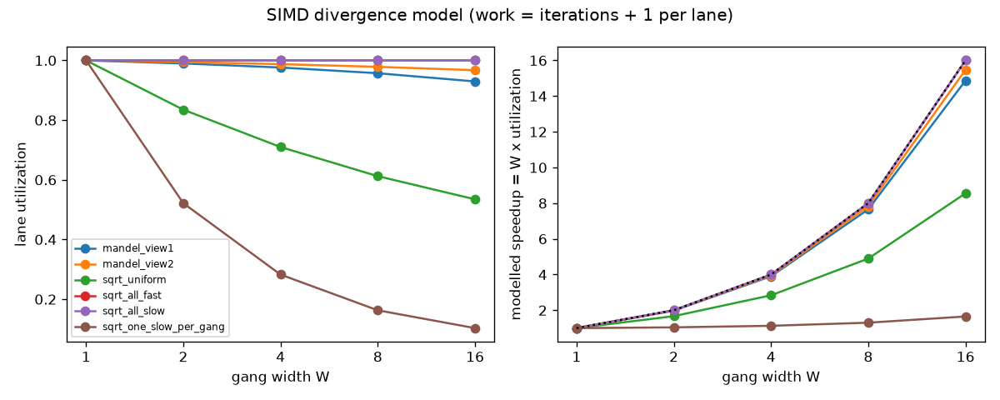

利用率随 W 的变化：Mandelbrot 两条线几乎是平的，one_slow_per_gang 随 W 增大一路下滑，因为 gang 越宽，那一个慢 lane 拖累的同伴越多。

#### 实测：标量 Python vs numpy 压缩 vs numpy 掩码（`artifacts/raw/simd_timing.csv`，ns/元素）

模型之外，再用 numpy 实测两种处理发散的办法：掩码执行（所有元素一起迭代，已收敛的元素被掩掉但仍占位置）和压缩活跃集（每次迭代只保留还没收敛的元素）。

| 内核 / 输入 | 平均迭代 | Python 标量 | numpy 压缩活跃集 | numpy 掩码（不压缩） |
| --- | ---: | ---: | ---: | ---: |
| sqrt uniform | 5.362 | 929.91 | 247.02 | 448.307 |
| sqrt all_fast | 0.0 | 188.01 | 29.29 | 10.605 |
| sqrt all_slow | 22.0 | 3157.9 | 480.653 | 356.447 |
| sqrt one_slow_per_gang（W=16） | 1.375 | 355.3 | 29.441 | 353.147 |
| mandel view1（16384 像素一块） | 69.434 | 10104.82 | 649.485 | 1532.422 |

掩码执行时，one_slow_per_gang 与 all_slow 几乎一样贵（353 对 356），平均迭代数却只有 1.375 对 22，这就是 numpy 版的发散代价。
压缩活跃集（stream compaction）把发散的代价去掉了（29.4），但没有发散时它反而更贵（all_slow 481 对 356），因为每次迭代都要多做一次 gather。
GPU 上对应的取舍是忍受 warp 发散，还是花代价重排、压缩数据。

Python 标量比 numpy 慢 15.6 倍（mandel），这主要是解释器开销，**不是** SIMD 宽度带来的加速。

#### prog5：saxpy 带宽（`artifacts/raw/saxpy_bandwidth.csv`，`saxpy_scaling.csv`）

先说口径。有效带宽 = 3 × 4 B × N / 时间（读 x、读 y、写 out）。写 out 时，CPU 先要把目标 cache line 读进来（write-allocate），
所以真实内存流量是 4 × 4 B × N，CSV 里另有一列 ×4/3 的数字。numpy 没有融合的 axpy，要分两遍（先乘、再加），实际流量更大，所以它的「有效带宽」更低。

| 工作集（3 个数组） | numpy 两遍 1 线程 | torch 融合 1 线程 | torch 融合 8 线程 |
| ---: | ---: | ---: | ---: |
| 192 KB | 34.375 | 43.424 | 45.271 |
| 768 KB | 48.496 | 71.442 | 28.949 |
| 12 MB | 23.106 | 37.203 | 101.068 |
| 192 MB | 9.897 | 14.829 | 51.429 |
| 768 MB | 10.286 | 14.754 | 51.193 |

N=2^25（384 MB，DRAM 区间）按线程数扩展（GB/s）：

| 线程 | 1 | 2 | 3 | 4 | 6 | 8 |
| --- | ---: | ---: | ---: | ---: | ---: | ---: |
| torch 融合 | 14.335 | 27.162 | 39.455 | 39.186 | 41.327 | 47.791 |
| numpy 分块线程 | 9.937 | 18.713 | 25.326 | 31.848 | 40.085 | 41.199 |

作为对比，12 MB 工作集上 torch 从 1 线程 33.949 升到 6 线程 159.868 GB/s。

这台机器上单核吃不满 DRAM：torch 1 线程 14.3 GB/s，3 线程起基本停在 39–48 GB/s（5 线程那一点 27.6 是抖动）。
所以「多线程对 DRAM 带宽完全无效」在这里不成立，成立的是「很快饱和，而且饱和值远低于 cache 区间」。CS149 原作业的四核桌面机上，单核更接近饱和。

768 KB 时 8 线程（28.9）反而比 1 线程（71.4）慢。每次调用只有约 11 µs，线程唤醒和同步的开销占了主导。

saxpy 的算术强度（每搬一个字节做多少次浮点运算）是 2 FLOP / 12 B ≈ 0.17 FLOP/B，无论多少核都是带宽受限。

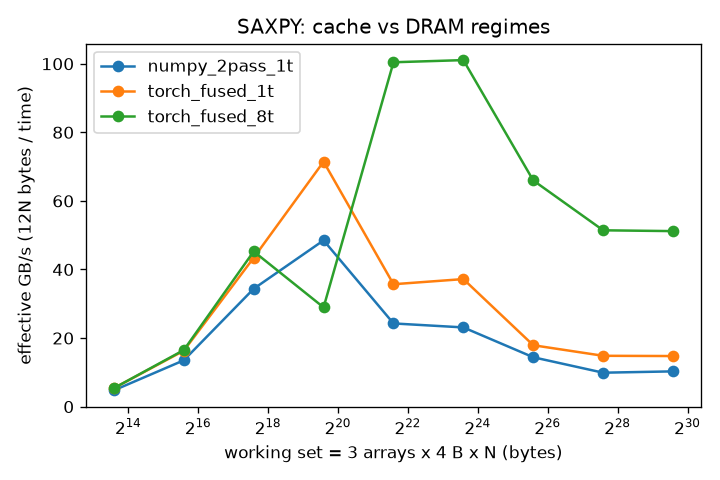

带宽随工作集的变化：放得进 cache 时带宽高，进入 DRAM 区间后各条线都明显下降；单线程时 torch 融合版始终高于 numpy 两遍版，因为它少走一遍内存。

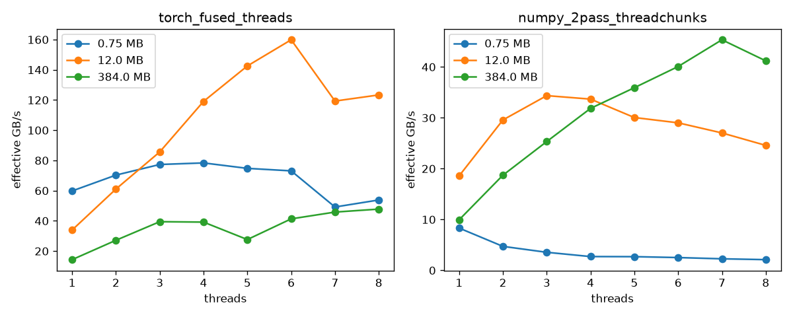

两种实现各一张，每条线是一个数组规模。DRAM 区间的线在几个线程后就变平，说明内存带宽已经接近这台机器的上限；
放得进 cache 的规模则能随线程数继续上涨。

### 面试讲法

**20 秒结论**：并行加速有三种杀手。第一是负载不均：Mandelbrot 中间贵，连续块静态分配时 4 核只有 2.9×，
隔行或动态分配能到 3.8–3.9×。第二是 SIMD 发散：一个 gang 的耗时由最慢的 lane 决定，每 8 个元素混 1 个慢的，
8 宽 SIMD 只剩 1.3×。第三是带宽：saxpy 每 12 字节只做 2 次浮点运算，加核很快撞上 DRAM 墙。

**白板**：
- 静态分配的加速比上限 = 总工作 / 最大块工作；隔行把空间上相关的代价打散。
- SIMD 利用率 = Σ work_i / Σ_gang (W · max work)；最坏情况是每个 gang 恰好 1 个慢 lane，利用率 ≈ (slow + (W−1)·fast) / (W·slow)。
- saxpy 流量：程序可见 12N 字节，加上 write-allocate 是 16N 字节；用 non-temporal / streaming store 可以省掉 write-allocate 那次读。
- 算术强度 2/12 FLOP/B；roofline 上的拐点 = 峰值 FLOPs / 峰值带宽，saxpy 远在拐点左边。

**不能推出的结论**：
- 不能推出「隔行在 8 worker 时比静态差」。view1 8 worker 隔行 4.081 是外部负载导致某个 worker 变慢（0.2922 s 对约 0.16 s），按迭代数它几乎完全均衡。
- 不能用 Python 标量对 numpy 的 15.6× 去估计 SIMD 加速，那是解释器开销。
- 不能把本机 DRAM 带宽的数字搬到别的机器，也不能据此判断这台虚拟机的物理拓扑。

**追问**：
1. 超线程对 Mandelbrot 有用吗？官方答案是：超线程隐藏延迟，对计算密集、ILP 已经很高的标量循环帮助有限。
   本机 8 worker 动态分块为 5.072× / 6.058×，高于 4，但测量期间机器不是独占的，又是虚拟机，分不清物理核和超线程。
   （C++ 版在服务器上测到的结论不同：Mandelbrot 内层是依赖链，SMT 很有用，见上文 smt 图。）
2. 动态分块的块大小怎么选？块小，负载均衡好，但每块都有调度和 IPC 开销；块大则反之。
   这里 16 行 = 25600 像素，同时也照顾了 numpy 临时数组的 cache 大小（见块大小表）。
3. 为什么 saxpy 的 numpy 版比 torch 慢？numpy 要两遍：`out = a*x` 写一遍，`out += y` 再读写一遍，流量约 20N 字节；
   torch 一遍融合完成。这是算子融合省带宽的最小例子。

### 文件

```text
asst1-cpu-parallel/
├── code/cpupar/
│   ├── mandelbrot.py   # 标量/向量/掩码内核，静态块、隔行、动态分块，工作量统计
│   ├── parallel.py     # 进程池 + barrier（静态块一进程一块）+ 每任务计时
│   ├── simd.py         # gang 利用率模型、prog4 Newton sqrt、输入模式
│   └── saxpy.py        # numpy / torch saxpy、有效带宽、计时
├── tests/test_asst1.py # 15 个测试
├── scripts/run_experiments.py
└── artifacts/
    ├── raw/       # mandel_block_size / mandel_speedup / mandel_task_times / mandel_work_imbalance /
    │              # simd_utilization / simd_timing / saxpy_bandwidth / saxpy_scaling .csv
    └── figures/   # mandel_speedup / mandel_worker_time / mandel_view1_counts /
                   # simd_utilization / saxpy_bandwidth / saxpy_scaling .png
```
