# CS149 Asst2 复刻：多核上的任务系统与任务图调度（C++17 主实现 + Python 对照）

任务系统是把「一批相互独立的任务」分给多个核执行的运行时，像 OpenMP 的 parallel for 或 TBB 都属于这一类。
这个实验要回答：任务系统的时间花在哪里？worker 空闲时应该自旋（循环检查有没有新活）还是睡眠（挂在条件变量上等通知）？
任务之间有依赖时，怎样才能不让核闲着？我在 12 个物理核上的主要发现是：常驻线程池把每次 launch 的固定开销从
spawn（每次都新建线程）的约 200 µs 降到 1–13 µs；自旋唤醒最快，但它的代价全在「核被别人占用」的时候爆发出来；
允许 launch 之间按依赖异步执行，能把每个 launch 尾部的空闲线程填满。

对应 CS149 Fall 2024 Assignment 2「Scheduling Task Graphs on a Multi-Core CPU」。`cpp/` 是与官方 API 一致的 C++17 实现：
Part A 的 serial / spawn / spinning pool / sleeping pool，Part B 的 `runAsyncWithDeps` + `sync`（sleeping 与 spinning 两版），
以及按结构重写的全部 20 个官方测试，每个测试都会校验结果。原来的 Python `threading` 版保留在 `code/`；
它的结论受 GIL（CPython 的全局解释器锁，同一时刻只允许一个线程执行字节码）主导，放在文末附录作对照。

完整报告：[`cs149_asst2_report.pdf`](../../../reports/cs149-asst2/cs149_asst2_report.pdf)（24 页，含 16 张图、
9 个面试追问及常见错答、work/span 推导）。

平台是服务器 Intel Xeon Gold 6459C，固定使用 socket 0 上 12 个空闲物理核 `{0,1,2,3,4,6,10,11,14,16,19,23}`
（cgroup 配额 16 CPU，与其他任务共享），g++ 11.4 `-O3 -march=native -std=c++17 -pthread`。整套实验独立跑了 3 轮
（`artifacts/raw/cpp/server12c`、`_r2`、`_r3`），每个测量在进程内再重复 3 次；下文数字是这 9 次的中位数，
全部由 `scripts/summarize_cpp.py` 生成（`artifacts/raw/cpp/summary_server12c.md`）。

## 一句话结论

常驻线程池把每次 launch 的固定开销，从「每次都新建线程」的约 200 µs 降到 1–13 µs。自旋池唤醒最快，单任务 0.783 µs，睡眠池要 10.8 µs，但空闲时会烧满 12 个核。任务一多，12 个线程抢同一个 CAS（compare-and-swap，比较并交换），自旋池每个空任务要 494 ns，是睡眠池的 7 倍。

自旋怕的是和别人抢核。12 个 worker 绑满 12 个核时，正在自旋等待的调用者要和一个 worker 分时共用一个核，出现 32.0 ms 的时间片平台；改成 11 个 worker 后降到 18.7 ms。线程数是核数的两倍时，带锁的自旋调度器慢了 766 倍。

任务之间有依赖时，让独立的 launch 互相填上彼此的尾部，能快 1.64×（理想情况是 1.83×），树形归约达到 work 下界的 96%。同一条 cache line 上的原子计数器，比各占一行慢 19 倍。

## 对应官方作业

| 官方部分 | 本目录实现（`cpp/tasksys/`） |
| --- | --- |
| Part A `TaskSystemSerial` | `TaskSystemSerial` |
| Part A `TaskSystemParallelSpawn` | 每次 `run` 建 min(P, n) 个线程，原子 `fetch_add` 动态取任务 |
| Part A `TaskSystemParallelThreadPoolSpinning` | 常驻 worker 自旋；(generation, next) 打包在一个 64 位原子变量里，CAS 认领，避免 launch 之间的竞态 |
| Part A `TaskSystemParallelThreadPoolSleeping` | 同样的分发逻辑；worker 在 `condition_variable` 上睡，调用者等 done 条件变量 |
| Part B `runAsyncWithDeps` / `sync` | `TaskSystemAsync<Spin>`：一把锁保护 launch 表和 ready 队列，记录依赖计数与后继，多个 launch 交错执行 |
| 官方 `tests.h` | `cpp/tasksys/tests.h`：super_super_light、super_light、ping_pong_equal/unequal、recursive_fibonacci、math_operations_in_tight_for_loop（含 fewer_tasks、fan_in、reduction_tree）、spin_between_run_calls、mandelbrot_chunked，以及它们的 `_async` 版本，共 20 个 |
| 扩展实验 | launch 开销、CPU 代价、超额订阅、任务粒度、DAG 形状与 work/span、false sharing、分发计数器、调用者占核、SMT |

## 怎么跑

```powershell
cd solutions/cs149/asst2-task-scheduler
python scripts/build_cpp.py                       # cpp/bin/tasksys_bench, cpp/bin/contention
python -m pytest -q tests                         # 87 passed（Python 65 + C++ 22），本机约 50 s
cpp/bin/tasksys_bench --mode tests --threads 8    # 6 个系统 × 20 个测试，输出 JSON lines
# 服务器上（Linux）：
taskset -c 0,1,2,3,4,6,10,11,14,16,19,23 python scripts/run_cpp_experiments.py \
    --platform server12c --cores 0,1,2,3,4,6,10,11,14,16,19,23 --smt-offset 64
python scripts/plot_cpp.py && python scripts/summarize_cpp.py > artifacts/raw/cpp/summary_server12c.md
```

本机（Windows，MinGW g++ 13）与服务器（Linux，g++ 11.4）上，整个实验室的 `pytest` 都是 87 passed
（服务器日志：`artifacts/raw/cpp/pytest_server_final.txt`）。`tests/test_cpp.py` 在 1、3、8 线程下把 6 个系统 × 20 个测试全部跑一遍，
带超时防死锁；没有 g++ 时自动 skip。

## C++ 结果（服务器，12 个物理核）

### launch 开销（`overhead.jsonl`，空任务，12 线程，µs / `run()`）

先看最纯粹的开销：任务体什么都不做，一次 `run()` 要多久。这就是任务系统自身的成本。

| 任务数 | serial | spawn | spinning | sleeping | async_spinning | async_sleeping |
| ---: | ---: | ---: | ---: | ---: | ---: | ---: |
| 1 | 0.0114 | 53.3 | **0.783** | 10.8 | 9.05 | 12.4 |
| 16 | 0.0876 | 215 | 13.2 | **10.7** | 15.8 | 17.9 |
| 64 | 0.328 | 204 | 34.0 | **12.7** | 32.8 | 27.7 |
| 1024 | 5.18 | 192 | 521 | **78.3** | 393 | 190 |
| 16384 | 82.3 | **558** | 8100 | 1140 | 5270 | 2750 |

spawn 的开销几乎全在建线程上：每多一个线程约多 16 µs（1 线程 28.6 µs，12 线程 204 µs）。睡眠池省掉了这笔钱，64 个空任务只要 12.7 µs。

自旋池唤醒只需要一次 cache line 迁移（0.783 µs），因为 worker 一直在盯着那个状态变量；睡眠池则要走 futex（Linux 让线程在内核里睡眠和被唤醒的机制）唤醒 worker，
做完后再反向唤醒调用者（10.8 µs）。

但任务数一大，自旋池反而最慢（494 ns/任务）。12 个线程对同一个 64 位状态做 CAS，同一时刻只有一个能成功，失败的就重试。
spawn 用的是不会失败的 `fetch_add`，所以 16384 个任务时它反而最快（34 ns/任务）。

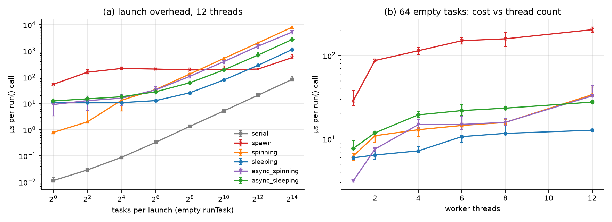

左图是上表随任务数变化的曲线：任务少时比的是「唤醒有多快」，自旋池领先；任务多时比的是「分发有多便宜」，自旋池的 CAS 冲突让它被反超。
右图固定 64 个空任务、改变线程数，spawn 随线程数直线上涨，每线程约 16 µs 的建线程成本就是从这里读出来的。

### 官方测试（`tests.jsonl`，12 线程，ms；120 个组合 3 轮全部通过校验）

官方测试覆盖了从极轻到很重、有依赖和无依赖的各种负载，正好用来看「哪个系统最好」这个问题有没有统一答案。

| 测试 | serial | spawn | spinning | sleeping | async_spinning | async_sleeping |
| --- | ---: | ---: | ---: | ---: | ---: | ---: |
| super_super_light | 7.26 | 84.4 | **3.10** | 9.98 | 32.8 | 18.4 |
| math_operations_in_tight_for_loop | **5.14** | 387 | 9.35 | 33.6 | 51.3 | 57.4 |
| ping_pong_equal | 133 | 21.3 | 29.4 | **14.0** | 29.8 | 14.2 |
| recursive_fibonacci | 77.1 | 7.95 | 7.90 | 10.7 | **7.29** | 12.8 |
| mandelbrot_chunked | 329 | **44.0** | 64.9 | 48.4 | 64.0 | 46.5 |
| math_ops_reduction_tree | 23.8 | 111 | 28.1 | 21.3 | **7.91** | 8.70 |
| spin_between_run_calls | 6.36 | 6.87 | **6.28** | 6.37 | 6.39 | 9.22 |

答案是没有：每一行的最快者都可能不同。每个任务只有约 100 ns 时（`math_ops`），所有并行系统都输给串行，只有自旋池接近串行，因为此时 launch 开销比任务本身还大。
反过来，每次 launch 有毫秒级计算时，launch 开销被摊薄，连 spawn 也能接近最优。带依赖图的测试只有 async 系统能赢：归约树上它比同步睡眠池快 2.7×。

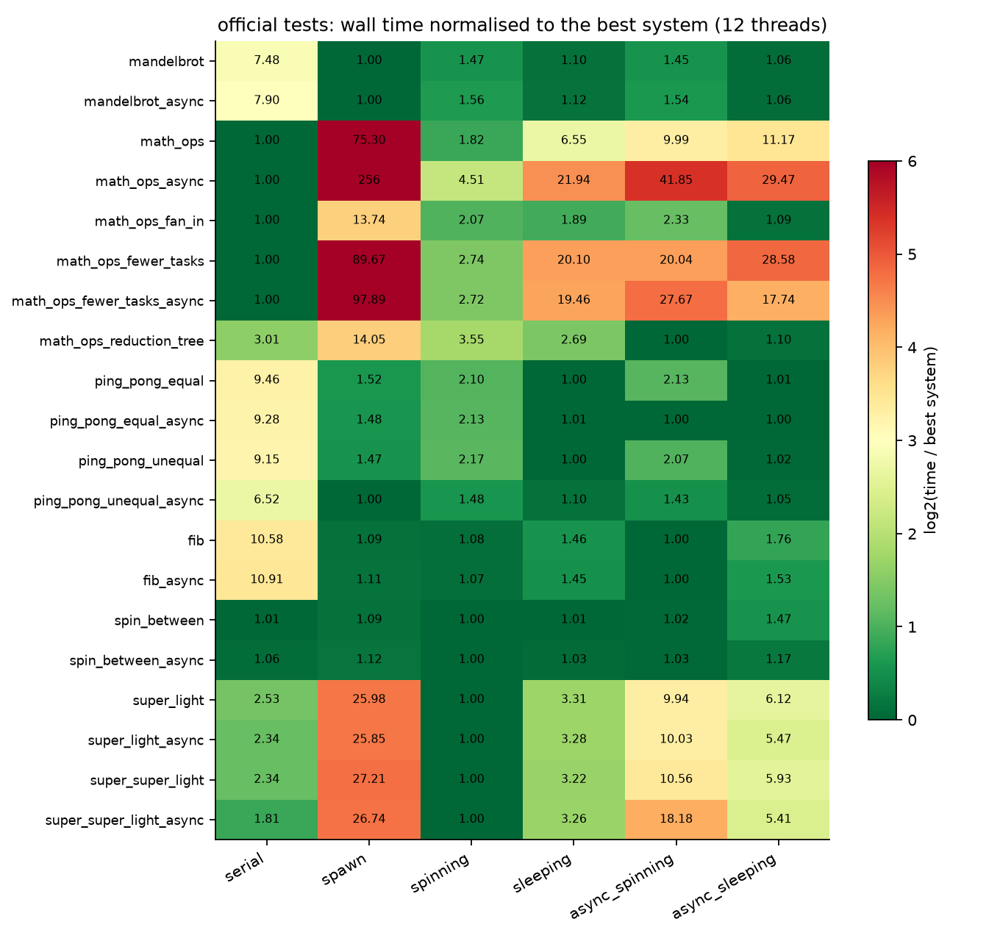

热力图里每个格子是这个系统相对该测试最快系统的倍数（颜色按 log2 取值），绿色的「最快格子」散落在不同的列里。

### 自旋的 CPU 代价与超额订阅（`idle.jsonl`、`tests.jsonl`、`oversub.jsonl`）

自旋的好处是快，坏处是它一直占着核。这一节看两种情况下的代价：机器空闲时浪费了多少 CPU，以及线程比核多时会发生什么。

| 指标 | spinning | sleeping | async_spinning | async_sleeping |
| --- | ---: | ---: | ---: | ---: |
| 空闲 1 s 烧掉的核数（12 线程） | 11.96 | 0.00 | 11.98 | 0.00 |
| spin_between_run_calls：CPU s / wall s | 10.09 | 1.27 | 12.44 | 1.23 |
| math_ops（规模 0.25）1× → 2× → 4× 超额订阅，ms | 3.81 → 3.42 → 2.37 | 6.06 → 10.2 → 23.7 | 18.8 → **14400** → 15300 | 10.7 → 15.3 → 24.0 |
| ping_pong_equal（规模 0.25）1× → 2× → 4×，ms | 7.93 → 20.0 → 31.6 | 5.32 → 3.92 → 9.76 | 4.03 → 217 → 201 | 3.95 → 3.94 → 5.02 |

`spin_between_run_calls` 上自旋池和睡眠池的墙钟几乎相同（6.28 对 6.37 ms），但自旋池多烧了约 8 倍 CPU。在共享机器上，这些 CPU 本可以给别的进程用。

超额订阅时，async_spinning 在 2× 下慢了 766 倍。原因是锁持有者被抢占：持锁的线程被操作系统换下 CPU 后，其余 23 个线程都在空转等这把锁，而它们空转恰恰又占着持锁线程需要的核。
Part A 的自旋池用 CAS 认领任务、不持锁，所以小任务时不受超额订阅影响；但任务一大，被抢占的 worker 手里的任务完不成，整个 launch 都得等它（ping-pong 7.93 → 31.6 ms）。

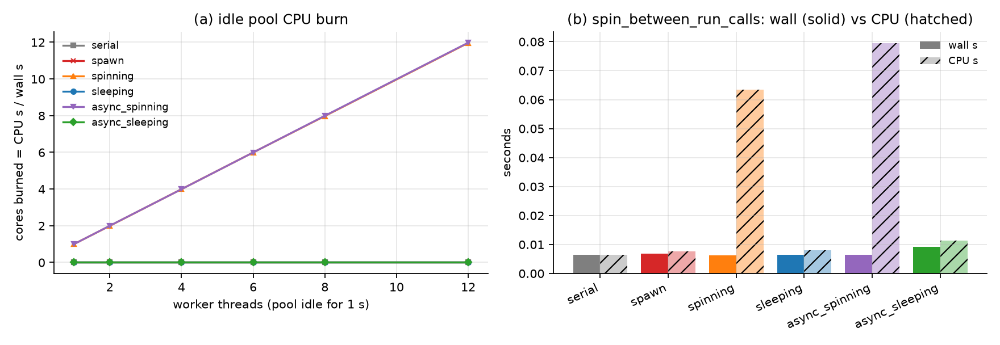

左图是线程池空闲 1 s 时烧掉的核数随 worker 数的变化：自旋类有几个 worker 就烧几个核，睡眠类几乎为零。
右图是 `spin_between_run_calls` 的墙钟（实心）和 CPU 时间（斜线）：两类实现墙钟差不多，CPU 时间差了约 8 倍。

### 任务粒度与「调用者占核」（`granularity*.jsonl`、`caller_core.jsonl`）

总工作量固定时，任务切多细最合适？切得太粗，负载摊不平；切得太细，每个任务的分发开销累积起来。这张图扫了任务数：

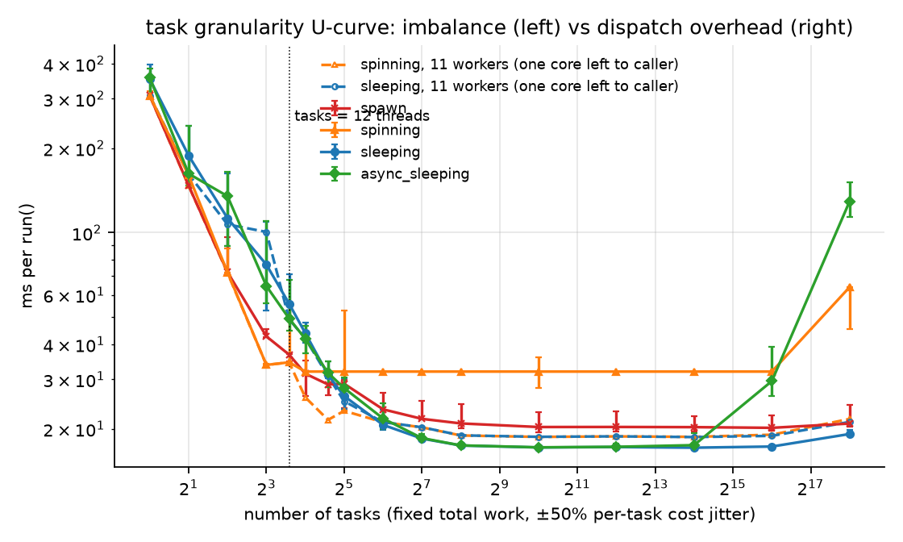

曲线呈 U 形，两端的原因不同。这里总工作量约 206 ms（串行），每个任务的代价带 ±50% 抖动。

- 左端：12 个任务时要 55.8 ms。每个线程只拿到一个任务，抖动无法摊平，最慢的那个任务决定完成时间。
- 底部：睡眠池在 256–16384 个任务时为 17.1–17.5 ms，接近 12 线程的理想值 17.1 ms。
- 右端：async_sleeping 每个任务都要进一次全局锁，262144 个任务时涨到 129 ms。

自旋池有一个单独的现象。用 12 个 worker 时，它卡在 **32.0 ms** 的平台上，262144 个任务时正好翻倍到 64.0 ms。
这种「整数倍」的台阶是时间片量子化的特征：调用者自旋等待时，要和一个 worker 分时共用一个核，两者轮流拿时间片。
改成 11 个 worker、给调用者留出一个核后，平台消失（18.7 ms）。ping-pong 也一样，12 个 worker 32.3 ms，11 个 worker 19.7 ms。

### 异步依赖图（`dag.jsonl`、`dag_tasks.jsonl`，64 个 launch × 13 任务，12 线程）

同步执行时，每个 launch 必须全部做完，下一个才能开始。13 个任务放到 12 个线程上要跑 2 轮，第二轮只有 1 个线程在干活，其余 11 个闲着。
Part B 的 `runAsyncWithDeps` 允许没有依赖关系的 launch 交错执行，这一节看它能把这些空闲填回多少。
这里的 span 指依赖图上最长那条链包含的 launch 数，它决定了再多核也压不掉的那部分时间。

| 形状 | span（launch 数） | 同步睡眠池 ms | async_sleeping ms | 下界 ms |
| --- | ---: | ---: | ---: | ---: |
| 独立，每次 `run` 同步 | 1 | 27.8 | 27.3 | 26.3 |
| 独立，async + 一次 `sync` | 1 | 27.1 | **16.6** | 14.25 |
| 链 | 64 | 27.1 | 26.9 | 26.3 |
| fan-in | 2 | 27.1 | 14.6 | 14.25 |
| 树 | 7 | 27.1 | 14.8 | 14.25 |
| 随机 | 8 | 27.1 | 14.8 | 14.25 |

下界为 max(T1/P, span·⌈n/P⌉·t)，其中 T1 = 171 ms，t = 0.2055 ms。前一项是「所有核都不闲」时的时间，后一项是「最长依赖链」的时间。
async 让下一个 launch 的任务填进空闲线程，独立 launch 实测快 1.64×，理想值 K⌈n/P⌉/⌈Kn/P⌉ = 1.83。
链式依赖没有可以交错的 launch，所以 async 也帮不上忙；fan-in、树和随机图的 span 都远小于 launch 总数，因此都贴近下界。
如果每个 launch 只有 1 个任务，同步执行时 11 个线程全程闲着，async 快 8.3×（理想 10.7×）。

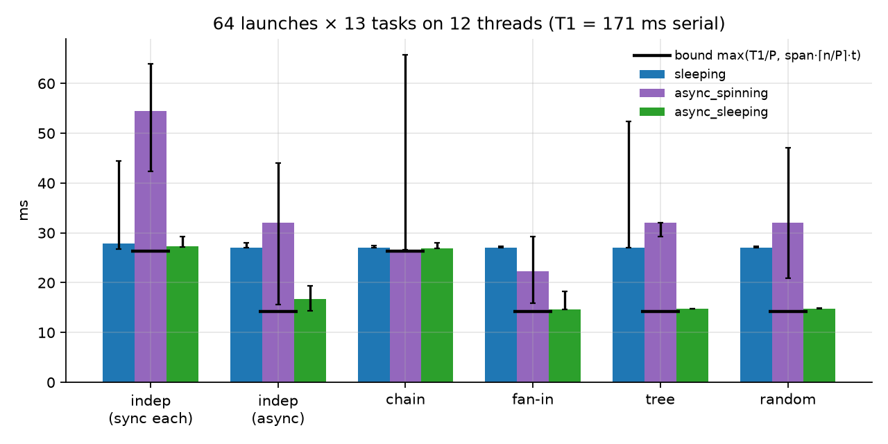

这张图是各种依赖形状下同步执行与 async 的耗时。除了链以外，async 的柱子都降到了接近下界的高度：只要依赖图的 span 远小于 launch 总数，async 就能逼近 work 下界。

### false sharing 与分发计数器（`false_sharing.jsonl`、`dispatch.jsonl`）

多个线程各自更新不同的变量，但这些变量恰好落在同一个 cache line 上，每次写都会让这一行在核之间来回迁移，这就是 false sharing。
分发计数器（所有 worker 用来领下一个任务编号的那个原子变量）则是真共享，同样是一个所有核都在抢的 cache line。

| 线程数 | atomic，同一行 ns/次 | atomic，各占一行 ns/次 | 分发：mutex ns/项 | atomic `fetch_add` | 每次取 64 个 | 静态划分 |
| ---: | ---: | ---: | ---: | ---: | ---: | ---: |
| 1 | 4.62 | 4.63 | 13.7 | 4.63 | 0.789 | 0.52 |
| 2 | 25.0 | 4.63 | 58.5 | 13.7 | 0.80 | 0.267 |
| 12 | **113** | 5.89 | 93.5 | 15.0 | 0.683 | 0.124 |

两种布局跑同一份代码，只有步长不同（8 B 对 64 B），12 线程时同一行比各占一行慢 19 倍。

这个结论我第一次没测出来。第一版微基准的两种布局用了不同的数据结构，单线程就差 6.7 倍，把 false sharing 完全掩盖了。
原始数据保留在 `false_sharing_v1_confounded.jsonl`，作为「对照组没控制好」的反例。

单个原子计数器约 15 ns/次，与线程数无关，相当于一次 cache line 迁移，是一个全局串行点。
所以当每项只有约 30 ns 工作时，原子计数器在 12 线程只能做到 45.5 ns/项；按 64 个一块取任务，把领任务的次数减少到原来的 1/64，就降到 4.26 ns/项。

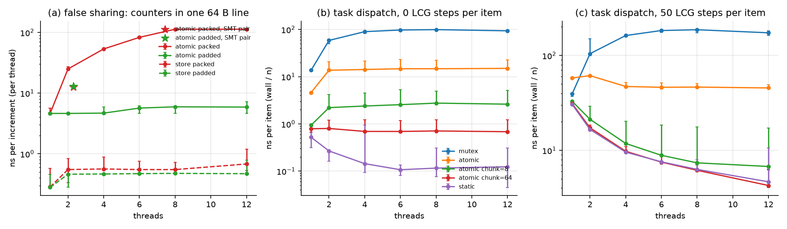

第一幅是 false sharing：同一行的曲线随线程数陡升，各占一行几乎是平的。后两幅是不同分发方式的每项成本，分别对应每项没有工作和有少量工作两种情况：
一次领一块、或者干脆静态划分，都比每项抢一次计数器便宜得多。

### 未解问题：mandelbrot 上睡眠类实现扩展差（`scripts/plot_anomaly.py`）

这是一个我没有完全解开的问题，记录排查到哪一步。服务器上 2–8 线程时，睡眠池、spawn 与 async 睡眠池在 mandelbrot_chunked 上只有 1.5–2.9×，
自旋池有 1.9–6.3×，3 轮都复现。容器内没有 perf/turbostat，只能用现有数据加一组本机对照缩小范围：

- 1 个 worker 时就慢。睡眠池 377 ms，自旋池 333 ms（等于串行）。4 次 launch 的唤醒开销只有几十 µs，1 个 worker 也谈不上负载不均，所以这两个解释都可以排除。
- 慢在执行，不在等待。睡眠池 1 线程的进程 CPU 时间也是 377 ms，说明 worker 一直在跑，只是同样的指令多花了 13% CPU。8 线程时睡眠类的 CPU 秒 / 串行秒为 1.60–1.63，自旋池为 1.25。
- 不是实现缺陷。本机 4 核（worker 绑在逻辑 CPU 2、4、6、0）上，四种常驻池在 1–4 线程相差不到 5%：4 线程睡眠池 3.57×、自旋池 3.50×，睡眠类 CPU 秒 / 串行秒为 0.98–1.01。
  本机唯一的系统性慢化在 CPU 0：任何实现把单个 worker 绑在 CPU 0 上都慢 11–13%。

目前的判断是：服务器上「有线程在自旋时 worker 跑得快，全部睡下后每条指令更贵」，和 A1 的「冷核」是同一类宿主机现象。
候选原因是频率或空闲状态管理，或者 SMT 兄弟核被其他租户占用，需要 turbostat 才能区分。

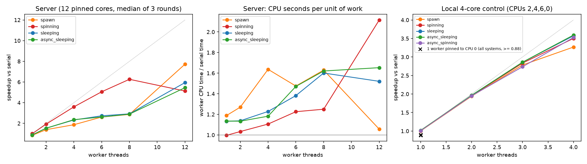

三幅图依次是服务器上的加速比、服务器上每单位工作的 CPU 时间、本机 4 核对照的加速比。
服务器上睡眠类和自旋类之间的缺口在前两幅里都很明显，本机上两者几乎重合，所以问题出在宿主机，而不在代码。

## 面试讲法（C++ 版）

**20 秒结论**：任务系统有三笔开销：
- 让线程开始干活：spawn 约 16 µs/线程，睡眠池约 10 µs，自旋池不到 1 µs。
- 每个任务的分发：分发计数器是一个所有核都在抢的 cache line，最少约 15 ns，CAS 冲突时可到 500 ns。
- 等待时的 CPU：自旋会烧满所有核。

在 12 核上实测，常驻池把每次 launch 从 200 µs 降到 1–13 µs。自旋只在线程数少于空闲核数时划算：留一个核给调用者能快 1.7 倍，超额订阅时加锁会慢 766 倍。
async 依赖图让独立的 launch 互相填满尾部，树形归约达到 work 下界的 96%。

**不能推出的结论**：
- 不能推出「自旋池在独占机器上比睡眠池慢」：12 线程时自旋池偏慢，主要来自调用者占核，以及共享服务器上其他租户的进程。
- 不能推出「睡眠池在 mandelbrot 上不扩展」：2–8 线程时只有 1.5–2.9×，3 轮都复现，但本机对照中睡眠池与自旋池扩展相同；已排除唤醒开销、负载不均和实现缺陷，剩余候选需要 turbostat 区分。
- 测试是按官方结构重写、并缩放过规模的，绝对时间不能和官方参考解比。

## 文件

```text
asst2-task-scheduler/
├── cpp/
│   ├── common/common.h        # 计时、进程 CPU 时间、绑核、参数、JSON 行（源自 asst1）
│   └── tasksys/
│       ├── tasksys.h          # IRunnable / ITaskSystem + 6 个系统
│       ├── tests.h            # 20 个官方测试（带结果校验）
│       ├── main.cpp           # tasksys_bench：tests / overhead / granularity / dag / idle
│       └── contention.cpp     # false sharing 与分发计数器微基准
├── scripts/
│   ├── build_cpp.py  run_cpp_experiments.py  plot_cpp.py  summarize_cpp.py  plot_anomaly.py
│   └── run_experiments.py     # Python 版实验
├── tests/test_cpp.py          # 22 个 C++ 测试（无 g++ 时 skip）
├── tests/test_tasksys.py      # 65 个 Python 测试
├── code/tasksys/              # Python 版
└── artifacts/
    ├── raw/cpp/server12c{,_r2,_r3}/*.jsonl, meta.json, summary_server12c.md, pytest_server_final.txt
    ├── raw/cpp/local4c/scaling_mandel*.jsonl  # 本机对照
    ├── raw/*.csv              # Python 版
    └── figures/cpp_*.png|pdf  # 12 张 C++ 图；另有 4 张 Python 图
```

---

## 附录：Python threading 版（原内容）

以下是本目录最初的 Python 实现与结论。它适合验证调度算法本身是否正确、尾部效应是否存在；但凡是和等待策略或硬件有关的结论，都被 GIL 改写了。
把它和上面的 C++ 版对照着读，能看清哪些结论属于算法，哪些属于运行时。

## CS149 Asst2 复刻：多核上的任务系统与任务图调度（Python threading 版）

对应 CS149 Fall 2024 Assignment 2「Scheduling Task Graphs on a Multi-Core CPU」。官方 starter 是 C++
（`std::thread`、`mutex`、`condition_variable`），当时离线拿不到。我在 Python 里用 `threading` 重写了同一套 API 和四种实现，
并测量 CPython 的 GIL 把结论改成了什么样。

机器是 8 逻辑处理器的 Windows Server（WMI 报告 4 核 × 2 超线程，虚拟机拓扑），Python 3.12、numpy 2.5，
`sys.getswitchinterval()` = 0.005 s（GIL 的切换间隔）。测量时机器上还有其他任务，墙钟只看相对大小。

### 一句话结论

线程池的睡眠版（条件变量）在每个维度上都不差：8 个空任务每次 launch 38.7 µs，空闲时 0 CPU。
每次 launch 都新建线程要 3169 µs。纯自旋版在 CPython 里每次 launch 要 31–50 ms，因为自旋线程要等 5 ms 的 GIL 切换间隔才让出解释器，空闲时还持续烧 1 个核。

任务体只有在释放 GIL 时才能并行：numpy ufunc 8 线程 5.78×，`sleep` 6.89×，纯 Python 循环 8 线程只有 0.92×。
async 依赖图在这里同样有效，它让独立 launch 互相填满尾部空闲，48 个 9 任务的 launch 从 259 ms 降到 152 ms。

### 对应官方作业

| 官方部分 | 本目录实现 | 因 CPU/Python 而不同之处 |
| --- | --- | --- |
| Part A：`TaskSystemSerial` | `systems.py::TaskSystemSerial` | — |
| Part A：`ParallelSpawn`（每次 `run` 建线程） | `TaskSystemParallelSpawn`，共享计数器动态取任务 | 建线程走 Python `threading.Thread`，比 C++ `std::thread` 贵 |
| Part A：`ThreadPoolSpinning` | `TaskSystemParallelThreadPoolSpinning`；另加 `yield_in_spin=True` 变体（`time.sleep(0)`） | C++ 自旋只浪费核；CPython 自旋还抢 GIL，阻塞干活的线程 |
| Part A：`ThreadPoolSleeping` | `TaskSystemParallelThreadPoolSleeping`，一把锁 + 两个条件变量 | — |
| Part B：`runAsyncWithDeps` / `sync` | 睡眠池上完整实现：依赖计数、ready 队列、多个 launch 交错执行；其余系统按官方 Part A 做法退化为同步 `run` | 任务体只有在 numpy/`sleep` 释放 GIL 时才真正并行 |
| 官方测试（`super_super_light`、`recursive_fibonacci`、`math_operations_in_tight_for_loop` 等） | `tests/`：随机 DAG 顺序、无丢任务、`sync`、2 万微任务压力、500 launch 异步压力、异常传播，全部带超时防死锁 | 用 Python 工作负载代替 C++ 工作负载 |
| false sharing（课程模块 04） | **未做** | Python 对象不在可控 cache line 上，测不出可信的 false sharing，不伪造 |

### 怎么跑

```powershell
cd solutions/cs149/asst2-task-scheduler
python -m pytest -q tests          # 65 passed，约 20 s（纯自旋版拖慢）
python scripts/run_experiments.py  # 约 35 s，写 artifacts/raw/*.csv 与 artifacts/figures/*.png
```

### 结果

#### launch 开销（`artifacts/raw/launch_overhead.csv`，空任务，8 线程）

| 系统 | 1 任务 µs/launch | 8 任务 µs/launch | 64 任务 µs/launch | 512 任务 µs/launch | 512 任务 µs/task |
| --- | ---: | ---: | ---: | ---: | ---: |
| serial | 0.31 | 0.56 | 2.61 | 21.79 | 0.043 |
| spawn | 376.02 | 3168.69 | 3262.59 | 3368.43 | 6.579 |
| spinning | 50220.03 | 31311.92 | 48930.16 | 36636.52 | 71.556 |
| spinning_yield | 46.53 | 52.05 | 84.18 | 339.69 | 0.663 |
| sleeping | 33.62 | 38.7 | 87.26 | 445.36 | 0.87 |

spawn 1 任务时只建 1 个线程（376 µs），8 任务以上建 8 个（约 3.2 ms），每个线程约 0.4 ms。

纯 spinning 每次 launch 要 31–50 ms。主线程和 8 个工作线程都在 Python 字节码里空转，而 GIL 每次易手都要等切换间隔（5 ms）。
同一个设计在 C++ 里反而是最快的，这是两种运行时差别最大的地方。

自旋时用 `sleep(0)` 主动让出 GIL 后，自旋池和睡眠池回到同一量级。512 个任务时自旋略快（340 对 445 µs），因为它省掉了条件变量的唤醒。

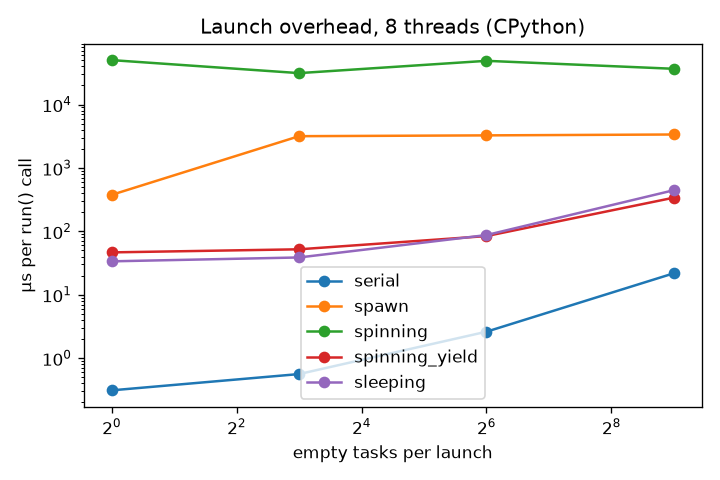

图中纯 spinning 那条线比其他系统高出一个数量级以上，这是 GIL 切换间隔造成的；去掉它之后，剩下几条线的排序和 C++ 版类似。

#### 吞吐：谁能绕开 GIL（`artifacts/raw/throughput.csv`，每 launch 128 任务，单任务约 1 ms）

| 任务类型 | 1 线程 | 2 | 4 | 8 | 16 | spawn 8 | spinning_yield 8 |
| --- | ---: | ---: | ---: | ---: | ---: | ---: | ---: |
| numpy ufunc（32k float64，sin/sqrt） | 0.979 | 1.8 | 3.342 | 5.776 | 5.722 | 4.992 | 5.723 |
| 纯 Python 循环 | 0.996 | 0.941 | 0.91 | 0.923 | 0.968 | 0.952 | 0.964 |
| `time.sleep(1 ms)` | 0.964 | 1.86 | 3.591 | 6.892 | 13.536 | 6.62 | 6.96 |

表中数字为相对 serial 的加速比（除最后两列外都是睡眠池）。

numpy 在 8 个逻辑处理器上停在 5.8×，16 线程不再涨，说明已经吃满 CPU。
纯 Python 循环多线程反而略慢（0.91–0.97×）：GIL 把执行串行化了，还要额外付线程切换的代价。
`sleep` 不占 CPU，16 线程达到 13.5×，超过了核数。它对应 I/O 型任务，这类任务的线程数可以大于核数。

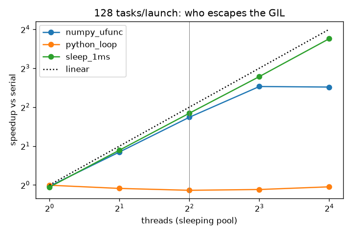

三条线分成了三种命运：sleep 随线程数一路上涨，numpy 在核数处封顶，纯 Python 循环贴着 1 不动。差别只在于任务体执行时是否释放 GIL。

#### 没活干时烧多少 CPU（`artifacts/raw/cpu_burn.csv`，`time.process_time`/墙钟）

| 系统 | 池空闲 1 s：核数 | 任务都阻塞在 sleep(20 ms)：核数 | 后者墙钟 s |
| --- | ---: | ---: | ---: |
| serial | 0.0 | 0.0 | 1.647 |
| spawn | 0.0 | 0.128 | 0.243 |
| spinning | 1.006 | 0.999 | 1.908 |
| spinning_yield | 1.92 | 0.973 | 0.209 |
| sleeping | 0.0 | 0.0 | 0.21 |

纯自旋只烧 1.0 个核而不是 8 个，因为 GIL 同一时刻只让一个线程跑字节码；C++ 版会烧满 8 个核。
加了 `sleep(0)` 反而烧 1.92 个核：让出 GIL 后，多个线程同时在内核里做 yield，自旋不再被 GIL 串行化。

纯自旋还让 10 次 sleep 任务的 launch 用了 1.908 s，睡眠池只要 0.21 s。原因是从 sleep 醒来的工作线程抢不到 GIL，这是 CPython 特有的放大效应。

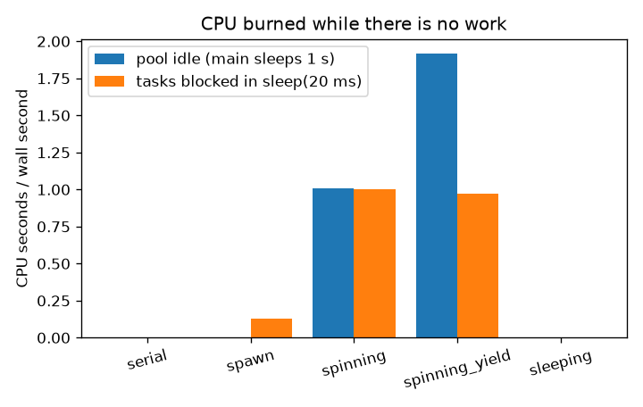

每个系统两根柱子，分别是池空闲和任务阻塞时占用的核数。明显高出来的只有自旋类，而且被 GIL 限制在 1–2 个核左右。

#### 异步依赖图的收益（`artifacts/raw/async_overlap.csv`，48 个 launch × 9 任务，8 线程）

| 任务 | 每次同步 `run` | `runAsyncWithDeps` 无依赖 + 一次 `sync` | 链式依赖 |
| --- | ---: | ---: | ---: |
| `sleep(2 ms)` | 0.2591 s | 0.1515 s | 0.2524 s |
| numpy ufunc | 0.1231 s | 0.0748 s | 0.1179 s |

9 个任务、8 个线程，同步 `run` 时每个 launch 要 2 轮，最后一轮只有 1 个线程干活。异步时下一个 launch 的任务填进这些空闲线程，
理想比值为 2 / (9/8) = 1.78，实测 sleep 1.71×、numpy 1.65×。链式依赖没有可交错的 launch，退化回同步，符合预期。

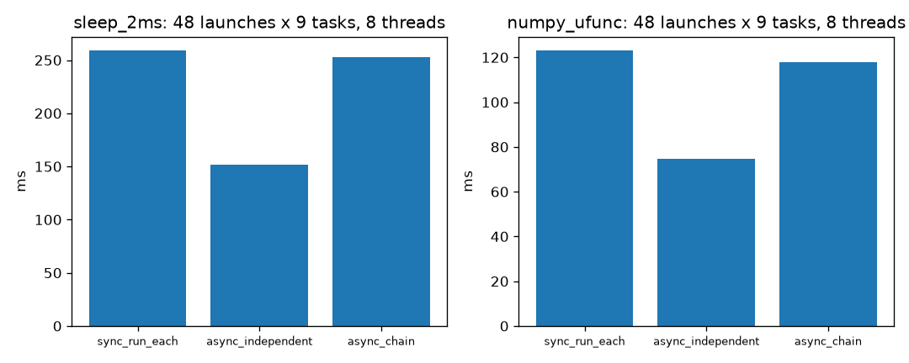

两种任务的三根柱子形状一样：只有无依赖的 async 明显变矮，链式依赖和同步几乎等高。这个结论和 C++ 版一致，因为它属于调度算法，和 GIL 无关。

### 面试讲法

**20 秒结论**：任务系统有三个开销：建线程（每个约 0.4 ms）、分发任务（锁 + 计数器）、等待（自旋还是睡眠）。
持久线程池摊掉了建线程的开销。睡眠池用条件变量，空闲时 0 CPU。自旋只在等待极短、且独占核时才划算。
async + 依赖图让独立的 bulk launch 互相填满尾部空闲。在 CPython 里还要再加一条：只有释放 GIL 的任务才能并行，
自旋会把 GIL 抢走。

**白板**：
- 睡眠池 worker：`lock; while ready 为空且未 stop: work_cv.wait(); 从 ready 队首 launch 取 next++; unlock; run_task; lock; done++; 若 done==total: 给每个依赖它的 launch 的 pending_deps 减 1，减到 0 就入 ready，notify_all; 若没有未完成 launch: done_cv.notify_all()`。
- 依赖：launch 记 `pending_deps` 和 `dependents`；已完成的依赖在提交时直接忽略。
- 尾部效应：n 个任务、P 个线程、单任务时间 t，同步 launch 时间 ⌈n/P⌉·t；把 K 个独立 launch 合起来是 ⌈Kn/P⌉·t。

**不能推出的结论**：
- 不能推出「自旋池在 C++ 里也慢」。31–50 ms 的开销来自 GIL 切换间隔，C++ 自旋池通常是 launch 开销最低的。
- 不能推出「Python 线程没用」。numpy 和 I/O 型任务在本机可达 5.8× / 13.5×。
- 不能推出 false sharing 的任何结论，本实验没测。
- numpy 停在 5.8× 不能直接归因于 8 个逻辑处理器中只有 4 个物理核：测量时机器上还有其他任务。

**追问**：
1. 为什么条件变量要在 `while` 里 wait？为了防虚假唤醒；而且被唤醒时，ready 队列可能已经被别的线程取空了。
2. 一次取一个任务的锁竞争太大怎么办？每次取一块（chunk），或者每线程一个本地队列再加 work stealing。
   本实现 512 个空任务每个约 0.87 µs，主要是锁和 Python 调度开销。
3. `sync` 和 `runAsyncWithDeps` 并发调用安全吗？安全，提交和完成都在同一把锁里改 `_unfinished`、`_launches`。
   `sync` 等的是「所有已提交的 launch 完成」，不是「某个 launch 完成」。

### 文件

```text
asst2-task-scheduler/
├── code/tasksys/
│   ├── systems.py     # Serial / Spawn / Spinning(+yield) / Sleeping(async + deps)
│   └── workloads.py   # Noop / Counting / Numpy / PythonLoop / Sleep runnables
├── tests/test_tasksys.py   # 65 个测试，均带超时
├── scripts/run_experiments.py
└── artifacts/
    ├── raw/       # launch_overhead / throughput / cpu_burn / async_overlap .csv
    └── figures/   # launch_overhead / throughput / cpu_burn / async_overlap .png
```
