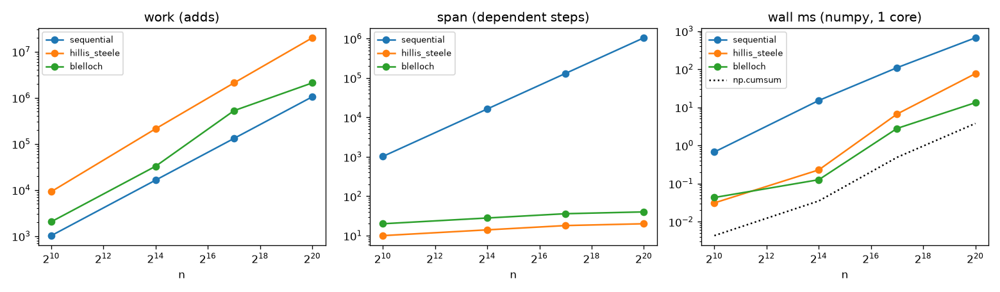
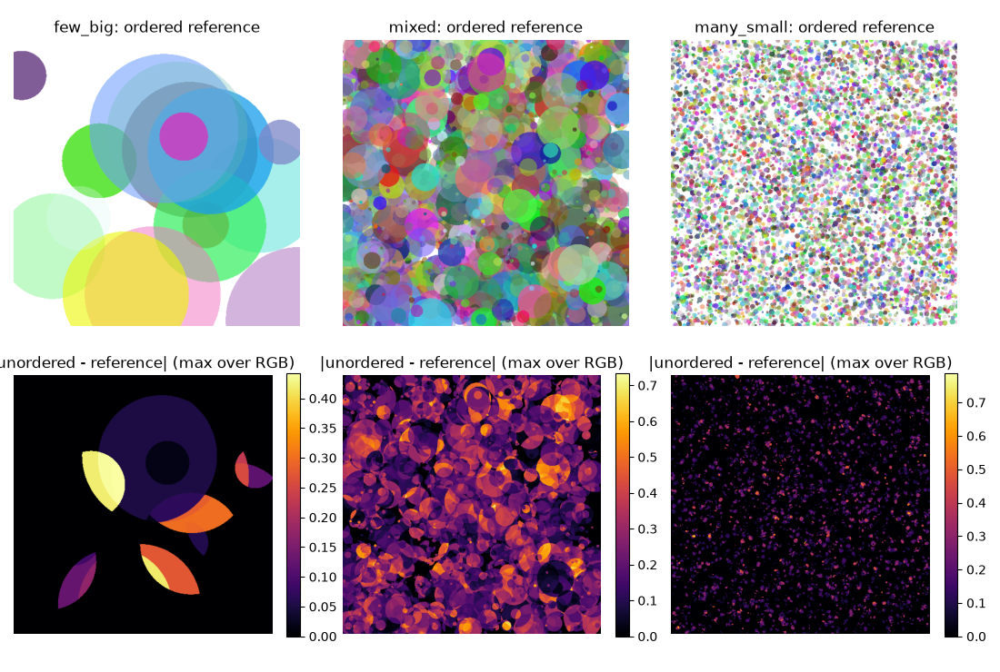
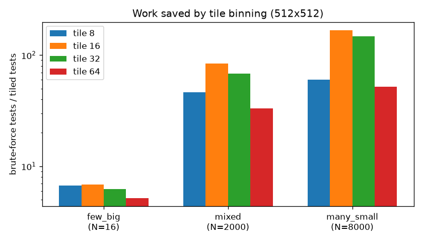
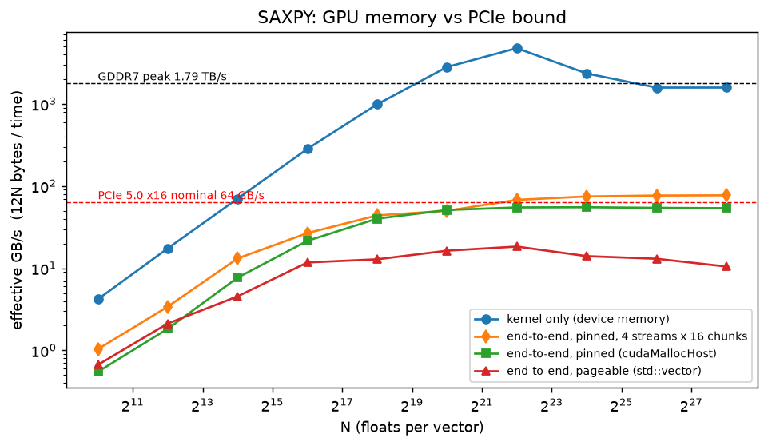
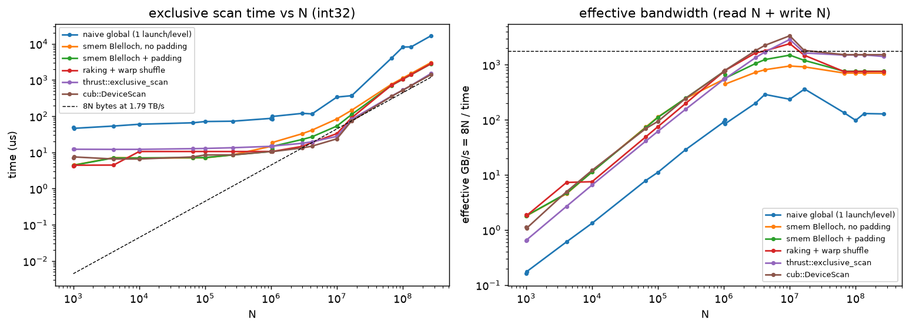
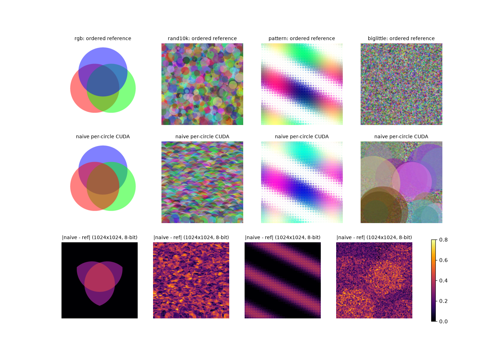
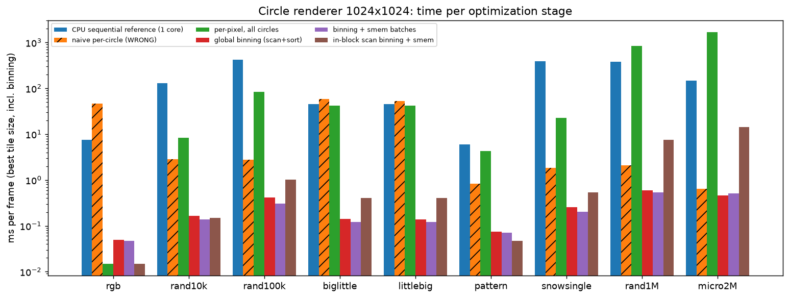
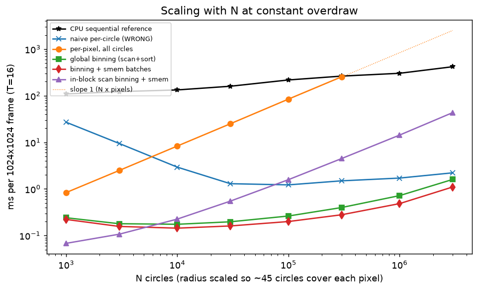

# CS149 Asst3 复刻：scan、find_repeats 与有序圆渲染器（numpy 模型 + CUDA 实测）

这个实验围绕两个问题。第一，scan（前缀和：输出的第 i 个元素是输入前 i 个元素之和）看起来天生是串行的，怎样把它并行化，又要付出多少额外的工作？
第二，渲染一堆半透明的圆时，同一个像素必须按圆的输入顺序混合颜色，怎样在大规模并行的同时保住这个顺序？
最重要的发现是：顺序不是细节。按圆并行、不保序时，2000 个圆的场景里 93% 的像素是错的；而把屏幕切成 tile、用 scan 给每个 tile 压出一个有序的圆列表，
就能做到既按像素并行、又和顺序参考逐位相等。scan 正是把「并行」和「有序」接在一起的那个原语。

对应 CS149 Fall 2024 Assignment 3「A Simple Renderer in CUDA」。官方 starter 是 CUDA，当时离线拿不到，所以我先用 numpy 把作业的核心思想重写了一遍：
每条向量化语句当作一次 kernel launch / 一次 barrier，用计数器记录 work（总共做了多少次加法）和 span（相互依赖、必须先后执行的步数）。
numpy 部分的墙钟时间是单核 numpy 的时间，不代表 CUDA 上的结论；但 work、span、测试次数和像素误差与硬件无关，可以直接拿来讲。

GPU 部分（[`gpu/`](gpu/)，CUDA C++，RTX 5090 实测）见下文「GPU 部分」一节，
完整分析见报告 [cs149_asst3_report.pdf](../../../reports/cs149-asst3/cs149_asst3_report.pdf)。

机器是 4 物理核 / 8 逻辑核的 Windows Server（超线程），Python 3.12、numpy 2.5；测量时机器上有其他任务并行，墙钟只看相对大小。

## 一句话结论

scan 的两种并行写法代价不同。Blelloch scan 的 work 恒为 2(m−1)（m 为补齐后的 2 的幂），Hillis–Steele 是 n·log n 量级。
n=2^20 时，两者的加法次数是 2.10M 对 19.9M，单核 numpy 上是 13.2 ms 对 76.5 ms。

圆渲染器必须保序。若按圆并行、不保序，2000 个圆的场景 93% 像素出错。按 tile 分桶、再用 scan 保序压缩后，结果与顺序参考**逐位相等**（误差 0.0）；
8000 个小圆时，它比「每个像素测试所有圆」少做 167 倍测试。

RTX 5090 上，saxpy kernel 达到 1578 GB/s，但算上 PCIe 端到端只剩 53.8 GB/s。scan 2²⁸ 从朴素实现的 16.75 ms 降到自写的 2.82 ms，cub 是 1.41 ms。
rand1M 场景上，「每像素遍历所有圆」的正确版本要 844 ms；分桶后测试次数少 1640 倍，只要 0.538 ms（渲染器关闭 FMA 编译，与 CPU 参考逐位一致）。

## 对应官方作业

| 官方部分 | 本目录实现 | 因 CPU/Python 而不同之处 |
| --- | --- | --- |
| Part 1 saxpy（CUDA 带宽） | numpy 版不做；GPU 版 `gpu/saxpy.cu`（kernel / pinned / pageable / 4-stream） | numpy 版没有 PCIe 拷贝和显存带宽可测 |
| Part 2 `exclusive_scan` | `scan.py`：顺序、Hillis–Steele、Blelloch up-sweep/down-sweep，2 的幂补齐，每层一次跨步更新 | 每层是一条 numpy 跨步切片语句而不是一次 kernel launch；没有 shared memory / bank conflict |
| Part 2 `find_repeats` | `primitives.py`：flags → exclusive scan → scatter；另有 stream compaction、segmented scan | 同上；输出与 `np.nonzero` 对拍 |
| Part 3 circle renderer | `renderer.py`：顺序参考、按圆并行（乱序模拟）、tile 分桶 + scan 压缩 | 「并行」只在算法结构上体现（tile 之间独立），实际单线程执行；不做 CUDA 性能优化 |

## 怎么跑

```powershell
cd solutions/cs149/asst3-scan-render
python -m pytest -q tests          # 本地无 GPU：94 passed, 1 skipped；RTX 5090 上：95 passed
python scripts/run_experiments.py  # 约 15 s，写 artifacts/raw/*.csv 与 artifacts/figures/*.png
python scripts/plot_gpu.py         # 由 artifacts/raw/gpu/*.jsonl 画 15 张 gpu_*.png/pdf
```

GPU 部分（Linux + CUDA 12.8，sm_120）：

```bash
bash gpu/build.sh                  # nvcc -O3 -arch=sm_120；render 额外 -fmad=false 以与 CPU 参考逐位一致
bash gpu/run_gpu.sh all            # 约 2 分钟，写 artifacts/raw/gpu/*.jsonl 与 images/
```

## 结果

### scan：work 与 span（`artifacts/raw/scan_work_span.csv`）

并行 scan 有两种经典写法。Hillis–Steele 每一步让每个元素加上左边距离 2^k 的元素，步数少，但每步几乎所有元素都在做加法。
Blelloch 先自底向上建一棵求和树（up-sweep），再自顶向下把前缀和分发下去（down-sweep），总加法次数和串行同一量级，代价是步数翻倍。
这一节用计数器数出两者的 work 和 span，看在什么条件下谁更好。

经验计数与解析公式在测试里逐一相等（`test_empirical_work_span_equals_analytic`）。
`brent_T_P` = ⌈work/P⌉ + span，是 P 个处理器上的 Brent 上界：前一项是把工作平分给 P 个处理器的时间，后一项是无论多少处理器都省不掉的依赖步数。

| n | 算法 | 补齐 | adds | steps | adds/n | Brent P=8 | Brent P=2048 | numpy ms |
| ---: | --- | ---: | ---: | ---: | ---: | ---: | ---: | ---: |
| 1000 | Hillis–Steele | 1000 | 8977 | 10 | 8.98 | 1133 | 15 | 0.032 |
| 1000 | Blelloch | 1024 | 2046 | 20 | 2.05 | 276 | 21 | 0.053 |
| 131073 | Hillis–Steele | 131073 | 2097171 | 18 | 16.0 | 262165 | 1043 | 6.671 |
| 131073 | Blelloch | 262144 | 524286 | 36 | 4.0 | 65572 | 292 | 2.795 |
| 1048576 | 顺序 | 1048576 | 1048575 | 1048575 | 1.0 | — | — | 665.971 |
| 1048576 | Hillis–Steele | 1048576 | 19922945 | 20 | 19.0 | 2490389 | 9749 | 76.499 |
| 1048576 | Blelloch | 1048576 | 2097150 | 40 | 2.0 | 262184 | 1064 | 13.238 |

几个值得看的点：

- 补齐有代价。n=131073（2^17+1）要补齐到 262144，Blelloch 的 adds/n 从 2 变成 4。
- 处理器比数据还多时，span 说了算。n=1000、P=2048 时，Hillis–Steele 的 Brent 上界 15 低于 Blelloch 的 21，步数少的算法赢；n 大时 work 主导，Blelloch 赢。
- 单核墙钟里，n=1000 时 Hillis–Steele（0.032 ms）反而快于 Blelloch（0.053 ms）。这里 numpy 每层语句的固定开销占主导，而 Blelloch 的层数多一倍。
  n=2^20 时 Blelloch 快 5.8 倍，和加法次数之比 9.5 同向。
- 所有手写 scan 都远慢于 `np.cumsum`（n=2^20 时 3.776 ms），因为 numpy 的 cumsum 是一个 C 循环。手写版本的价值在于结构，不在于速度。



三幅图分别是 work、span 和单核墙钟随 n 的变化。work 图里 Hillis–Steele 的斜率更陡，因为它多了一个 log n 因子；span 图里则是 Blelloch 高出一截。
墙钟图更接近 work 图，说明在只有一个核的情况下，决定快慢的是总工作量。

### 基于 scan 的原语（`artifacts/raw/primitives.csv`，n=2^20）

有了 exclusive scan，很多「按条件挑出元素」的操作都可以并行化：先给每个元素打一个 0/1 标记，对标记做 exclusive scan，
得到的值就是每个被选中元素在输出里的位置，最后按位置写出去（scatter）。find_repeats 和 stream compaction 都是这个套路。

| 原语 | 输出长度 | 正确 | scan 实现 ms | numpy 内置 ms |
| --- | ---: | --- | ---: | ---: |
| find_repeats | 10516 | True | 22.329 | 1.236 |
| stream_compact(v>1) | 165711 | True | 26.696 | 4.589 |
| segmented_exclusive_scan | 1048576 | True | 167.578 | 4.251（`np.cumsum`，非分段） |

segmented scan（每一段各自从零开始求前缀和）用 Hillis–Steele 结构加 (flag, value) 结合律算子实现，work 是 O(n log n)，所以最慢。

### 圆渲染器：顺序为什么重要（`artifacts/raw/render_unordered_error.csv`）

渲染器要按输入顺序把一个个半透明的圆叠到画布上。半透明混合不满足交换律，先画红再画蓝和先画蓝再画红结果不同。
最直接的并行方式是「每个线程负责一个圆，像素用原子操作更新」，但这样就没法保证同一个像素上的圆按顺序混合。
这里用随机打乱圆的顺序来模拟这种乱序（3 个种子），在 512×512 的画布上看会错多少：

| 场景 | 圆数 | 最大绝对误差（3 种子） | 误差 > 0.01 的像素比例 |
| --- | ---: | --- | --- |
| few_big | 16 | 0.4423 / 0.6287 / 0.6439 | 0.2695 / 0.2859 / 0.3527 |
| mixed | 2000 | 0.7339 / 0.7341 / 0.7534 | 0.9246 / 0.9267 / 0.9315 |
| many_small | 8000 | 0.7875 / 0.6956 / 0.7361 | 0.1861 / 0.1861 / 0.1892 |

出错的像素一定被至少两个圆覆盖，而且这些圆的相对顺序被打乱了。所以错多少取决于重叠有多少：mixed 里大圆多、重叠多，九成以上的像素都错；many_small 的圆小、重叠少，错得也少。



上排是按顺序渲染的参考图，下排是乱序结果与参考的差。亮的地方正好是圆与圆重叠的区域，单个圆独占的区域完全没有误差。

### tile 分桶省了多少测试（`artifacts/raw/render_tests.csv`，512×512）

保序的做法是改成按像素并行：每个像素自己按顺序遍历所有圆，顺序自然就对了。问题是这样每个像素都要测一遍所有圆（brute force），工作量是圆数 × 像素数。
tile 分桶先把画布切成小方块，用包围盒判断每个圆碰到哪些 tile，再用 scan 给每个 tile 压出一个按圆编号排好的列表，像素只需遍历自己 tile 的列表。

计数口径：tiled 总测试 = 包围盒测试（圆数 × tile 数）+ 圆-像素测试（每个 tile 的圆列表长度 × tile 像素数）；
brute force = 圆数 × 像素数。所有配置的 `max_abs_err_vs_ref` 都是 0.0。

| 场景 | tile | 每 tile 平均圆数 | brute force | 包围盒测试 | 像素测试 | brute / tiled | 参考 s | tiled s |
| --- | ---: | ---: | ---: | ---: | ---: | ---: | ---: | ---: |
| few_big (16) | 8 | 2.122 | 4194304 | 65536 | 556352 | 6.74 | 0.04 | 0.382 |
| few_big (16) | 64 | 3.078 | 4194304 | 1024 | 806912 | 5.19 | 0.04 | 0.034 |
| mixed (2000) | 16 | 16.001 | 524288000 | 2048000 | 4194560 | 83.99 | 0.215 | 0.503 |
| many_small (8000) | 8 | 7.32 | 2097152000 | 32768000 | 1918848 | 60.46 | 0.358 | 1.073 |
| many_small (8000) | 16 | 16.608 | 2097152000 | 8192000 | 4353792 | 167.16 | 0.358 | 0.463 |
| many_small (8000) | 64 | 151.5 | 2097152000 | 512000 | 39714816 | 52.13 | 0.358 | 0.424 |

tile 的大小是一个两头都有代价的选择。tile 太小，包围盒测试（圆数 × tile 数）会爆炸：many_small 在 tile=8 时有 32.8M 次包围盒测试，是像素测试的 17 倍。
tile 太大，每个 tile 的列表变长，像素测试变多。many_small 和 mixed 都在 tile=16 达到最优。

few_big 只省了 5–7 倍：大圆本来就覆盖大量像素，这些测试是剔除不掉的。

还要说清楚比较对象。顺序参考（逐圆只遍历自己包围盒内的像素）的像素测试更少（many_small 603230 次），单线程墙钟也更快。
tile 方案的意义是**能按像素并行，而且不需要锁或原子操作**，代价是多做一些测试，所以在 CPU 单线程上它本来就不该更快。



纵轴是 brute force 与 tiled 的测试次数之比（对数坐标）。圆越多越小，分桶省得越多；同一个场景里，柱子随 tile 大小先升后降，最高点就是上面说的最优 tile。

## GPU 部分（RTX 5090，CUDA 12.8）

上面的 numpy 模型只能数操作次数。这一部分在真实 GPU 上回答：同样的算法，访存遍数、kernel launch 次数和 shared memory 各自占多大分量。

环境是 RTX 5090（170 SM，96 MB L2，GDDR7 标称 1.79 TB/s，PCIe 5.0 x16），nvcc 12.8 `-O3 -arch=sm_120`。
所有 GPU 运行都独占 GPU 锁；每个点为 5–50 次重复的中位数。`ncu` 在容器里报 `ERR_NVGPUCTRPERM`（见 `artifacts/raw/gpu/ncu_attempt.txt`），
因此改用 `cudaFuncGetAttributes` 和占用率 API 记录寄存器数与理论 occupancy（`*_attrs.jsonl`）。

### Part 1：SAXPY（`artifacts/raw/gpu/saxpy.jsonl`）

| N | kernel GB/s | pinned 端到端 GB/s | pageable 端到端 GB/s | 4-stream 端到端 GB/s | kernel 占端到端 |
| ---: | ---: | ---: | ---: | ---: | ---: |
| 2^20 | 2809（L2 内） | 51.1 | 16.4 | 50.0 | 1.8% |
| 2^24 | 2342 | 55.2 | 14.0 | 74.6 | 2.4% |
| 2^28 | 1578（88% 峰值） | 53.8 | 10.5 | 77.1 | 3.4% |

kernel 本身受显存带宽限制，端到端则受 PCIe 限制：2^28 时 H2D 56.5 GB/s、D2H 54.1 GB/s，kernel 只占端到端时间的几个百分点。
pageable 内存（普通 malloc 出来、可能被换页的内存）要先经过 CPU 拷到一块固定的 staging 缓冲区，所以只有 10.5 GB/s。

4-stream 版超过了单向 PCIe 带宽（77.1 GB/s），因为 PCIe 是全双工的，把数据切成几段后，一段的 H2D 可以和另一段的 D2H 同时进行。

2^20–2^24 的 kernel 带宽超过 1.79 TB/s，是因为数据留在了 L2 里，测到的是 L2 带宽，不是 GDDR7 带宽。另外，连续 launch 的间隔是 1.85 µs，launch 加同步是 5.72 µs。



kernel 的曲线和端到端的曲线之间隔着一个数量级以上的鸿沟。对 saxpy 这样每个字节只做一点点计算的任务，数据如果不是本来就在显存里，GPU 再快也被 PCIe 挡住了。

### Part 2：scan 与 find_repeats（`scan.jsonl`、`find_repeats.jsonl`）

六种实现在 19 个规模（10^3–2^28，包括 2^20+1、3000007、2^24−1、10^8）上都与 CPU 逐元素一致（mismatch 全为 0）。

| 算法 | N=1000 µs | N=2^20 µs | N=2^28 ms | 2^28 有效 GB/s（8N/t） | 实际流量 | launch 数（2^28） |
| --- | ---: | ---: | ---: | ---: | --- | ---: |
| naive global（starter 结构） | 49.55 | 83.34 | 16.75 | 128 | ≈84N（跨步浪费 sector） | 56 |
| smem Blelloch，无 padding | 4.45 | 14.74 | 3.049 | 704 | 16N | 5 |
| smem Blelloch + padding | 4.43 | 12.54 | 2.817 | 762 | 16N | 5 |
| raking + warp shuffle | 4.19 | 10.62 | 2.839 | 756 | 16N | 5 |
| thrust::exclusive_scan | 12.32 | 14.96 | 1.522 | 1411 | 8N | — |
| cub::DeviceScan | 6.98 | 10.59 | 1.412 | 1521 | 8N | — |

大 N 时，快慢取决于数据在显存里走了几遍。smem 和 raking 版本按实际的 16N 流量折算是 1.52 TB/s，和 cub 按 8N 流量折算的值相同，
也就是说三者都已经跑满了显存带宽。cub 快一倍，是因为它用 decoupled look-back（每个块向前面的块查询已算好的前缀，不必等全局同步）只读写一遍数据。

小 N 时，时间由 launch 次数决定：naive 在 N=1000 时有 20 次 launch，每次约 2 µs。

非 2 的幂只对 naive 有影响：10^8 补齐到 2^27，每元素时间是 2^26 的 1.37 倍。
padding（在 shared memory 数组里每隔一段插一个空位，避开 bank conflict）在 2^24 时把 smem 版从 146.9 µs 降到 112.1 µs。

find_repeats（flags → scan → scatter）在 10^8 时 1.869 ms，`thrust::copy_if` 为 0.283 ms，后者快 6.6 倍。自写版的流量约 32N，已经达到 1.71 TB/s，所以它慢在遍数多，不在带宽没用满。



左图是时间，右图是按「读 N + 写 N」折算的有效带宽。小 N 时各条曲线被 launch 次数压在一个延迟地板上；N 变大后，曲线按访存遍数分层，cub 和 thrust 在最上面。

### Part 3：渲染器（`render.jsonl`、`render_sweep.jsonl`，1024×1024）

渲染器按五个阶段逐步优化：

1. naive：一个线程负责一个圆（starter 的写法，结果错误）；
2. 每个像素遍历所有圆；
3. 全局分桶：每个圆数出覆盖几个 tile，exclusive scan 得到写入位置，emit 出 (tile, 圆) 对，稳定 radix sort，再对每个 tile 的计数做 scan 得到列表起点；
4. 分桶 + shared memory 批量取圆；
5. 块内 scan 分桶：单次 launch，不生成全局列表。

四个正确阶段在 90 个（场景, 阶段, tile）组合上的最大绝对误差为 0（snow 场景为 2.98e-7，来自 `expf`）。

| 场景 | N | CPU 参考 ms | naive ms（错误像素） | 每像素全圆 ms | binned ms | binned+smem ms | blockscan ms | CPU / 最快 |
| --- | ---: | ---: | ---: | ---: | ---: | ---: | ---: | ---: |
| rgb | 3 | 7.4 | 46.518（24.3%） | 0.015 | 0.049 (T32) | 0.047 (T32) | 0.015 (T16) | 506× |
| rand10k | 10000 | 129.9 | 2.837（100%） | 8.322 | 0.165 (T16) | 0.136 (T16) | 0.150 (T32) | 952× |
| rand100k | 100000 | 422.7 | 2.782（100%） | 84.532 | 0.411 (T16) | 0.303 (T16) | 1.008 (T32) | 1393× |
| biglittle | 50020 | 45.4 | 58.206（99.7%） | 41.930 | 0.141 (T16) | 0.121 (T16) | 0.404 (T32) | 375× |
| pattern | 5120 | 6.0 | 0.838（48.5%） | 4.263 | 0.074 (T16) | 0.070 (T16) | 0.047 (T32) | 126× |
| snowsingle | 50000 | 393.3 | 1.841（96.2%） | 22.472 | 0.258 (T16) | 0.201 (T16) | 0.533 (T32) | 1957× |
| rand1M | 1000000 | 383.3 | 2.109（99.9%） | 844.282 | 0.587 (T8) | 0.538 (T16) | 7.591 (T32) | 712× |
| micro2M | 2000000 | 147.8 | 0.638（54.3%） | 1690.730 | 0.463 (T8) | 0.505 (T8) | 14.239 (T32) | 319× |

（littlebig 与 biglittle 的数字几乎相同，见报告。CPU 参考为单线程 C++。）

naive 有两种错误。rgb 的三个圆在同一个 warp 中，结果可以复现（两次运行 0 个像素不同），但顺序是错的，24.3% 的像素出错。
其余场景还叠加了读写竞争，例如 rand100k 两次运行所有像素都不同。biglittle 的 naive 图里大圆浮在最上层，因为大圆的线程循环最长，最后才写完。

每像素遍历所有圆虽然正确，但工作量是 O(NP)（N 个圆 × P 个像素），rand1M 上要 844 ms，比 CPU 还慢。分桶后测试次数减少 1640 倍，用时 0.538 ms。

shared memory 批量取圆在 T≥16 时带来 1.7–2.1 倍的提升（例如 rand1M T=32 的渲染时间从 1.772 降到 0.849 ms）。
同时寄存器数从 52 降到 34，256 线程块的理论 occupancy 从 0.67 升到 1.0。

tile 大小没有统一的最优值。圆半径约 1 像素的 micro2M 用 T=8 最快（T=32 慢 6.2 倍）；T=16 在 9 个场景中有 7 个是 binned+smem 的最优值。
blockscan 的工作量是 tile 数 × N，只在 N≲5000 时更快（见 sweep 图）。



三排依次是顺序参考、naive 一线程一圆的结果、两者之差。差值图几乎铺满了重叠区域，biglittle 那一列能直接看到大圆被画到了最上面。



每个场景下 CPU 参考和五个阶段的耗时（对数坐标）。从「每像素全圆」到分桶是最大的一跳，而且圆越多跳得越高；shared memory 是在分桶基础上的第二级收益。



固定每个像素的平均重叠程度、只改变圆数 N，把 CPU 参考和各个阶段画在一起。「每像素全圆」贴着斜率为 1 的虚线（工作量 ∝ N × 像素数）；
blockscan 的工作量也随 N 成比例增长，所以只在 N 较小（N≲5000）时领先，之后被全局分桶超过。

其余 GPU 图：`gpu_saxpy_breakdown`、`gpu_scan_latency_floor`、`gpu_scan_nonpow2`、`gpu_find_repeats`、`gpu_bandwidth_roof`、
`gpu_render_gallery`、`gpu_render_naive_error`、`gpu_render_tile_sweep`、`gpu_render_breakdown`、`gpu_render_lists`（均在 `artifacts/figures/`）。

## 面试讲法

**20 秒结论**：scan 有两种并行写法。Hillis–Steele 步数是 log n，但 work 是 n log n；Blelloch 的 work 是 2n，步数是 2 log n。
处理器比数据多时看 span，否则看 work，所以 GPU 上大数组用 Blelloch。渲染器的难点不在并行本身，而在「同一像素必须按输入顺序混合」：
按圆并行会错，按像素或 tile 并行才自然保序。做法是先用包围盒和 scan 给每个 tile 压出一个有序的圆列表，再让每个像素按顺序遍历。

**白板**：
- Blelloch up-sweep：`for d: a[i+2^{d+1}-1] += a[i+2^d-1]`；把根置 0；down-sweep：`t=a[i+2^d-1]; a[i+2^d-1]=a[i+2^{d+1}-1]; a[i+2^{d+1}-1]+=t`。
- work：顺序 n−1；HS Σ(n−2^k) ≈ n log n；Blelloch 2(m−1)。span：n−1 / log n / 2 log m。
- Brent：T_P ≤ W/P + S。
- over 混合：c ← α·rgb + (1−α)·c，两个圆交换顺序结果不同，所以不满足交换律。
- 压缩：flags → exclusive scan 给出写入位置 → scatter；总数 = 末位 scan + 末位 flag。

**不能推出的结论**：
- 不能推出「Blelloch 在 GPU 上一定比 HS 快 5.8 倍」。这里是单核 numpy 墙钟，GPU 上还要算 launch 次数、shared memory、bank conflict 和 warp 内 scan。
- 不能推出「tile 分桶让渲染变快」。本机单线程上它比顺序参考慢（mixed 0.503 s 对 0.215 s）。省掉的是 brute force 的测试次数，不是顺序参考的。
- 167 倍只对这个场景成立（8000 个半径 1.5–5 的圆、512×512、tile=16），换分布会变。

**追问**：
1. 非 2 的幂长度怎么办？补齐到下一个 2 的幂，最坏多一倍 work（n=2^17+1 时 adds/n=4.0）；或者分块 scan 后再对块和做一次 scan。
2. tile 大小怎么选？包围盒测试 ∝ N·T，像素测试 ∝ 每 tile 列表长度 × tile 面积；本实验中 16 最优。GPU 上还要让一个 tile 对应一个 thread block，列表放进 shared memory。
3. 怎么不用全局排序就保住顺序？每个 tile 对所有圆做一遍 flag，再做 exclusive scan，scatter 出来的列表天然按圆下标递增。CUDA 实现里，这一步通常是每个 block 处理一批圆、block 内 scan，再按批次顺序拼接。

## 文件

```text
asst3-scan-render/
├── code/scanrender/
│   ├── scan.py          # 顺序 / Hillis–Steele / Blelloch + work、span 计数与解析公式
│   ├── primitives.py    # find_repeats、stream_compact、segmented scan
│   └── renderer.py      # 场景、顺序参考、乱序模拟、tile 分桶渲染
├── gpu/
│   ├── common.h         # CK()、cudaEvent 中位数计时、JSONL 输出
│   ├── saxpy.cu         # Part 1：kernel / pinned / pageable / 4-stream，launch 开销
│   ├── scan.cu          # Part 2：naive、smem(±padding)、raking、thrust、cub；find_repeats
│   ├── render.cu        # Part 3：场景、CPU 参考、5 个 GPU 阶段、tile 扫描、N 扫描、kernel 属性
│   ├── build.sh         # nvcc -O3 -arch=sm_120
│   └── run_gpu.sh       # 运行全部实验 → artifacts/raw/gpu/
├── tests/               # 88 个 CPU pytest + 7 个 GPU 测试（test_gpu.py：校验原始结果；live 测试无 CUDA 时跳过）
├── scripts/run_experiments.py
├── scripts/plot_gpu.py  # 15 张 gpu_* 图（PNG + PDF）
└── artifacts/
    ├── raw/             # scan_work_span / primitives / render_tests / render_unordered_error .csv
    ├── raw/gpu/         # saxpy / scan / find_repeats / render / render_sweep / *_attrs .jsonl，images/
    └── figures/         # CPU 图 3 张 + gpu_* 图 15 张
```
