# CS149 Asst4：DNN 加速器上的分块、脉动阵列与 im2col

DNN 加速器（这里以 AWS Trainium 为原型）的算力远大于它从片外内存取数的能力，所以矩阵乘能跑多快，主要看数据在片上被复用了多少次。
这个实验要回答：分块（tiling，把大矩阵切成能放进片上存储的小块）能把算术强度提到多高？片上容量在哪里把它卡住？
脉动阵列什么时候喂不饱？卷积换成矩阵乘（im2col）要付多大的内存代价？
在我的模型里，最重要的发现是：HBM 算术强度大致等于 tile 边长的一半，tile 越大强度越高，直到片上的部分和缓冲（PSUM）先装不下为止；
到那之后再加大片上 scratchpad 也提不高强度，只能减少 DMA 次数。为了检验这套流量模型，我又在 RTX 5090 上把同样的分块问题实测了一遍，
模型预测的带宽和实测只差 2.3%。

对应 CS149 Fall 2024 Assignment 4（AWS Trainium / NKI）以及更早的 cs149gpt 中的分块矩阵乘部分。没有 Trainium 和 starter，
这里用 Python 写了四样可测的替身：带 SBUF/PSUM 容量约束的分块 traffic/cycle 模型、寄存器级的 weight-stationary 脉动阵列、CPU 上的 GEMM 实测、im2col 卷积。
SBUF 是 Trainium 上由软件管理的片上 scratchpad，PSUM 是专门存放矩阵乘部分和的累加缓冲。

机器是 4 物理核 / 8 逻辑核的 Windows Server CPU（Intel64 Family 6 Model 106，与其他任务共享），Python 3.12，numpy 2.5，torch 2.6 CPU。
CPU 部分的计时是这台 CPU 的数字；加速器参数（128×128 PE、1.4 GHz、HBM 410 GB/s、SBUF 24 MiB、PSUM 2 MiB、每次 DMA 固定 1 µs）是**模型假设**，不是规格表。

GPU 部分（下文，RTX 5090）用 CUDA 把同一套分块问题实测了一遍：SGEMM 阶梯从 0.94 爬到 49.4 TFLOP/s（cuBLAS 的 78%），
WMMA fp16 达到 177.8 TFLOP/s（86%），分块流量模型与实测带宽差 2.3%。
完整报告：[cs149_asst4_report.pdf](../../../reports/cs149-asst4/cs149_asst4_report.pdf)

## 一句话结论

在 M=N=K=4096 的 bf16 GEMM 上，HBM 算术强度大致等于 tile 边长的一半。tile 取 128、256、512 时，强度分别是 63.0、124.1、240.9 FLOP/B。边长加大，强度就跟着涨，直到片上有一块缓冲先装不下。

先满的是哪一块，取决于 SBUF 有多大。SBUF 不超过 512 KiB 时，先满的是 SBUF；到了 1 MiB 以上，先满的变成 2 MiB 的 PSUM，强度停在 315.1 FLOP/B。这之后再加大 SBUF，只能把 tk（K 方向的块长）加大，DMA 次数从 2080 降到 96，强度不再提高。

## 对应官方作业

| 官方部分 | 本目录实现 | 差异 |
| --- | --- | --- |
| NKI 入门：tile、128 partition、HBM↔SBUF DMA、PSUM 累加 | `dnnaccel/tiling.py`：输出驻留 PSUM 的三重循环，精确算 HBM 字节、DMA 次数、强度、cycle；容量约束下搜索 tile；numpy 执行同一循环并计数 | 无 NKI/硬件；cycle 模型是简化的（固定 stationary 加载 128 cycle，moving 每次 ≤512 列） |
| 用 matmul 实现 conv2d（及融合）并调优 | `dnnaccel/im2col.py`：im2col+GEMM 对照逐 tap 直接卷积和 `torch.conv2d`，统计内存膨胀 | 只在 CPU 上计时；没有做 maxpool 融合 |
| 课程讲的 systolic array / TPU | `dnnaccel/systolic.py`：P×P weight-stationary 寄存器级仿真，数 cycle 与 PE 利用率 | 官方作业不要求仿真，这是补充 |
| cs149gpt 的 blocked matmul | `dnnaccel/gemm_cpu.py`：纯 Python 三重循环、行向量 AXPY、Python 级分块、`np.matmul` | 官方用 C++；Python 级分块测不出 cache 效应，见下文 |
| 分块 matmul 在真实硬件上调优（SBUF/PSUM ↔ shared memory/寄存器） | `gpu/sgemm.cu`：RTX 5090 上 11 级 SGEMM 阶梯 + WMMA tensor core，对照 cuBLAS fp32/tf32/fp16/bf16/fp8 | GPU 替身：shared memory≈SBUF，寄存器累加≈PSUM，tensor core≈PE 阵列 |
| fused conv2d + maxpool | `gpu/conv.cu`：直接卷积、显式 im2col+cuBLAS、implicit GEMM、融合 conv+ReLU+maxpool，对照 cuDNN | fp32、NCHW；implicit GEMM 是我自己写的简单版本，远慢于 cuDNN |

官方作业的具体分部与评分以 handout 为准；cs149gpt 的 fused/flash attention 在 [CS229S P1](../../cs229s/project1-transformer-kernels/) 里实现。
完整报告：[`cs149_asst4_report.pdf`](../../../reports/cs149-asst4/cs149_asst4_report.pdf)。

## 怎么跑

```powershell
cd solutions/cs149/asst4-dnn-accelerator; python -m pytest -q tests; python scripts/run_experiments.py
python scripts/plot_gpu.py   # 只读 artifacts/raw/gpu/*，本地 CPU 即可
```

本地共 21 个测试通过（18 个 CPU 模型测试 + 3 个 bank-conflict 模型测试），`tests/test_gpu.py` 在没有 CUDA 时整体 skip。
GPU 端（需要 nvcc 12.8 + sm_120）：`python gpu/run_gpu.py build|meta|micro|ladder|tiles|skinny|conv|fusion|info`，
每个子命令都是一次独立的短 GPU 任务，输出 `artifacts/raw/gpu/*.jsonl`。服务器上 66 个测试通过、3 个 skip（skip 的是 vec4 对非 128 倍数形状的用例）。

## 结果

### 分块 traffic 模型（`tiling_square.csv`、`tiling_capacity.csv`、`tiling_tk.csv`）

输出矩阵 C 按 tm×tn 的块驻留在 PSUM 里累加；每算一个输出块，就要把 A 的 tm 行和 B 的 tn 列沿 K 方向分段（每段 tk）从 HBM 搬进 SBUF。
所以 A 要被读 ⌈N/tn⌉ 遍、B 要被读 ⌈M/tm⌉ 遍：tile 越大，重复读得越少，算术强度（每从 HBM 读一个字节做多少次浮点运算）越高。
第一张表固定 tk、只放大方形 tile：

| tm=tn（tk=128） | FLOP/B | HBM GB | DMA 次数 | 能否放进默认 PSUM | 瓶颈 |
| ---: | ---: | ---: | ---: | --- | --- |
| 128 | 63.02 | 2.181 | 66,560 | 是 | memory |
| 256 | 124.12 | 1.107 | 16,640 | 是 | memory |
| 512 | 240.94 | 0.570 | 4,160 | 是 | memory |
| 1024 | 455.11 | 0.302 | 1,040 | 否（PSUM 需 4 MiB） | compute |

tile 每翻一倍，强度也差不多翻一倍。但 1024 的 tile 需要 4 MiB 的 PSUM，放不进默认的 2 MiB。第二张表换一个问法：给定 SBUF 容量，在容量约束下能找到的最好 tile 是什么？

| SBUF | 最优 tile (tm×tn×tk) | FLOP/B | DMA 次数 | 卡住的容量 | DMA ms / 计算 ms |
| ---: | --- | ---: | ---: | --- | --- |
| 128 KiB | 128×128×128 | 63.02 | 66,560 | SBUF | 71.88 / 5.99 |
| 512 KiB | 512×512×128 | 240.94 | 4,160 | SBUF | 5.55 / 3.75 |
| 1 MiB | 512×1024×128 | 315.08 | 2,080 | PSUM | 3.14 / 3.75 |
| 24 MiB | 512×1024×4096 | 315.08 | 96 | PSUM | 1.16 / 3.75 |

这里有一个出乎我意料的地方。SBUF=512 KiB 时强度 240.9 已经高于 ridge point（算力与带宽之比，强度超过它才算 compute-bound）111.9，模型却仍判为 memory-bound。
原因是 4160 次 DMA 各有 1 µs 的固定开销，加起来 4.16 ms，比计算时间还长。

这也解释了 tk 的作用。固定 tm=tn=512、把 tk 从 128 拉到 4096，强度不变（240.94），DMA 次数却从 4160 降到 192，DMA 时间从 5.55 降到 1.58 ms。
tk 不改变搬运的字节数，只改变搬运的次数。

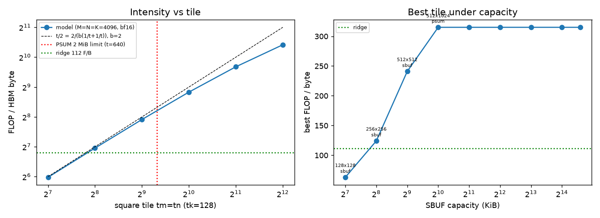

左图是强度随方形 tile 边长的变化，近似线性增长；右图是给定 SBUF 容量时能达到的最好强度，它先随容量上升，到 PSUM 卡住后变成一条水平线。

### 脉动阵列（`systolic_vs_size.csv`、`systolic_vs_p.csv`）

脉动阵列是 P×P 个乘加单元（PE）组成的网格，数据像波一样逐格传递，每个 PE 只和邻居通信。weight-stationary 指权重块先装进阵列、固定不动，输入矩阵一行行流过去。
它的弱点是每换一块权重，数据都要先花时间灌满阵列、最后再排空，这段时间里很多 PE 是闲着的。

每个权重块需要 M+2P−2 个 cycle（流入 M 行，加上 2(P−1) 的填充和排空），测试按 cycle 精确校验了这个数，所有规模下 C 与 `A@B` 的误差都 ≤1e-13。
下表是 PE 利用率：

| 设置 | 串行加载权重 | 权重双缓冲、流水衔接 |
| --- | ---: | ---: |
| P=16，n=16 | 0.258 | 0.258 |
| P=16，n=64 | 0.582 | 0.957 |
| P=16，n=256 | 0.848 | 0.999 |
| n=128，P=4 | 0.928 | 1.000 |
| n=128，P=32 | 0.577 | 0.956 |
| n=128，P=128 | 0.251 | 0.251 |

阵列越大，单块的填充/排空开销 3P−2 越难摊薄。权重双缓冲（一块在算时预先装下一块）能把相邻块的填充和排空叠起来，所以矩阵有多个块时利用率接近 1；
但矩阵只有一个块时，没有下一块可以衔接，双缓冲也救不回来（P=128、n=128 仍是 0.251）。

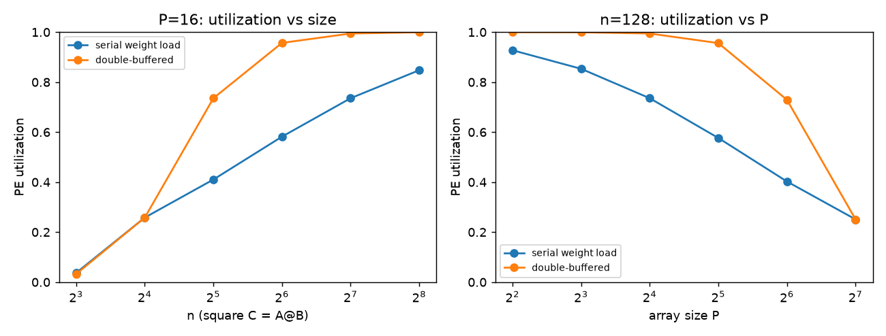

左图固定 P=16 看矩阵规模，右图固定 n=128 看阵列大小。两张图说的是同一件事：矩阵相对阵列越大，填充和排空越不要紧。

### CPU GEMM 实测（`cpu_gemm.csv`，float64，best-of-5）

这一节想看分块在 CPU 上的效果，结果测到的主要是 Python 本身的开销，这也是一个值得记下的教训。

| 方法 | n | GFLOP/s |
| --- | ---: | ---: |
| 纯 Python 三重循环 | 128 | 0.034 |
| 行向量 AXPY（numpy 内层） | 256 | 0.191 |
| Python 级分块，bs=16 / 64 / 1024 | 1024 | 1.16 / 19.6 / 135.3 |
| `np.matmul` | 128 / 1024 / 2048 | 35.3 / 202.9 / 314.3 |

`np.matmul`（n=2048）比纯 Python 循环快约 9200 倍。Python 级分块里块越小越慢，这是调用开销在主导（一共 (n/bs)³ 次调用），并不是 cache 不起作用；
BLAS 内部本来就做了寄存器和 cache 分块。n=128 低于 n=64（35.3 对 47.9）在多次运行中都出现，可能是 BLAS 多线程的启动成本，这里没有深究。

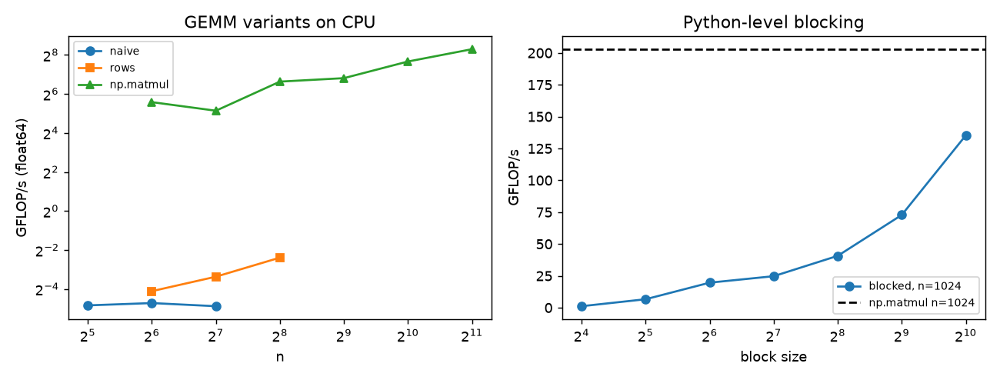

左图是各种写法随 n 的吞吐，几种写法之间差了几个数量级；右图是 Python 级分块随块大小的变化，块越大越接近 `np.matmul`，因为调用次数越少。

### im2col（`im2col.csv`，fp32，batch 1，best-of-5）

im2col 把卷积的每个输出位置对应的输入 patch 展开成矩阵的一行，这样整个卷积就变成一次大 GEMM，可以直接用加速器的矩阵乘单元。
代价是同一个输入像素会被复制进好几个 patch，内存会膨胀。

| 层 | 膨胀倍数 | im2col 矩阵 MiB | 直接卷积 ms | im2col 总 ms（其中拷贝） |
| --- | ---: | ---: | ---: | ---: |
| ResNet conv1 7×7 s2 | 12.25 | 7.03 | 75.24 | 4.55（2.67） |
| 3×3 @56，C=64 | 9.0 | 6.89 | 11.46 | 6.26（4.58） |
| 3×3 s2 @28 | 2.25 | 0.86 | 4.14 | 1.61（0.82） |
| 1×1 @14 | 1.0 | 0.19 | 1.18 | 2.53（0.12） |
| 5×5 @32 | 25.0 | 3.13 | 25.93 | 2.44（1.65） |

膨胀倍数约等于 KH·KW/stride²。在 numpy 里 im2col 仍然更快，因为它把 KH·KW 次小运算换成了一次大 GEMM；
但 3×3 层 73% 的时间花在拷贝 patch 矩阵上。1×1 卷积没有膨胀，也就没有可省的小运算，直接卷积反而更快。

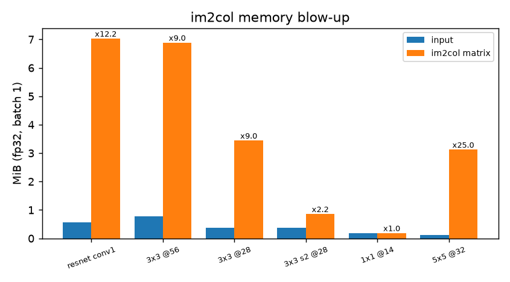

每一层原始输入和 im2col 矩阵并排的大小，柱顶标的是膨胀倍数。大卷积核、小 stride 的层膨胀最厉害，这部分额外的内存流量在加速器上同样要付。

## GPU 部分：RTX 5090 上的同一套问题

上面的分块模型只是一个模型，它对不对，需要拿真实硬件来验证。没有 Trainium，我把同样的问题搬到 RTX 5090（170 SM，sm_120，96 MB L2，32 GB GDDR7；
CUDA 12.8，torch 2.8.0+cu128，cuDNN 9.10.2）上。对应关系是：shared memory ≈ SBUF，线程寄存器里的累加器 ≈ PSUM，tensor core ≈ PE 阵列，
`cp.async` 双缓冲 ≈ DMA 与计算重叠。所有数字来自 `artifacts/raw/gpu/*.jsonl`，计时为 cudaEvent 中位数。

### 实测 roofline（`micro_*.jsonl`）

先用微基准测出这张卡的「屋顶」：内存带宽和峰值算力。roofline 模型说，一个 kernel 的性能上限是 min(峰值算力, 带宽 × 算术强度)。

| 屋顶 | 实测 | 说明 |
| --- | ---: | --- |
| DRAM（triad，每个数组 ≥256 MiB） | 1549 GB/s | 规格 1792 GB/s 的 86% |
| L2 常驻（triad，每个数组 32 MiB） | 5107 GB/s | 64 MiB 起掉回 DRAM |
| fp32 FMA（16 条独立链、64 warp/SM） | 118.97 TFLOP/s | 推得 SM 时钟约 2.73 GHz；单条链只有 89.0 |
| cuBLAS bf16 / fp16 / tf32（16384³） | 232.0 / 217.7 / 117.7 TFLOP/s | tensor-core 屋顶 |

由此得到 fp32 的 ridge point = 118.97/1.549 = 76.8 FLOP/B，bf16 的 ridge point = 149.8 FLOP/B。

### SGEMM 阶梯（`gemm_ladder.jsonl`，M=N=K=4096，误差 = max|C−C_fp64| / max|C_fp64|）

从最朴素的 kernel 开始，每一级只加一项优化，看每一项各贡献多少：

| kernel | 块 tile | TFLOP/s | 占 fp32 峰值 | 模型强度 FLOP/B | 误差 |
| --- | --- | ---: | ---: | ---: | ---: |
| naive（不合并访存） | 1×1 | 0.94 | 0.8% | 0.25 | 2.85e-6 |
| coalesced | 1×1 | 6.43 | 5.4% | 0.25 | 2.85e-6 |
| smem 16×16 | 16 | 9.82 | 8.3% | 3.99 | 2.85e-6 |
| 1D 寄存器分块 64×64, TM=8 | 64 | 25.73 | 21.6% | 15.88 | 2.85e-6 |
| 2D 寄存器分块 128×128, 8×8 | 128 | 21.53 | 18.1% | 31.51 | 2.85e-6 |
| + float4 / LDS.128（vec4） | 128 | 49.40 | 41.5% | 31.51 | 2.85e-6 |
| + 双缓冲（vec4_db） | 128 | 49.44 | 41.6% | 31.51 | 2.85e-6 |
| cuBLAS fp32 / tf32 | — | 63.06 / 100.05 | 53.0% / — | — | 9.2e-7 / 3.0e-4 |
| 我的 WMMA fp16 / bf16（fp32 累加） | 128 | 177.80 / 165.11 | — | 62.06 | 6.1e-6 / 5.8e-6 |
| cuBLAS fp16 / bf16 / fp8（`_scaled_mm`） | — | 207.57 / 178.99 / 375.57 | — | — | 3.6e-4 / 2.9e-3 / 2.9e-3 |

模型能不能预测 GPU？表里的「模型强度」用的是和 CPU 部分 `tiling.py` 完全相同的流量公式（b=4，测试里逐字节核对过），
即 `bytes = 4(MK·⌈N/BN⌉ + KN·⌈M/BM⌉ + MN)`，它假设没有 L2 复用。8192³ 的 smem8 工作集远超 L2，按这个公式反推出的 DRAM 带宽是 1585 GB/s，
和实测 triad 的 1549 GB/s 只差 2.3%。所以在 L2 帮不上忙的时候，scratchpad 流量模型能直接预测 GPU 性能。

2D 分块反而比 1D 慢。解析 bank 模型（`gpu/bankmodel.py`）显示 B 的读有 4-way、A 的转置写有 8-way 的 bank conflict
（同一个 warp 的多个线程访问 shared memory 的同一个 bank，只能排队）。但消除冲突的 `reg2d_nc` 只快了 2.5%（22.07 TFLOP/s）。
真正的跳变来自把 16 条 LDS.32 换成 4 条 LDS.128（vec4），一下快了 2.3 倍：瓶颈在 shared memory 的加载指令条数，而不在冲突。

双缓冲这一级第一次没有做对。第一次编译用了 129 个寄存器，每个 SM 只能放 1 个 block（8 warp），4096³ 跑出 46.68 TFLOP/s，反而比单缓冲慢 6.6%
（`log_campaign.txt`、`log_wave2.txt`）。改模板后 ptxas 分到 128 个寄存器，每个 SM 回到 2 个 block，跑出 49.44（`ptxas_sgemm.txt`、`kernel_info.jsonl`）。
多 1 个寄存器，occupancy 就减半。

fp16/bf16 的 cuBLAS 误差（3.6e-4 / 2.9e-3）主要来自输出 C 被舍入成 16 位；我的 WMMA 输出 fp32，所以误差在 6e-6 量级。

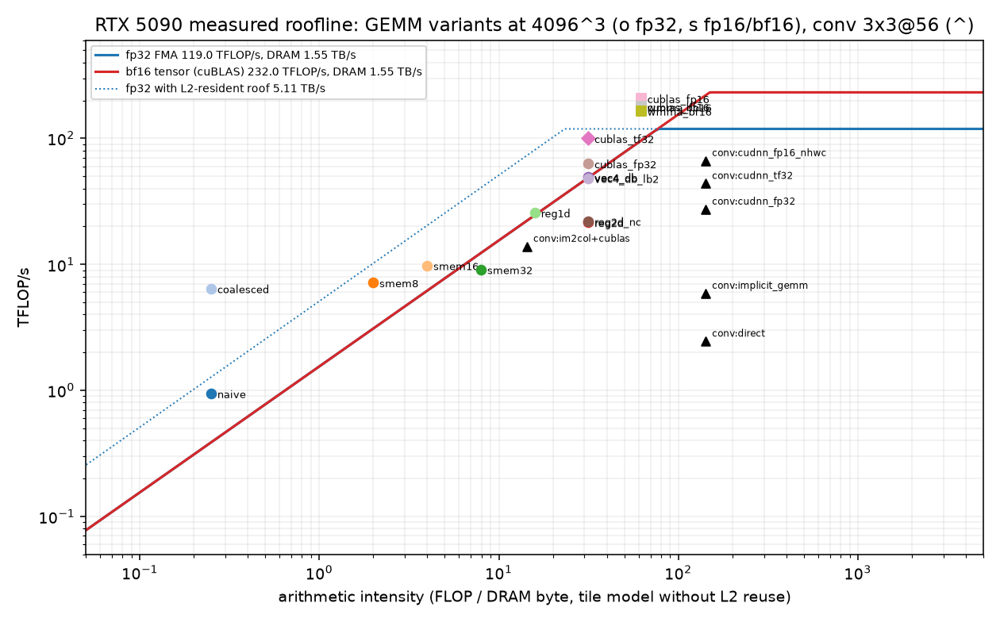
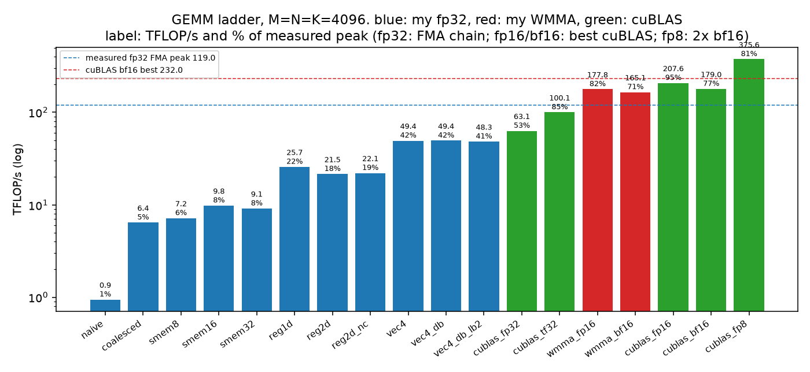

上图是实测的 roofline：带宽斜线、fp32 和 tensor-core 两层屋顶，再把各个 GEMM 变体（圆点 fp32，方块 fp16/bf16）和一个 3×3 卷积按强度和实测吞吐放上去。
一个点离它下方的屋顶越远，说明除了访存和峰值算力之外，还有别的瓶颈在拖它，比如上面说的加载指令条数和 occupancy。
下图是阶梯本身，按我的 fp32、我的 WMMA 和 cuBLAS 三种颜色排开，可以直接看出每一级优化的增量。

### tile 大小、skinny GEMM

tile 不是越大越好。在 `gemm_tiles.jsonl` 里，4096³ 下 BM×BN=64×64 最快（33.36 TFLOP/s）。256×256 每个块有 1024 个线程，`__launch_bounds__` 把寄存器压到 64 个，
产生大量 spill（寄存器放不下的变量溢出到慢得多的本地内存），只有 3.09 TFLOP/s，尽管它的模型强度最高（62.1 FLOP/B）。

skinny GEMM 指一边很窄的矩阵乘（比如 M=1 的矩阵向量乘），它几乎没有复用，纯粹受带宽限制。`gemm_skinny.jsonl`（N=K=4096，B=64 MiB 正好放得进 L2）里，
warm L2 下 M=1 我的 split-K kernel 跑出 3122 GB/s，看起来「超过」了 DRAM，其实是 L2 命中；每次先刷 256 MiB 的 cold L2 之后，降到 1093 GB/s，
与 cuBLAS fp32 的 1058 GB/s 持平。M=64 时 cuBLAS fp32 有 965 GB/s（cold），我的 kernel 只有 375，因为它按 8 行一组重复读 B。

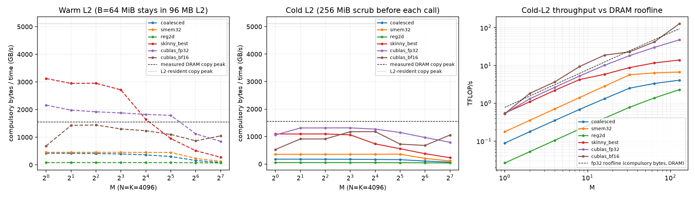

左边两幅是 warm L2 和 cold L2 下的有效带宽，对比它们就能看出 warm 情况下的「超 DRAM」全是 L2 的功劳；右边是 cold L2 下的吞吐和 DRAM 屋顶的对比。

### Conv2d 与融合（`conv.jsonl`、`conv_fusion.jsonl`，batch 8 / 64，fp32，TF32 关闭）

这一节对应作业里「用矩阵乘实现卷积并做融合」的部分。先比较几种卷积实现：

| 层（batch 8） | 直接卷积 | im2col+cuBLAS（膨胀） | 我的 implicit GEMM | cuDNN fp32 | cuDNN fp16 NHWC |
| --- | ---: | ---: | ---: | ---: | ---: |
| conv1 7×7/2 @224 | 0.470 ms | 0.130 ms（×12.25，56.3 MiB） | 0.220 ms | 0.075 ms | 0.040 ms |
| 3×3 @56 C64 | 0.754 | 0.133（×9.0） | 0.314 | 0.068 | 0.028 |
| 3×3 @7 C512 | 3.403 | 0.172（×9.0） | 2.019 | 0.054 | 0.036 |
| 1×1 @14 C1024→256 | 2.237 | 0.045（×1.0） | 0.534 | 0.109 | 0.021 |

再看融合：把 conv、ReLU、maxpool 合进一个 kernel，中间结果就不必写回显存再读出来。

| 融合（conv+ReLU+maxpool 2×2） | 模型 DRAM 字节 | 时间 |
| --- | ---: | ---: |
| 3×3 @112 C64，batch 64，直接卷积：3 个 kernel → 1 个 | 1029.1 → 245.1 MiB | 4.230 → 3.768 ms |
| 同层 cuDNN conv + ReLU + pool → cuDNN + 我的融合 ReLU-pool | 1029.1 → 637.1 MiB | 2.062 → 1.711 ms |
| 3×3 @56 C128，batch 8，直接卷积（中间结果在 L2 里） | 64.9 → 15.9 MiB | 0.627 → 0.609 ms |

融合省下的时间约等于「省下的字节 / 带宽」，而这里的带宽取决于中间张量落在哪一级存储。batch 8 时中间张量 ≤26 MB，留在 L2 里，只省了十几 µs；
batch 64 时中间张量有 103–206 MB，溢出了 L2，省下的时间接近按 DRAM 带宽算出的值。
卷积本身计算受限时（3×3 @14 C512），融合几乎没有收益（14.52 → 14.55 ms，在噪声内）。

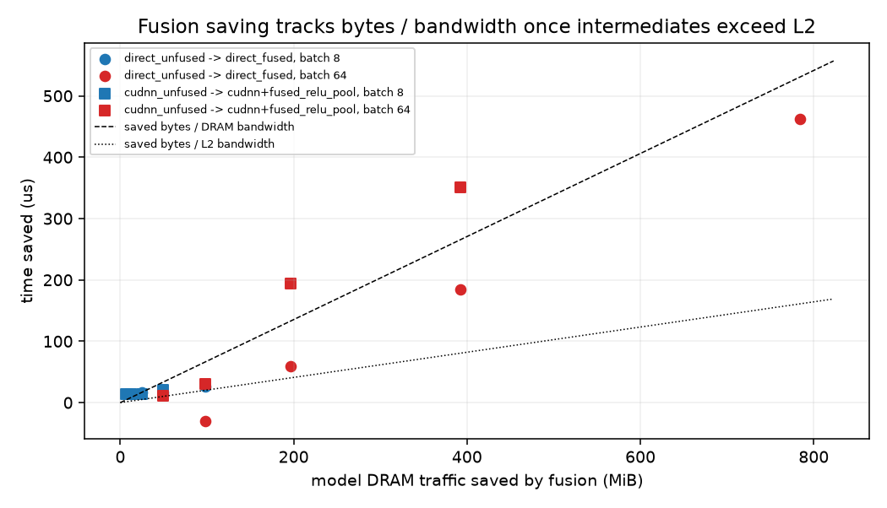
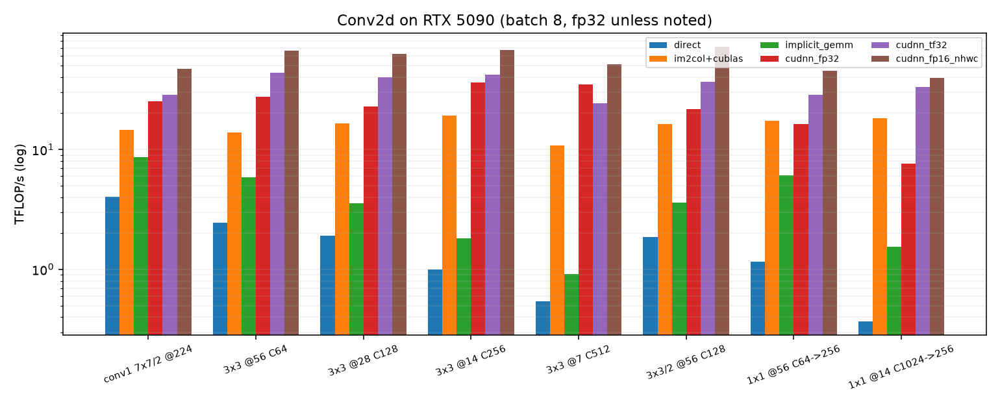

上图把实测省下的时间和「省下的字节 / 带宽」放在一起：中间结果一旦超出 L2，两者就对得上。下图是各卷积实现的吞吐，cuDNN 遥遥领先，我的 implicit GEMM 介于直接卷积和 cuDNN 之间。

ncu 在容器里没有权限（`ERR_NVGPUCTRPERM`，见 `ncu_raw.csv`），所以没有实测 DRAM 字节、实测 occupancy 和 bank-conflict 计数；
我用 CUDA occupancy API（`kernel_info.jsonl`，理论 occupancy、寄存器、smem）和解析 bank 模型（`bank_model.jsonl`）代替。
同一条权限错误在 RTX 4080 SUPER 的容器上复现，换卡解决不了。

### 第二张卡：FP8 才是还没吃到的屋顶（RTX 4080 SUPER）

在 5090 上我的 kernel 已经停在 cuBLAS 的八成左右，下一步该往哪里使劲？我在第二张卡上回答了这个问题。
同一份 SGEMM 阶梯在 4080 SUPER（cc 8.9，80 SM，64 MB L2，实测拷贝带宽 626 GB/s）上，N=8192：

| 实现 | TFLOP/s | 相对 cuBLAS |
| --- | ---: | ---: |
| vec4 fp32 | 24.2 | cuBLAS fp32 30.8 的 79% |
| WMMA bf16（fp32 累加） | 86.9 | cuBLAS bf16 108.0 的 80% |
| Triton FP8 e4m3，11 组 tile / stage / swizzle 里最好的 | 207.5 | cuBLAS `_scaled_mm` 207.6 |

fp32 和 bf16 都停在 cuBLAS 的约 80%，再调 tile 也搬不动。FP8 用的是另一条指令（e4m3、K 维 32、fp32 累加），吞吐大约是 bf16 WMMA 的 2.4 倍。

`gpu/fp8_triton.py` 把 B 做成 cuBLAS 要求的列主序，11 组配置在 N=8192 时全部落在 189–207，最好的和 cuBLAS 打平。
N=2048 时 64×64 的小 tile 反而到 185，超过 cuBLAS 的 145，因为大 tile 切出的块太少，填不满 80 个 SM。N=1024 时 cuBLAS 仍更快（50.7 对 42.6）。
和 cuBLAS 在同一组 fp8 输入上的最大绝对差是 1.0（N=1024），差在累加顺序，不在公式。

Ada 的共享内存上限是 99 KB。编译器实验里，256×256、BK=64、3 级流水的配置要 128 KB，直接报 `OutOfResources`。
所以 Hopper 上的 tile 搬到 Ada 上编译失败是硬件容量所致，不是搜索写错了。

### 第三张卡：RTX 6000D 的算力不是一个稳定的数（`sustained.jsonl`、`burst.jsonl`）

跨卡比较时，6000D 的 FlashAttention 只有 5090 的 0.43 倍、cuBLAS fp16 8192³ 是 0.64 倍，而 `peaks.json` 里的 bf16 峰值却是 0.97 倍。
三个数对不上，说明至少有一个是错的。我用两个探针来回答「哪个数是真的」。

第一个探针测持续负载（`gpu/sustained_probe.py`）：每个形状连续跑 8 s，每 0.25 s 一个窗口，同时用 100 ms 间隔的 nvidia-smi 记录时钟和功耗。
结果每个形状从第一个窗口起就是平的，最后一个窗口 ≥ 最大值的 98%。8192³ / 16384³ 稳定在 141–145 TFLOP/s，SM 时钟 2422 MHz 不动，
功耗最高 443 W（上限 600 W），没有任何降频原因。所以它既不是过热，也不是撞了功耗墙。

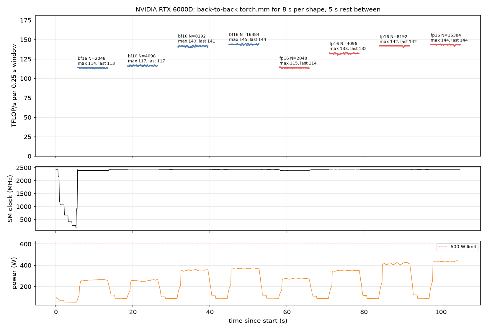

每个形状连续跑 8 s、中间休息 5 s 的吞吐曲线。每一段都是水平的，没有「先快后慢」的降频形状。

第二个探针给每个 kernel 单独计时（`gpu/burst_probe.py`，每次 `torch.mm` 一对 CUDA event，约 0.4 s 工作量，`burst_summary.csv`），结果发现单个 kernel 的速度是双峰的：

- 2048³ 有 58% 的 kernel 在 240–260 TFLOP/s，其余在 50–80；4096³ 最快 303，中位数 136。
- 快段和慢段交替出现：快段中位 0.15–0.75 ms，慢段 0.2–4.4 ms，没有固定周期；kernel 之间平均只空 0.4 µs，GPU 一直在忙。
- 按时间平均，2048³ 是 114、4096³ 是 117–133、8192³ 是 143 TFLOP/s。一个 8192³ kernel 要 7 ms，自己就把快慢段平均掉了，所以分布集中在 150 附近。
- 空闲换不来爆发。4096³ 前面先空闲 0 / 2 ms / 10 ms / 50 ms / 0.2 / 1 / 3 s，整段平均都是 116–118（bf16）和 132–133（fp16），最快的单 kernel 都是约 300 / 258。
  所以这不是「攒一段预算、用完降速」的模型。20 ms 一次的 nvidia-smi（1525 个样本）里，SM 时钟只在 2385–2422 MHz 之间，降频原因全是 0。

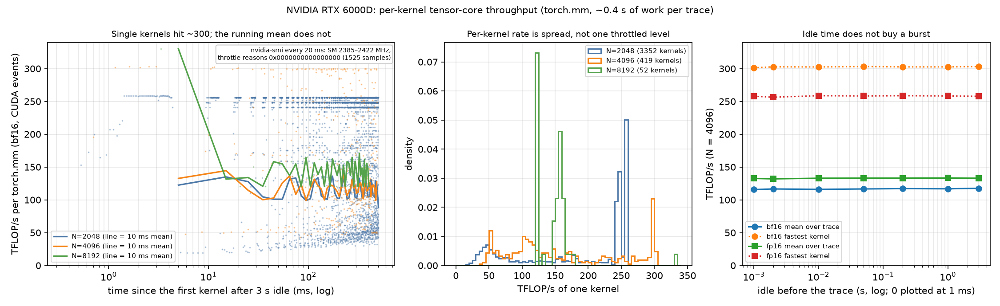

三幅图分别是：单个 kernel 能冲到约 300，但滑动平均到不了；每个 kernel 的速率是散开的，不是被压在一个固定的限速水平上；空闲多久都换不来爆发。

结论是，`peaks.json` 的 228.7 来自 30 次 75 µs 的 2048³ 正好落在一个快段里（共 2.3 ms），是采样假象。这张卡能用来算 roofline 的是约 143 TFLOP/s 的持续值，
相对 5090 的 236 是 0.61 倍，所以 cuBLAS 的 0.64 倍其实就是算力比。FlashAttention 的 0.43 倍再低一截，是因为它的 kernel 更短、更受快慢段影响（没有单独验证）。
限速发生在时钟以下、NVML 看不到的层面；没有 ncu 权限，具体机制（固件限流、tensor 管线发射限制）无法确认。

我从这件事得到的教训是：短 benchmark 测「峰值」，要么跑够几百毫秒，要么报中位数和分布。同一个 `a @ b`，计时 2 ms 和计时 8 s 在这张卡上差 1.6 倍。

```bash
python gpu/sustained_probe.py --seconds 8 && python gpu/plot_sustained.py --card rtx6000d
python gpu/burst_probe.py && python gpu/plot_burst.py --card rtx6000d
```

## 面试讲法

**20 秒结论**：分块 GEMM 的 HBM 流量是 b(MK·N/tn + KN·M/tm + MN)，强度约等于 2/(b(1/tm+1/tn))，
所以 tile 翻倍，强度也翻倍，直到片上容量卡住。在我的模型里，PSUM 2 MiB 把强度封顶在 315 FLOP/B；再大的 SBUF 只用来加大 tk、减少 DMA 次数。
脉动阵列的利用率是 M/(M+3P−2)，大阵列需要大矩阵和权重双缓冲才能喂饱。

**白板**：
- traffic：A 被读 ⌈N/tn⌉ 遍，B 被读 ⌈M/tm⌉ 遍，C 写 1 遍 → `I = 2MNK / (b(MK⌈N/tn⌉ + KN⌈M/tm⌉ + MN))`。
- 容量：`2·b·tk·(tm+tn) ≤ SBUF`（双缓冲），`4·tm·tn ≤ PSUM`（fp32 累加）。
- 脉动阵列：每块 `M+2P−2` cycle，利用率 `MNK / (P²·Σcycles)`。
- im2col 膨胀：`OH·OW·C·KH·KW / (C·H·W) ≈ KH·KW/s²`。

**不能推出的结论**：
- 不能推出 Trainium 上真实是 315 FLOP/B 或 3.7 ms：加速器参数是假设，cycle 模型忽略了 DMA 队列并行和 engine 间同步。
- 不能推出「小块分块在 CPU 上没用」：Python 级分块测到的是解释器开销，cache 分块在 BLAS 内部已经做了。
- 不能推出「im2col 永远更快」：这只是 numpy 里的结果；GPU 上 implicit GEMM 或 Winograd 会避开显式膨胀，1×1 卷积这里直接卷积就更快。

**追问**：
1. tk 不影响 HBM 字节，为什么还要调大？因为它决定 DMA 次数与固定开销，以及 PSUM 累加次数；在本模型中 tk 从 128 到 4096 时，DMA 从 4160 次降到 192 次。
2. weight-stationary 和 output-stationary 怎么选？看哪个操作数复用最多、哪个最大；权重驻留适合 batch（M）大的推理。
3. 为什么 P=128 的阵列跑小矩阵利用率只有 25%？因为填充/排空的 3P−2 无法摊薄，需要批量拼接，或者把矩阵拆小喂给多个小阵列。
4. bf16 WMMA 已经是 cuBLAS 的 80%，下一步优化什么？不是再抠 fp32 tile。FP8 是另一条指令，4080 SUPER 上 Triton 扫 11 组配置就和 `_scaled_mm` 打平（207 TFLOP/s），
   是 bf16 WMMA 的 2.4 倍。小矩阵要换小 tile，因为大 tile 填不满 SM。

## 文件

```text
asst4-dnn-accelerator/
├── code/dnnaccel/{tiling,systolic,gemm_cpu,im2col}.py
├── gpu/{sgemm,conv,micro}.cu          # CUDA kernels, built as .so, driven via ctypes
├── gpu/{kernels,run_gpu,bankmodel,ncu_targets,fp8_triton}.py
├── tests/{conftest.py,test_dnnaccel.py,test_bankmodel.py,test_gpu.py}
├── scripts/{run_experiments,plot_gpu}.py
└── artifacts/raw/*.csv, meta.json, raw/gpu/*.jsonl；artifacts/figures/*.png, gpu_*.png|pdf
```
