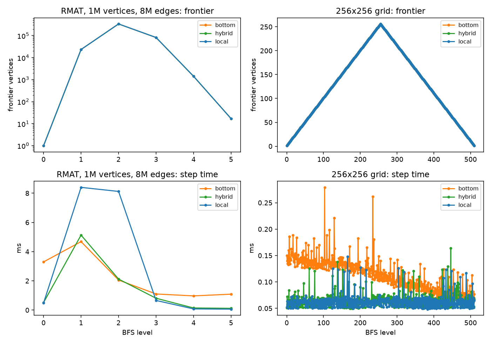
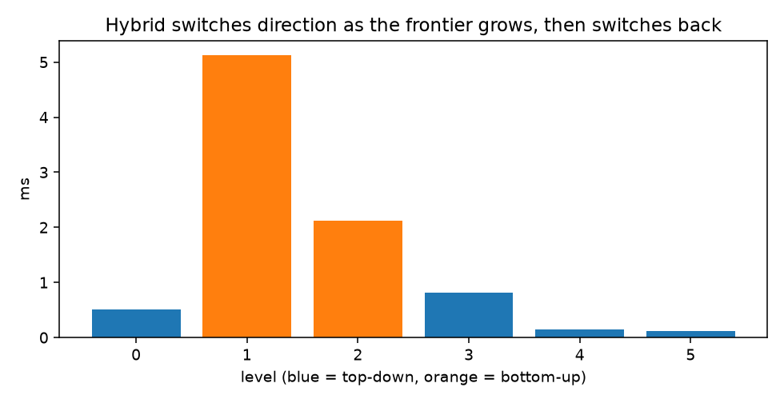
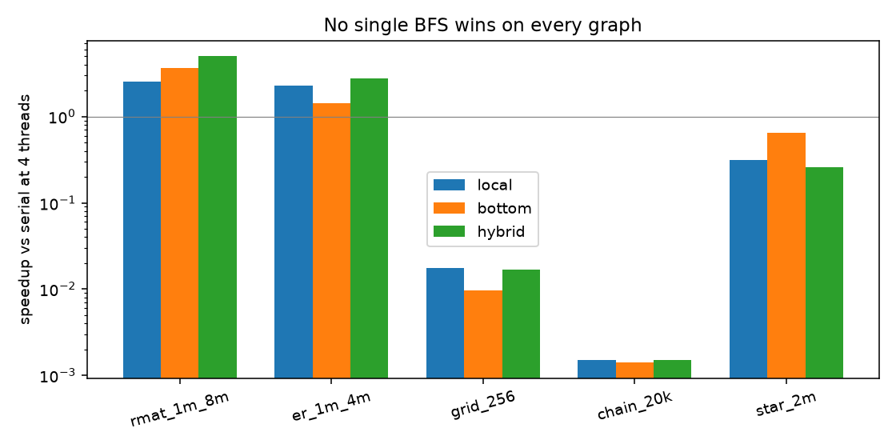
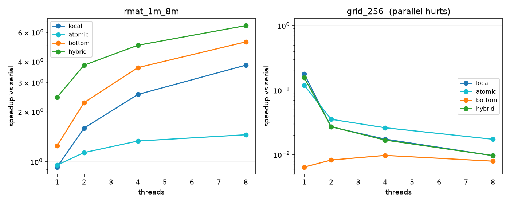
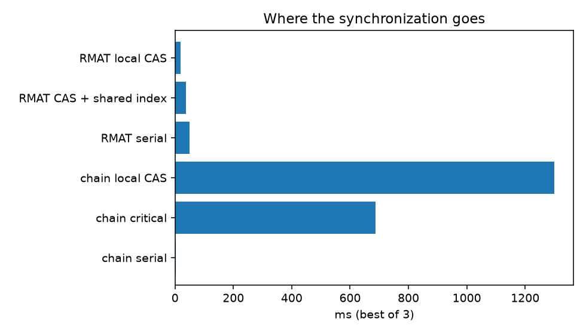
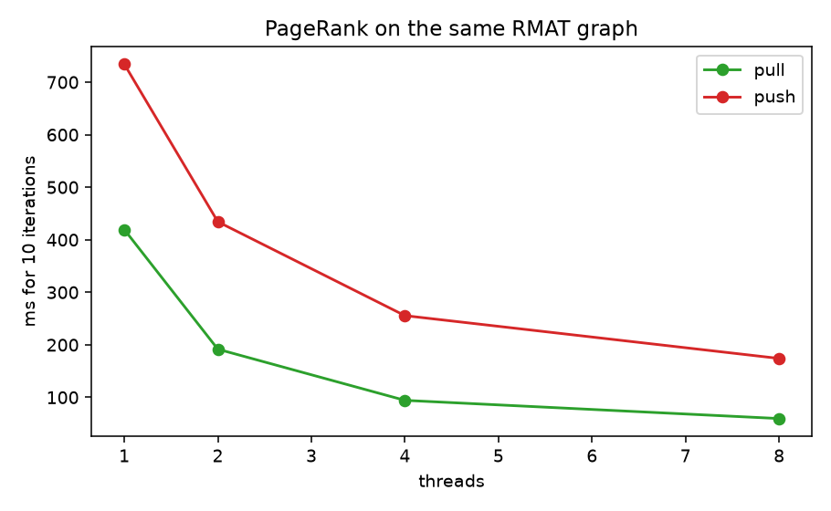
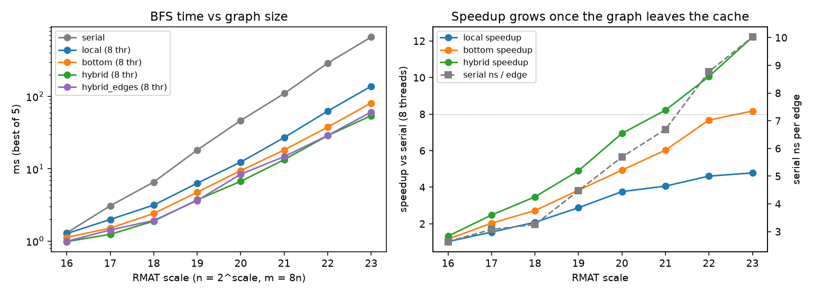
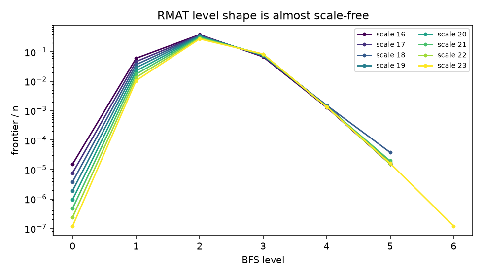
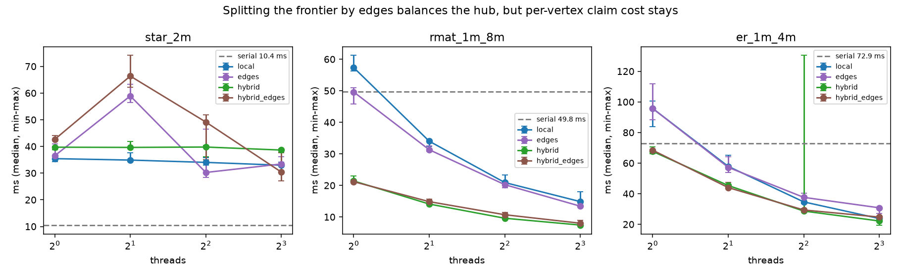
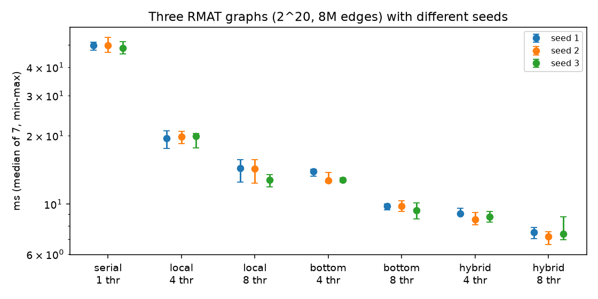

# CS149 A5（加分）：方向自适应的大图 BFS（OpenMP）

BFS（广度优先搜索）几乎不做计算，主要是在内存里跳着读邻接表，所以并行的难点在于少看几条边、少同步几次。
这个实验要回答：BFS 每一层该从 frontier 往外找（top-down），还是让未访问的顶点往回找（bottom-up）？什么样的图值得并行？
我的主要发现是：在 RMAT 这类社交网络式的图上，只在 frontier 最大的那两层切到 bottom-up，就能把要检查的边砍到 top-down 的 9.1%，8 线程加速 6.58×；
而网格和链这种层数很多、每层很薄的图，并行比串行慢两个数量级。

对应 CS149 Fall 2024 Assignment 5「Big Graph Processing in OpenMP」。官方要求用 OpenMP 实现 top-down、bottom-up 和按层切换的 hybrid BFS。
本文在同一份 CSR（压缩稀疏行：邻接表首尾相接存成一个数组，另用偏移数组记录每个顶点的起点）上实现这三部分，
并补了往年同题里的 PageRank（pull 与带原子加的 push）。所有 BFS 变体与串行队列 BFS 的距离逐元素相等。

完整报告（19 页）：[`reports/cs149-asst5/cs149_asst5_report.pdf`](../../../reports/cs149-asst5/cs149_asst5_report.pdf)。

平台是本机 4 物理核 / 8 逻辑核，MinGW g++ 13.2，`-O3 -fopenmp`。BFS 是纯 CPU 作业，没有 GPU 部分。
主实验每组热身一次后取 3 次最小值；扩展实验（规模扫描、边区间切分、三个种子）记录每一次重复的时间。
图在进程内生成（Graph500 的 RMAT 参数），不提交边表。

## 一句话结论

先把两个词说清。frontier 是当前层刚访问到的顶点。top-down 让 frontier 里的顶点去检查所有出边；bottom-up 让每个还没访问过的顶点到邻居里找 frontier，找到一个就停。

收益几乎全来自换方向。RMAT（2^20 顶点、8.18M 边）上，hybrid 在 8 线程时是 6.58×（7.47 ms 对串行的 49.18 ms），检查的边只有 top-down 的 9.1%。这个切换只发生在 frontier 最大的两层：第 2 层 top-down 要看 389 万条边，bottom-up 只看 8.6 万条；第 0 层和第 3 层必须留在 top-down。

下一层的 frontier 要用线程私有数组收集。大家抢一个共享的原子下标，4 线程上就慢 1.90 倍，而且从 1 个线程加到 8 个几乎不加速。

不是所有图都值得并行。网格有 511 层，链有 20,000 层，每层都很薄，4 线程比串行慢两个数量级。星图即使按边区间切开、负载已经均衡，仍然比串行慢 2.6 倍，瓶颈是每个顶点上的 CAS 和把 frontier 物化出来，不是分不匀。

PageRank 用 pull。8 线程的 pull 是 7.03×，push 是 4.22×，而且 8 线程的 push 仍然比 1 线程的 pull 慢。

图越大，并行越划算。RMAT 从 2^16 放大到 2^23（6619 万边），hybrid 8 线程从 1.33× 涨到 12.2×。串行每条边从 2.6 ns 涨到 10.0 ns，因为图已经放不进缓存；每一层的形状、以及该在哪一层切换，都没有变。三个种子、每组 7 次，8 线程的中位加速是 6.56–6.94×，6.58× 能复现。

## 怎么跑

```powershell
cd solutions/cs149/asst5-big-graphs
python -m pytest -q tests                 # 编译并跑 selftest
python scripts/run_experiments.py         # 重新计时并画图，大约几分钟
```

## 结果



上排是每层 frontier 的大小，下排是每层的耗时。RMAT 只有 6 层，工作量集中在第 1、2 层；网格的 frontier 是一条薄波前，共 511 层。
前者每层都有足够的活分给所有线程，后者每层只有一点活，却要付一次完整的同步。

RMAT 前四层两种方向的代价对比如下（hybrid 一列是它实际选的方向）：

| 层 | frontier | top-down 边 / ms | bottom-up 边 / ms | hybrid |
| ---: | ---: | --- | --- | --- |
| 0 | 1 | 23,410 / 0.49 | 4,144,533 / 3.30 | top-down |
| 1 | 23,410 | 4,018,164 / 8.40 | 520,443 / 4.68 | bottom-up |
| 2 | 338,375 | 3,885,288 / 8.12 | 85,879 / 2.06 | bottom-up |
| 3 | 81,887 | 103,463 / 0.66 | 3,357 / 1.10 | top-down |

frontier 小时，top-down 只碰 frontier 的出边，bottom-up 却要扫一遍所有未访问顶点。frontier 大时正好反过来：
多数未访问顶点很快就能找到一个在 frontier 里的父节点、提前停下，而 top-down 要把几百万条出边都看一遍。



hybrid 在 RMAT 各层的耗时，蓝色是 top-down，橙色是 bottom-up。第 3 层切回去，是因为出边数 1.03×10^5 已经小于估计的 bottom-up 工作量 3.37×10^5，
依据是两种方向的工作量对比，而不只是 frontier 在变小。



4 线程相对串行的加速比，高于 1 才比串行快。没有一种 BFS 在所有图上都赢。网格和链越并行越慢：它们慢在 OpenMP 每一层都要付的固定成本，而不在负载不均。



左边 RMAT、右边网格，各实现的加速比随线程数的变化。RMAT 上曲线一路往上，hybrid 最高；网格上所有曲线都在 1 以下，线程越多越糟。



4 线程下不同同步方式的耗时。RMAT 上，用共享原子下标收集下一层 frontier 明显比私有 frontier 慢，因为所有线程都在抢同一个计数器。
链上 critical 反而比私有 frontier 快，但两者都远远慢于串行。



10 轮 PageRank 的耗时随线程数的变化。pull 让每个顶点沿入边收集邻居的值，只写自己，不需要原子操作；
push 把自己的值沿出边加到邻居上，多个线程会同时加到同一个邻居，必须用原子加，所以扩展得差得多。

主实验的数字汇总：

| | 1 线程 | 4 线程 | 8 线程 |
| --- | ---: | ---: | ---: |
| RMAT hybrid | 20.17 ms | 9.81 ms（5.02×） | 7.47 ms（6.58×） |
| RMAT top-down 私有 frontier | 52.93 | 19.37（2.54×） | 12.93（3.80×） |
| RMAT top-down 共享下标 | 51.54 | 36.90（1.33×） | 33.83（1.45×） |
| PageRank pull，10 轮 | 419 ms | 94.3 | 59.7（7.03×） |
| PageRank push，10 轮 | 734 ms | 256 | 174（4.22×） |

### 扩展实验（`artifacts/raw/extra.jsonl`）

主实验只用了一个规模、一个种子。扩展实验追问三件事：结论随图的大小怎么变，星图能不能靠切边解决，换个种子还成立吗。



左图是耗时随规模的变化，右图是 8 线程加速比和串行每条边的耗时。两者一起上升：图越大、越出缓存，并行的收益越大。

| scale | 边数 | 串行 ms | top-down ×8 | bottom-up ×8 | hybrid ×8 | hybrid 加速 | 串行 ns/边 |
| ---: | ---: | ---: | ---: | ---: | ---: | ---: | ---: |
| 16 | 0.49M | 1.30 | 1.27 | 1.12 | 0.98 | 1.33 | 2.63 |
| 18 | 2.02M | 6.56 | 3.15 | 2.41 | 1.89 | 3.47 | 3.25 |
| 20 | 8.18M | 46.53 | 12.37 | 9.43 | 6.70 | 6.94 | 5.69 |
| 22 | 33.0M | 289.22 | 62.77 | 37.68 | 28.76 | 10.06 | 8.77 |
| 23 | 66.2M | 663.17 | 138.62 | 81.21 | 54.29 | 12.22 | 10.02 |

hybrid 的加速超过了 8 倍，但超出的部分来自算法而不是并行：它只看 8.7% 的边。要衡量并行本身，得看工作量相同的 top-down，它在 8 线程下从 1.02× 涨到 4.78×。



把各规模每层的 frontier 占顶点总数 n 的比例画在一起，几条曲线几乎重合，峰值都在第 2 层。所以切换阈值 α=14 不用随规模重调。



星图的中心顶点连着几乎所有顶点，按顶点分工时，拿到它的线程要独自处理海量的边。按边区间切分（`edges`）先对 frontier 出度做前缀和，
按 2048 条边一块切开，每块用二分定位起点。星图 4 线程因此从 33.0 降到 28.3 ms，但串行只要 10.4 ms；
1 线程的并行版本已是串行的 3.3 倍，多出来的是每个顶点的认领和 frontier 物化成本，切边解决不了。
RMAT、ER 的 frontier 足够宽，按顶点的 `dynamic, 64` 已经均衡，切边没有收益。



三个种子生成的 RMAT 图上，各配置的排序完全一致；7 次之内最大/最小比为 1.04–1.26，8 线程时抖动更大。

## 面试讲法

**20 秒**：大图 BFS 要按层换方向。frontier 小时向外扩展；frontier 大时，让未访问的顶点向回找父节点，找到就停。
RMAT 上 8 线程 6.6 倍，检查的边不到原来的十分之一。网格和链不要并行。PageRank 沿入边聚集，不要用原子加往外推。

**不能推出的结论**：

- 没有在官方 Myth / 32 核机器上跑 grader，绝对时间不能换算成作业分数。
- 图是生成的 RMAT，不是 `com-orkut` 或 `rmat_200m`。层级先尖峰再收缩是这类图的共性，具体层数会变。
- 星图上边区间切分的 2 线程版本比 1 线程慢（56.4 对 35.1 ms），稳定复现，原因没有定位。
- 最大只测到 2^23 顶点，没有 NUMA；十亿边、多 socket 的行为不能由此推出。
- 链上 critical 比私有 frontier 快，是因为每层只有一个顶点、锁没有争用；两者都比串行慢几百倍。

## 文件

```text
cpp/graphbench.cpp          # CSR、七种 BFS（含边区间切分）、PageRank、selftest、campaign、extra
scripts/plot_graphs.py       # 13 张图
scripts/run_experiments.py   # 编译、两组实验、画图
tests/test_asst5.py
artifacts/raw/campaign.jsonl # 主实验（链图的逐层记录不保存）
artifacts/raw/extra.jsonl    # 规模扫描、边区间切分、三个种子，每行含全部重复时间
```
