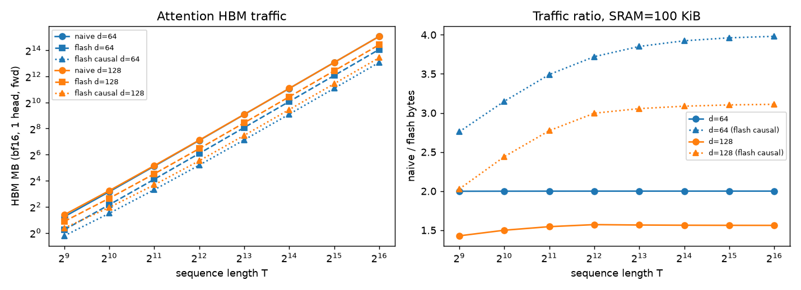
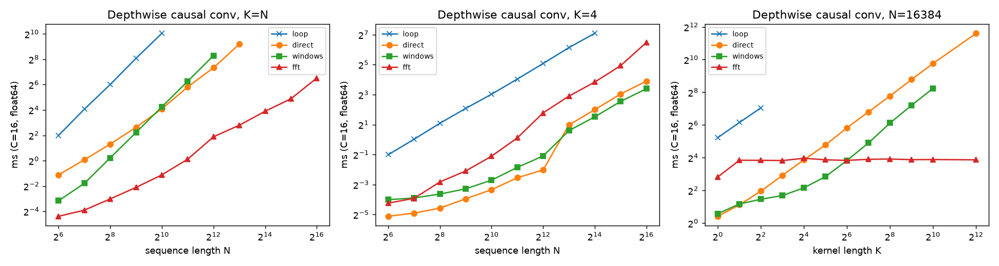
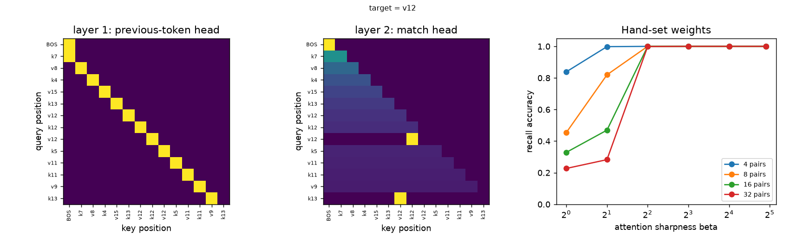
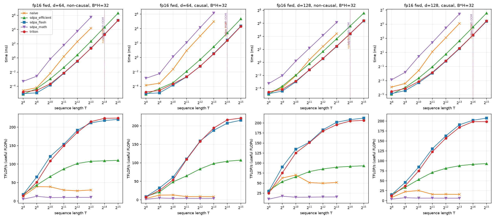
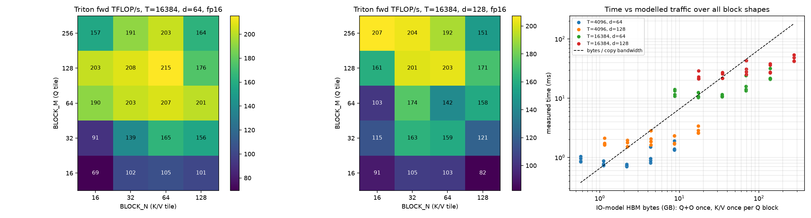
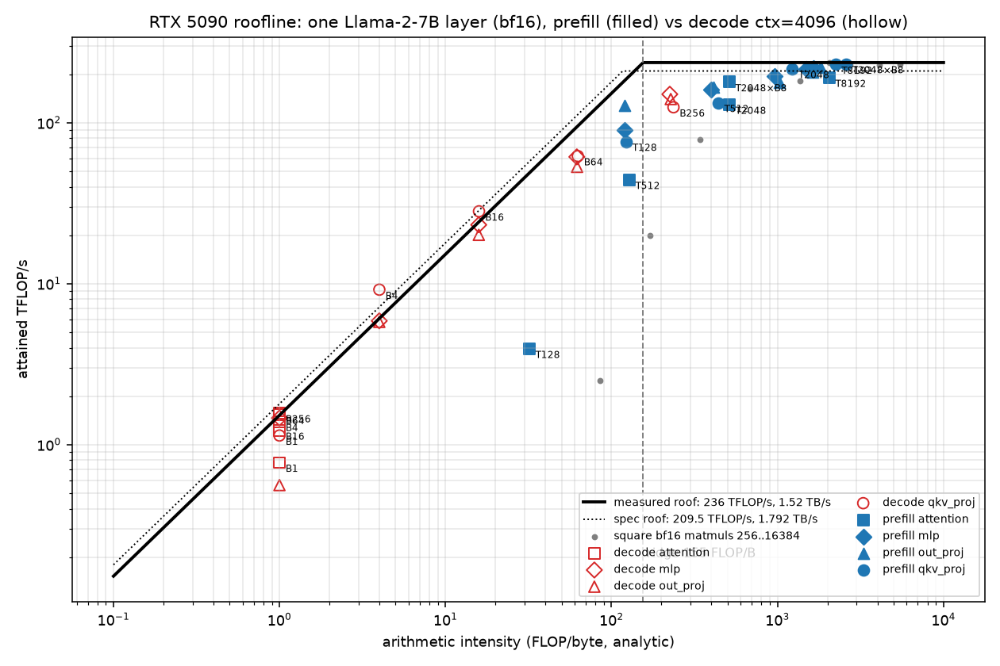
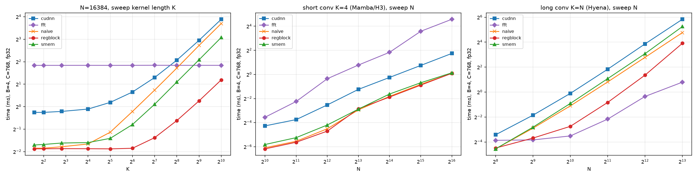
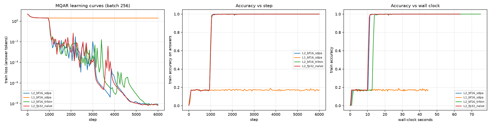

# CS229S Project 1：Attention 内核、IO 模型、depthwise 卷积与手写 associative recall

这个实验想回答一个问题：FlashAttention 到底快在哪里？常见的说法是「它减少了 HBM 流量」，但到底少了多少、
流量的阶数有没有变，要自己数一遍才知道。我先在 CPU 上用 numpy 写了 FlashAttention 风格的前向和反向，
用 IO 计数器把每一次 HBM 读写记下来，再到 RTX 5090 上用 Triton 重写并实测。最重要的发现是：在论文的块大小下，
FlashAttention 的 HBM 流量仍然是 Θ(T²)，只比朴素实现少 2 倍左右，它真正省下的是 T×T 矩阵占用的显存；
而 GPU 上实测的 7 倍加速，主要是因为朴素实现本身就是一个被显存带宽卡死的访存程序。

实验对应 CS229S Fall 2023 Project 1。另外还有三个较小的部分：depthwise 因果卷积三种写法的计时；
一个手工设定权重、没有训练的两层 attention-only transformer，用来解 associative recall（给一串键值对，再给一个键，输出对应的值）；
以及 GPU 上的 GPT 训练。

关于机器和口径：CPU 部分跑在 4 物理核 / 8 逻辑核的 Windows Server 上（与其他任务共享），Python 3.12，numpy 2.5，torch 2.6 CPU。
CPU 部分的计时来自 numpy，不代表 GPU kernel 的速度。IO 模型假设每个 SM 有 100 KiB SRAM、数据为 bf16。
GPU 部分（下文，RTX 5090）是 Triton FlashAttention-2 前向和反向、CUDA depthwise 卷积和 GPT 训练的实测。
完整报告：[cs229s_project1_report.pdf](../../../reports/cs229s-project1/cs229s_project1_report.pdf)。

## 一句话结论

分块 attention 的前向和反向都与 torch 一致（float64 下最大误差 4.9e-15）。在论文的块大小下（Br=min(Bc,d)），
前向的 HBM 流量非因果时比朴素实现少约 2 倍（d=64），因果时少约 4 倍。所以主要收益是显存从 O(T²) 降到 O(T)，流量的阶数没有变。

GPU 上的差距比「2 倍流量」大得多。Triton 前向达到 224 TFLOP/s（PyTorch 的 FA2 是 217.9），
T=8192 时比朴素实现快 7.15 倍。多出来的倍数要从朴素实现那一侧找：eager 模式下它有 4Td+6T² 次读写，
本身就是一个跑满带宽（93%）的访存程序。因此加速比可以写成 3·ridge/d，其中 ridge 是峰值算力除以带宽；
d=64 时这个式子预测 7.3，实测 7.15。训练方面，GPT-2 small 用 bf16 加 flash attention 时，
MFU（模型 FLOPs 利用率，即有效算力占峰值的比例）为 0.447。

## 对应官方作业

官方 Project 1 的必做项和本目录的对应关系如下，最后一列写明和官方要求的差异。

| 官方部分 | 本目录实现 | 差异 |
| --- | --- | --- |
| 训练 Transformer LM | `gpu/train_tiny.py`：GPU 上训练 1/2 层 GPT 解 MQAR，GPT-2-small 形状测 tokens/s 与 MFU（见下方「GPU 部分 → 训练」） | 只有合成任务（MQAR），没有在真实语料上训练 |
| 手写两层 transformer 解 associative recall | `tfkernels/recall.py`：上一 token 头 + 匹配头，权重全部手工设定 | 没有训练，也没有用 MLP 或 LayerNorm |
| MHA 的算术强度推导 | `tfkernels/io_model.py`：朴素实现与 flash 的 HBM 字节数；decode 阶段 MHA/GQA/MQA 的强度（复用 `tools/mlsys_calc.py`） | 只算前向、单头 |
| 1D depthwise 卷积的 CUDA kernel | `tfkernels/conv1d.py`：参考循环、O(NK) 移位相加、滑窗点积、FFT | 没有 GPU，用 numpy 代替 CUDA；滑窗版对应「每个线程算一个输出」 |
| （补充）FlashAttention | `tfkernels/attention.py`：朴素实现、online softmax、分块前向（运行中的 max/sum，因果块跳过）、基于 logsumexp 重计算的反向 | 课上讲过，但不是 P1 的必做项 |

## 怎么跑

```powershell
cd solutions/cs229s/project1-transformer-kernels; python -m pytest -q tests; python scripts/run_experiments.py
```

33 个测试大约 5 s；实验大约 70 s（`meta.json` 记录为 68.2 s）。

## 结果

### 正确性（`attention_correctness.csv`，float64，对照 `torch.scaled_dot_product_attention` 的 autograd）

流量和计时都以实现正确为前提，所以先对照 torch 的自动微分。8 组配置里 T 最大 1024，d 取 64 和 128，因果和非因果都有；
分块代码最容易错在边界块，所以特意让块大小不整除 T（例如 T=255、Bc=48，T=512、Bc=100）。O、dQ、dK、dV 的最大绝对误差都 ≤4.9e-15。测试的阈值是 1e-5，另外覆盖了 T=1、Tq≠Tk 和 batch×head 维。

显存上的差别很直观。T=1024 时，朴素实现的 S 矩阵在 fp64 下占 8.39 MB，而 flash 每块只要 0.033 MB。
但 numpy 版 flash 并不更快：T=1024、d=128 非因果时它要 44.6 ms，朴素实现只要 22.9 ms；
因果时 flash 靠跳过整块被 mask 掉的区域才追平（23.9 对 26.1 ms）。慢的原因是分块循环跑在 Python 里，
循环开销盖过了省下的访存。到了 GPU 上，这个结论会反过来。

### HBM 流量（`attention_io.csv`、`attention_io_vs_sram.csv`、`attention_io_counter_check.csv`）

这一节回答开头的问题：flash 究竟省了多少 HBM 流量。两种实现的流量都可以直接数出来。
朴素实现是 4Td + 4T²，其中 4T² 来自 S 和 P 这两个 T×T 矩阵各写一次、读一次。
flash 按 FA2 的循环顺序，Q 读 1 次，K/V 读 ⌈T/Br⌉ 遍，O 和 lse（每行 softmax 分母的对数）各写 1 次。
实现里的 IO 计数器在 8 组配置上与这个模型逐元素一致；T=2048 因果时，352 个 K/V 块里跳过了 168 个。

| d | T | 朴素 MB | flash MB | 比值 | 因果 flash 比值 |
| ---: | ---: | ---: | ---: | ---: | ---: |
| 64 | 4,096 | 136.3 | 68.2 | 2.00 | 3.72 |
| 64 | 65,536 | 34,393 | 17,197 | 2.00 | 3.98 |
| 128 | 4,096 | 138.4 | 88.1 | 1.57 | 3.00 |
| 128 | 65,536 | 34,427 | 22,045 | 1.56 | 3.11 |

意外的是，比值不随 T 增长。既然 flash 省掉的是 T² 项，直觉上序列越长它的优势应该越大。
但 Br 被 d 封顶，K/V 要重读 T/Br 遍，所以 flash 的流量约为 2T²d/Br = 2T²，和朴素实现同阶，只差一个常数。

把 SRAM 从 16 KiB 扫到 256 KiB（T=8192，d=64）能看清这个常数是怎么来的。16 KiB 时比值只有 1.004；
从 32 KiB 起 Br 已经顶到 d=64，比值固定在 2.00。再加大 SRAM 只会让 Bc 变大，不再减少流量。
因果的情况不一样：朴素实现仍然算完整的 T²，flash 却能跳过一半的块，所以比值接近 4 倍。



左图在对数坐标下，朴素实现和 flash 的流量是几条斜率相同的平行线：两者都随 T² 增长，flash 只是整体下移了一段。
右图把这段下移画成比值：非因果的线是水平的，这就是「流量阶数没变」；因果的线随 T 爬升并饱和，
因为序列越长，对角线上只能部分跳过的块占比越小，跳块省下的比例越接近一半。

### Decode 阶段的强度（`decode_attention_intensity.csv`，Llama-3-8B 形状，H100，seq=4096，bf16）

decode（逐 token 生成）关心的是算术强度：每读一个字节的 KV 能做多少次浮点运算，它决定 attention 被算力还是带宽卡住。

| 变体 | KV 头数 | 每 token 的 KV（KiB） | 每条序列 KV（GB） | FLOP/B | 每 token 每序列 attention 时间（µs） |
| --- | ---: | ---: | ---: | ---: | ---: |
| MHA | 32 | 512 | 2.15 | 1 | 641 |
| GQA-8 | 8 | 128 | 0.54 | 4 | 160 |
| GQA-4 | 4 | 64 | 0.27 | 8 | 80 |
| MQA | 1 | 16 | 0.067 | 32 | 20 |

强度等于 2·(H/H_kv)/bytes，与 T 和 batch 都无关。原因是每条序列有自己的 KV，加大 batch 并不能让多条序列共用一份 KV。
即使是 MQA，强度也离 H100 的 ridge（295）差 1 到 2 个数量级，所以 GQA 和 MQA 的提速完全来自少读 KV 字节。

### Depthwise 因果卷积（`conv1d_timing.csv`，C=16，float64）

Mamba、H3 和 Hyena 这类模型用 depthwise 因果卷积代替 attention，核长差别很大：前两者 K=4，Hyena 的核和序列一样长。
这里要回答的是：直接卷积和 FFT 卷积各在什么范围内更快。

| 设置 | 移位相加 ms | 滑窗 ms | FFT ms |
| --- | ---: | ---: | ---: |
| N=16384，K=4 | 3.90 | 2.76 | 14.34 |
| N=16384，K=16 | 14.67 | 4.48 | 15.64 |
| N=16384，K=64 | 57.11 | 14.29 | 14.30 |
| N=16384，K=1024 | 867.9 | 303.6 | 14.83 |
| K=N=4096 | 160.6 | 313.6 | 3.69 |
| K=4，N=65536 | 14.96 | 10.55 | 89.64 |

FFT 的耗时只取决于 N（约 14–15 ms），和 K 无关；O(NK) 的两种写法则随 K 线性增长。
因此它们迟早会和 FFT 交叉：移位相加在 K≈16 处交叉，滑窗在 K≈64 处交叉。
落到具体模型上，短卷积（Mamba/H3 的 K=4）直接卷积快 5.2–8.5 倍；长卷积（Hyena 的 K=N）在所有 N 上都是 FFT 更快。



右图固定 N 扫 K：FFT 是水平线，直接卷积是斜线，交点就是该换算法的地方。左图（K=N）里直接卷积是 O(N²)，FFT 一直最快；
中图（K=4）里 FFT 反而最慢，因为它要为一个很短的核付出整段 N log N 的变换。

### Associative recall（`recall_accuracy.csv`，每格 5000 条随机序列，权重手工设定，没有训练）

这一部分想说明：两层 attention 足以表达「查表」这个算法，不需要训练就能把权重直接写出来。

| 键值对数 | β=1 | β=2 | β=4 | β≥8 |
| ---: | ---: | ---: | ---: | ---: |
| 4 | 0.8386 | 0.9982 | 1.0 | 1.0 |
| 8 | 0.4538 | 0.8198 | 1.0 | 1.0 |
| 16 | 0.3286 | 0.4694 | 1.0 | 1.0 |
| 32 | 0.2268 | 0.2826 | 0.9988 | 1.0 |

构造分两步。第 1 层的 query 是 β·e_pos(p)，key 是 e_pos(j+1)，所以位置 p 会注意到 p−1，并把 tok(p−1) 写进一个单独的 prev 子空间。
第 2 层的 query 是 β·tok(p)，key 是 prev(j)。这样最后一个位置（也就是查询键 q）会注意到「前一个 token 是 q」的那个位置，而那个位置上的 token 正是要找的值。
β 控制 softmax 有多尖。β 太小时注意力分散到其他位置，正确答案被稀释；序列越长，干扰的位置越多，退化越严重。



前两张热力图是一条具体序列上的注意力：第 1 层是一条紧贴对角线的次对角线，每个位置都只看前一个位置；
第 2 层在最后一行只有一个亮点，落在查询键后面紧跟的值上。右图对应上表：键值对越多，需要的 β 越大，β 够大以后所有曲线都到 1。

## GPU 部分（RTX 5090）

CPU 部分只能数流量、验正确性。这一部分到 GPU 上回答：自己写的 Triton kernel 能不能追上 FA2，朴素实现慢在哪里，这些差别在训练中还剩多少。

完整分析见报告 [cs229s_project1_report.pdf](../../../reports/cs229s-project1/cs229s_project1_report.pdf)。
机器是 RTX 5090（sm_120，170 SM，32 GB，96 MB L2），torch 2.8.0+cu128，Triton 3.4.0，CUDA 12.8。
实测峰值记录在 `artifacts/raw/gpu/peaks.json`：copy 带宽 1521.9 GB/s，BF16 matmul 236.3 TFLOP/s，ridge 155 FLOP/B。
所有计时都在共享 GPU 锁内独占完成。原始数据在 `artifacts/raw/gpu/*.jsonl`，`python scripts/summarize_gpu.py` 会打印下面的每张表。

| 文件 | 内容 |
| --- | --- |
| `gpu/flash_triton.py` | Triton FlashAttention-2 前向（online softmax，exp2，因果分两段）+ 反向（dK/dV 与 dQ 两个 kernel），朴素实现，fp32 分块参考 |
| `gpu/dwconv_cuda.py` | depthwise 因果卷积的三个 CUDA kernel（naive / smem+halo / 寄存器分块），`load_inline` 编译；cuDNN 与 FFT 基线 |
| `gpu/tiny_gpt.py`, `gpu/train_tiny.py` | 可切换 attention 实现的 GPT；MQAR 训练、GPT-2-small 形状吞吐与 MFU、手写 recall 的 GPU 复核 |
| `gpu/bench_attention.py`, `gpu/bench_roofline.py`, `gpu/bench_dwconv.py` | 基准；`gpu/run_gpu.sh` 依次运行全部实验 |
| `tests/test_gpu.py` | 35 个 GPU 测试（无 CUDA 时整体 skip） |

### FlashAttention（`attention_fwd.jsonl`，fp16，d=64，非因果，B·H=32；ms / TFLOP/s）

| 方法 | T=1024 | T=4096 | T=8192 | T=16384 | T=32768 |
| --- | ---: | ---: | ---: | ---: | ---: |
| Triton（本实验） | 0.079 / 108.5 | 0.739 / 185.9 | 2.558 / 214.9 | 9.818 / 224.0 | 39.18 / 224.5 |
| SDPA flash | 0.071 / 120.9 | 0.717 / 191.6 | 2.599 / 211.5 | 10.09 / 217.9 | 39.81 / 221.0 |
| SDPA efficient | 0.129 / 66.5 | 1.350 / 101.8 | 5.107 / 107.6 | 20.17 / 109.0 | 79.78 / 110.2 |
| SDPA math | 0.894 / 9.6 | 13.66 / 10.1 | 54.06 / 10.2 | OOM | — |
| 朴素（物化 S、P） | 0.222 / 38.7 | 4.943 / 27.8 | 18.28 / 30.1 | OOM | — |

先看速度。Triton 前向在长序列上与 PyTorch 的 FA2 持平，峰值 224.5 TFLOP/s，是实测 matmul 峰值的 95%。
它在 T=8192 时比朴素实现快 7.15 倍，因果时快 22.2 倍。

再看显存。朴素实现要额外存两个 fp16 的 T×T 张量，T=8192 时是 8.62 GB；到 T=16384 需要 34 GB，超出显存而 OOM。
Triton 在 T=32768 时额外显存只有 138 MB。

精度上，以 fp32 参考为准，Triton 在 T=4096 时 fp16 误差 6.6e-5、bf16 误差 3.65e-4，与 SDPA flash 相同；
朴素实现的误差大 2–4 倍，因为它把 S 以 fp16 写回显存，多经历了一次舍入。

反向是对的（dQ 误差与 SDPA flash 同为 8.8e-5），但只有 FA2 的 80%：T=16384 时是 167.4 对 209.0 TFLOP/s。
差距的来源很清楚。我的反向拆成了两个 kernel，各自重算一遍 QKᵀ 和 dO·Vᵀ，总共 9 个矩阵乘，而 FA2 只要 7 个。



下排的吞吐图里，Triton 和 SDPA flash 几乎重合，随 T 增大顶到平台；朴素实现和 SDPA math 是贴着底部的平线。
这正是访存受限的样子：工作量和读写量都按 T² 增长，吞吐被带宽锁死，而 flash 的瓶颈在算力上。朴素实现的曲线中途断掉，就是 OOM。

接下来把 GPU 的实测和 CPU 部分的 IO 模型对上。朴素实现按 eager 实际的 4Td+6T² 次 fp16 读写计算，
T=8192 时隐含带宽是 1.417 TB/s，即 copy 带宽的 93%。换句话说，它就是一个以 DRAM 带宽运行的访存程序。
所以加速比可以写成 `3·ridge/d`：d=64 时预测 7.3，实测 7.15；d=128 时预测 3.6，实测 3.8。

反过来按 IO 模型计算 flash 的隐含带宽，最高能到 6.57 TB/s（出现在块扫描中 Br=16 时），是 DRAM 的 4.3 倍。
这不可能是 DRAM 在供数，只能是 K/V 的重读大多命中了 96 MB 的 L2。因此 Θ(T²d²/M) 只是 DRAM 流量的上界。
flash 前向的 DRAM 强度约等于 Br（fp16），最佳块是 (Br,Bc)=(128,64)，达到 215.4 TFLOP/s。
需要说明的是，容器无权读取性能计数器（ncu 报 `ERR_NVGPUCTRPERM`），所以 L2 命中是推断出来的，不是直接测量。



热力图里 Q 块（纵轴）太小时整行都暗，因为每个 Q 块都要把 K/V 完整读一遍，Q 块越小重读越多。
右边散点里很多点落在「字节数 ÷ copy 带宽」虚线的下方，即比 DRAM 带宽允许的还快，这就是推断 L2 命中的依据。

### Roofline：一层 Llama-2-7B（`roofline.jsonl`，bf16）

roofline 模型说：一个算子能达到的速度，取决于它的算术强度落在 ridge 的左边（受带宽限制）还是右边（受算力限制）。
这一节把一层 Llama-2-7B 的各个算子在 prefill 和 decode 两种形状下放到实测的 roofline 上，看哪些算子被哪一边卡住。

| 形状 | 算子 | 强度 FLOP/B | ms | 实测 | roofline 比例 |
| --- | --- | ---: | ---: | ---: | ---: |
| decode B=1 | MLP | 1.0 | 0.1851 | 1463 GB/s | 0.96 |
| decode B=1 | attention | 1.0 | 0.0868 | 773 GB/s | 0.51 |
| decode B=256 | attention | 1.0 | 10.95 | 1570 GB/s | 1.03 |
| decode B=256 | QKV 投影 | 236 | 0.2067 | 124.7 TFLOP/s | 0.53 |
| prefill T=8192 | QKV 投影 | 2234 | 3.589 | 229.8 TFLOP/s | 0.97 |
| prefill T=8192 | attention | 2048 | 2.887 | 190.5 TFLOP/s | 0.81 |

decode 的 attention 强度恒为 1，与前面 `decode_attention_intensity` 的 2(H/H_kv)/b 一致。它不随 batch 变化，
所以 B=256 时它占了一层时间的 94%。线性层不一样，权重被 batch 里的所有序列共用，强度约等于 B，要到 B≈155 才越过 ridge。
prefill 的四个算子都在 ridge 右侧。表外还有一个反常点：decode B=4 的 QKV 投影比例是 1.51，超过了 1。
这是因为 100 MB 的权重在重复测量时有一部分留在 L2 里，真实推理时不会这样。



红色空心点（decode）沿左边的斜线排开，batch 越大越往右上走；只有 decode attention 的方块无论 batch 多大都挤在强度为 1 的那一列。
蓝色实心点（prefill）都在右边的平顶附近。「decode 靠加 batch 提速，但 attention 加 batch 没用」就是这张图。

### Depthwise 因果卷积（`dwconv.jsonl`，B=4，C=768，fp32；ms）

CPU 上得到的交叉点能不能搬到 GPU 上？这里写了三个 CUDA kernel 和 cuDNN、FFT 对比。

| 设置 | naive | smem | regblock | cuDNN | FFT |
| --- | ---: | ---: | ---: | ---: | ---: |
| N=16384，K=4 | 0.2785 | 0.3124 | **0.2735** | 0.8396 | 3.577 |
| N=16384，K=64 | 0.8633 | 0.5770 | **0.2776** | 1.573 | 3.581 |
| N=16384，K=1024 | 13.00 | 8.462 | **2.289** | 14.82 | 3.581 |
| K=N=512 | 0.1343 | 0.1423 | 0.0776 | 0.2768 | **0.0701** |
| K=N=8192 | 27.28 | 38.20 | 15.07 | 57.18 | **1.737** |

K=4 时这个算子完全受带宽限制。寄存器分块 kernel 达到 1472 GB/s，是 copy 带宽的 97%；cuDNN 的 `conv1d(groups=C)` 反而慢 3.07 倍。

K=1024 时计算量上来了，寄存器分块的直接卷积等效达到 45.0 TFLOP/s，比 smem 版快 3.7 倍。
smem 版慢在共享内存上：它每个 FMA 要读 2 次共享内存，停在约 12 TFLOP/s，大致就是共享内存带宽的上限；寄存器分块每 64 个 FMA 只读 23 次。

和 FFT 的交叉点也变了。N=16384 时交叉在 K≈1600 附近；K=N 时，N≥512 就该用 FFT。
CPU 上的交叉点是 K≈16–64，GPU 上右移了 25–100 倍，因为直接卷积在 GPU 上被加速得比 FFT 多。
数值上，与 fp64 cuDNN 参考的最大误差 ≤1.4e-5（K=4096）。



左图和 CPU 版的右图是同一种形状：FFT 是水平线，直接卷积随 K 上升，只是交点挪到了很靠右的地方；
寄存器分块（红线）在 K 较小时几乎是平的，说明这段时间都花在读写数据上，多算几次乘加不花额外时间。
右图（K=N）里 FFT 从一开始就压在最下面，所以 Hyena 那种长卷积在 GPU 上仍然应该用 FFT。

### 训练（`train_throughput.jsonl`，`train_mqar*.jsonl`）

kernel 级的差别到了端到端训练还剩多少？这里用 GPT-2-small 的形状（12 层，d=768，T=1024，B=8，110.2M 参数）测吞吐，
MFU = 6N·tokens/s ÷ 236.3 TFLOP/s（`mlsys_calc.mfu`）：

| 精度 | attention | k tokens/s | MFU（6N） | 峰值显存 GB |
| --- | --- | ---: | ---: | ---: |
| fp32 | 朴素 | 41.5 | 0.116 | 15.38 |
| fp32 | SDPA | 59.6 | 0.167 | 10.53 |
| TF32 | SDPA | 82.2 | 0.230 | 10.54 |
| bf16 autocast | 朴素 | 64.8 | 0.181 | 15.37 |
| bf16 autocast | SDPA flash | 159.6 | 0.447 | 8.27 |
| bf16 autocast | Triton（本实验，前向+反向） | 156.0 | 0.437 | 8.25 |

bf16 和 SDPA 都打开时，比 fp32 朴素快 3.84 倍。如果只开 bf16、保留朴素 attention，只快 1.56 倍。
原因是 bf16 加速的是矩阵乘，而朴素 attention 受访存限制，矩阵乘再快也省不掉它读写 T×T 矩阵的时间。

接着固定每步 16384 个 token、扫序列长度 T。朴素实现从 T=1024（B=16）起就 OOM。
SDPA 的吞吐从 T=512 的 174.1k 降到 T=8192 的 121.8k tokens/s，但按 PaLM 公式（6N + 12LTd）把 attention 计入后，MFU 反而从 0.53 升到 0.81。
问题出在口径：12LTd 计的是非因果的全部 attention FLOPs，因果只做了一半；按因果的 6LTd 计，MFU 在 0.51–0.57 之间基本不变。

最后是 MQAR（多查询的 associative recall），用 2 层和 1 层 GPT（d=128，4 头，batch 256，每步重新采样数据）来训。
我先扫了 (n_keys, P, lr, wd)：n_keys=64 时，P=4 和 P=8 在 lr 1e-3 下 6000 步都达到 1.000；lr 3e-3 卡在 0.36；
P=16 和 P=32 在 6000 步内学不会（0.10–0.25）。然后用选出的 n_keys=64、P=8、lr 1e-3 跑 6000 步做对照：

| 配置 | eval 准确率 | 首次 acc ≥ 0.99 | 训练时间 s |
| --- | ---: | ---: | ---: |
| 2 层，bf16 + SDPA | 1.000 | 第 1100 步 | 63.5 |
| 1 层，bf16 + SDPA | 0.172 | — | 44.8 |
| 2 层，bf16 + Triton（本实验） | 1.000 | 第 1100 步 | 75.1 |
| 2 层，fp32 + 朴素 | 1.000 | 第 1100 步 | 63.2 |

2 层模型前 1000 步和 1 层模型一样停在约 0.17 的平台上，然后在 100 步内跳到 100%，这是 induction head（「找到上次出现的同一个 token，复制它后面那个」的注意力回路）形成的时刻。
1 层模型始终学不会，因为匹配需要「上一 token 头 + 匹配头」两步，正好对应前面手写构造的两层。
三种 attention 实现的曲线在跳变前完全重合，这也顺带校验了 Triton 反向在端到端训练里是对的。
T=32 的小模型每步约 10 ms，几乎全是 kernel 启动开销，所以选哪种实现不影响速度。



中图里三条 2 层曲线先一起趴在平台上，在同一步几乎垂直地跳到 1，1 层曲线一直停在平台上。
右图换成墙钟时间后 Triton 晚一点跳，只是因为它每步稍慢。

手写 associative recall 在 GPU 上也复核了一遍（`train_recall.jsonl`）：24 组配置的准确率与 CPU 逐格相同，预测不一致的条数为 0。

## 面试讲法

20 秒结论：FlashAttention 用 online softmax（边扫边维护每行的最大值、分母和输出缩放）把 attention 融合成分块的一趟计算，
不写出 T×T 矩阵；反向用保存的 logsumexp 重算 P。它把显存从 O(T²) 降到 O(T)，但 HBM 流量是 Θ(T²d²/M)。
d=64–128 时这仍然是 Θ(T²)，在我的模型里只比朴素实现少 2 倍（因果时 4 倍）。decode 阶段的 attention 强度只有 2·(H/H_kv)/b，
所以 GQA/MQA 是靠减少 KV 字节来提速的，加大 batch 对它没有帮助。

白板上可以写这几行：
- online softmax：`m' = max(m, s)`，`l' = l·e^{m−m'} + Σe^{s−m'}`，`acc' = acc·e^{m−m'} + e^{s−m'}V`。
- 反向：`P = exp(S − lse)`，`D = rowsum(dO∘O)`，`dS = P∘(dO·Vᵀ − D)`，`dQ = dS·K/√d`，`dK = dSᵀ·Q/√d`，`dV = Pᵀ·dO`。
- 流量：朴素 `4Td + 4T²`；flash `Td + ⌈T/Br⌉·2Td + Td`。
- decode：`I = 4·H·hd·T / (2·H_kv·hd·T·b) = 2(H/H_kv)/b`。

**不能推出的结论**：
- 不能推出「FlashAttention 在 GPU 上只快 2 倍」。朴素模型只数了 S 和 P 各一次读写；实际的 eager 实现还有 scale、mask、dropout 各自的 T² 读写和 kernel launch，fp32 的 S 也更大。
- 不能推出 numpy 的计时代表 GPU。numpy 版 flash 比朴素版慢，是 Python 循环的开销。
- 不能推出「训练出来的模型就是这样解 recall 的」。手写模型只证明两层 attention 足以表达这个算法（induction head）；GPU 上训练的 2 层模型学会了 MQAR、1 层学不会，与这个构造一致，但我没有检查训练出的 attention 模式。

追问：
1. 为什么 FA2 把外层循环换成 Q 块？因为不同 Q 块之间没有依赖，可以分给不同的 thread block 并行；而且 O 只写一次，不需要反复读写 O。
2. 反向为什么保存 lse，而不是 m 和 l？一个标量就够重算 P = exp(S − lse)，既省显存，又避免了二次归一化。
3. 什么时候卷积该用 FFT？核长 K 超过 log N 的若干倍时。本机 N=16384 时交叉点在 K≈16–64，短卷积直接写更快。

## 文件

```text
project1-transformer-kernels/
├── code/tfkernels/{attention,io_model,conv1d,recall}.py
├── tests/{conftest.py,test_kernels.py}
├── scripts/run_experiments.py
└── artifacts/raw/*.csv, meta.json；artifacts/figures/*.png
```
