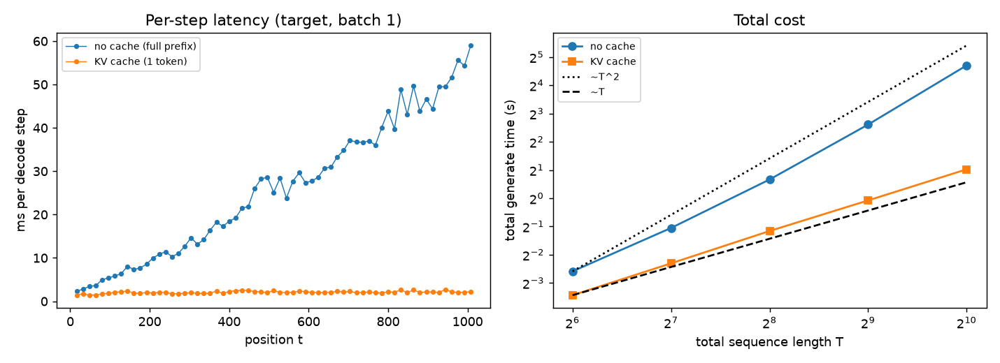
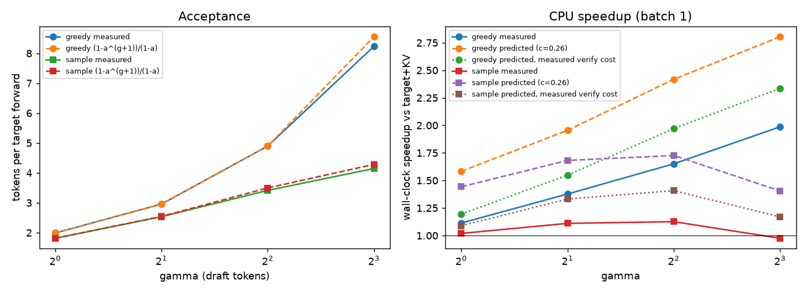
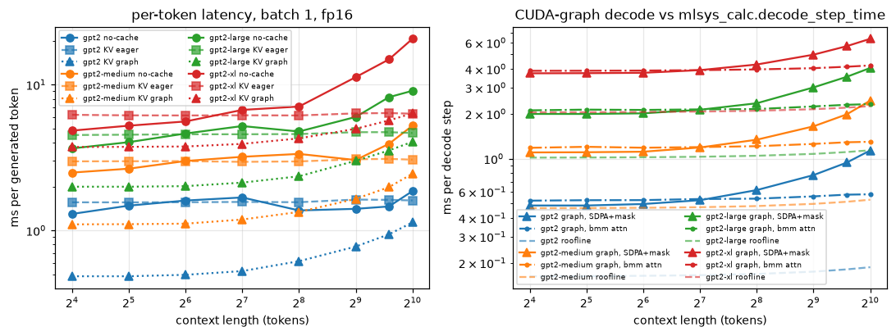
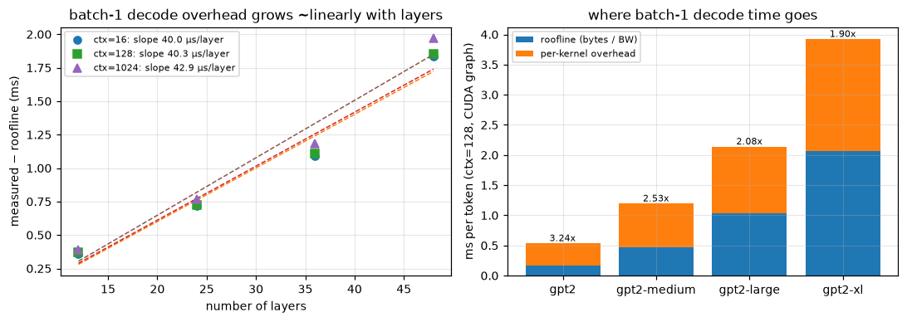
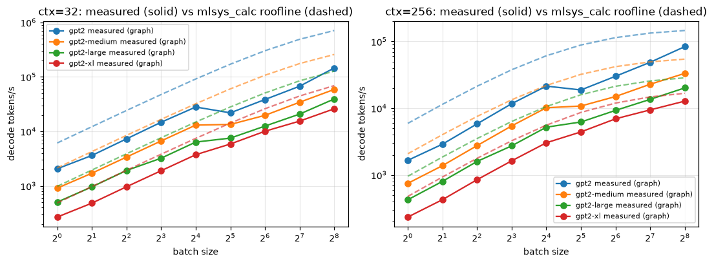
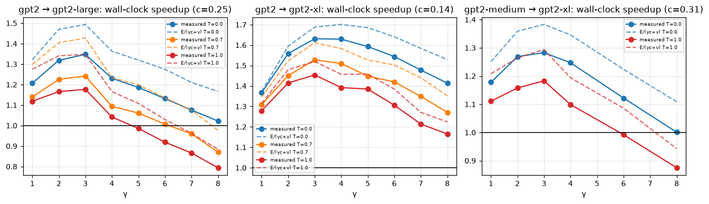
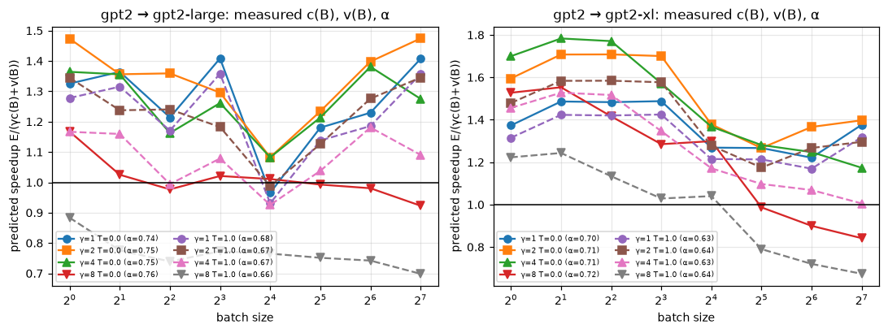

# CS229S Project 2：KV cache、推测解码与推理估算

这个实验想回答：KV cache 和推测解码（speculative decoding，用小模型先猜几个 token、大模型一次验证）各能把生成加快多少，
加速公式在什么条件下成立。我先在 CPU 上用自己训练的小模型把两者实现出来并验证正确性，
再在 RTX 5090 上用真实的 GPT-2 权重重测。最重要的发现是：推测解码的接受率公式在两边都很准，
但实际加速取决于「一次验证 γ+1 个 token 是否接近免费」。CPU 上这一步不免费，加速只有 1–2 倍；
GPU 上 decode 受访存限制，验证几乎免费，gpt2→gpt2-xl 贪心实测 1.631 倍，与公式的预测只差 3%。

实验对应 CS229S Fall 2023 Project 2。CPU 部分是一个 nanoGPT 风格的解码器，带预分配 KV cache；
用本地生成的合成语法分别训练 target（4 层）和 draft（1 层）；实现 Leviathan/Chen 的接受-拒绝采样（含残差重采样）
和贪心版推测解码；最后用 `tools/mlsys_calc.py` 估算 Llama-3-8B 在 H100 上 decode 的 roofline。

CPU 机器是 4 物理核 / 8 逻辑核的 Windows Server（与其他任务共享），Python 3.12，torch 2.6 CPU。训练用 8 线程，
decode 计时用 1 线程，因为这两个小模型的 decode 受每次调用的开销限制，1/2/4/8 线程的吞吐差不多。
CPU 部分的计时都是 CPU batch=1 的数字；真实 GPT-2 权重在 RTX 5090 上的实测见下文「GPU 部分」，完整报告：
[cs229s_project2_report.pdf](../../../reports/cs229s-project2/cs229s_project2_report.pdf)。

## 一句话结论

CPU 上，KV cache 在 T=1024 时把生成速度从 38.9 提到 499 tok/s（12.8 倍），总耗时从约 T² 变成约 T。
推测解码的贪心输出与 target 逐 token 一致（16/16 条），实测的「每次 target 调用产出的 token 数」与 (1−α^{γ+1})/(1−α)
相差在 4% 以内。但实际加速只有 0.98–1.99 倍，低于公式，因为一次验证 γ+1 个 token 的 forward 并不免费，
要花单 token forward 的 1.41–1.61 倍。

GPU 上（RTX 5090，真实 GPT-2 权重），fp32 下与 HF 对齐，贪心输出 bit-exact。gpt2-xl 上下文 1024 时，KV cache 加 CUDA Graph
比无 cache 快 4.9 倍。gpt2→gpt2-xl 推测解码贪心实测 1.631 倍，验证几乎免费（v≈1.11），与公式的预测差 3%。
同一对模型换到 RTX 4080 SUPER 上，贪心 γ=4 仍是 1.631 倍（α=0.712，c=0.119，v=1.060）。
这张卡的拷贝带宽只有 5090 的约四成，但多验几个 token 的代价几乎没变。

## 对应官方作业

| 官方部分 | 本目录实现 | 差异 |
| --- | --- | --- |
| nanoGPT 加 KV cache | `kvspec/model.py`：`KVCache` 预分配 (L,B,H,T_max,hd)，靠 `length` 回滚；`generate_nocache` 与 `generate_kv` 对照 | 不用 GPT-2 权重（没有网络），模型在本地合成数据上训练 |
| 推测解码 | `kvspec/speculative.py`：采样版 `accept_reject_sample`（残差 norm(max(p−q,0))，全部接受时采一个 bonus token），贪心版 `accept_reject_greedy`；两个 cache 都会回滚 | 只做 batch=1 |
| 推理估算（KV 字节、roofline） | `inference_math.csv`：直接调用 `mlsys_calc.decode_step_time` | 公式与仓库工具共用，没有重复实现 |
| 数据与训练 | `kvspec/data.py`：64 个随机「单词」，单词内拼写确定，单词之间是稀疏 bigram 链；`kvspec/train.py` | target 300 步训练 43.9 s，draft 400 步训练 8.0 s |

## 怎么跑

```powershell
cd solutions/cs229s/project2-kv-speculative; python -m pytest -q tests; python scripts/run_experiments.py
```

CPU 的 15 个测试约 8 s（`tests/test_gpu.py` 的 5 个 GPU 测试在没有 CUDA 时整体 skip）。实验包括训练共 172.4 s（`meta.json`）；
机器负载高时会更慢，曾测到 239 s。

## 结果

### 模型（`models.json`、`train_log.csv`）

推测解码需要一对模型：一个大而准的 target，一个小而快的 draft。两者都在同一份合成语法上训练：

| 模型 | 参数（不含位置嵌入） | 层 × 宽度 | 训练 | 验证 loss（nats/字符） |
| --- | ---: | --- | --- | ---: |
| target | 796,928 | 4 × 128 | 300 步，43.9 s | 0.296 |
| draft | 29,712 | 1 × 48 | 400 步，8.0 s | 0.560 |

### KV cache（`kv_equivalence.csv`、`kv_timing.csv`、`kv_step_latency.csv`）

不用 cache 时，生成第 t 个 token 要把前面 t 个 token 全部重算一遍；KV cache 把每层已经算过的 K、V 存下来，每步只算新 token。
这一节先确认两种做法输出相同，再看省了多少时间。

5 个 prompt 各生成 200 个 token，fp32 下贪心输出完全相同，logits 最大差 4.1e-5。测试在 float64 下要求差 ≤1e-9，
还检查了分段 prefill 与整段 forward 的一致性。

| 总长 T | 不用 cache（s） | KV cache（s） | 不用 cache tok/s | KV tok/s | 倍数 |
| ---: | ---: | ---: | ---: | ---: | ---: |
| 64 | 0.166 | 0.093 | 336.8 | 605.2 | 1.80 |
| 256 | 1.585 | 0.448 | 156.5 | 554.0 | 3.54 |
| 512 | 6.107 | 0.949 | 82.5 | 531.3 | 6.44 |
| 1024 | 26.091 | 2.035 | 38.9 | 499.2 | 12.82 |

T 从 512 翻倍到 1024 时，不用 cache 的总耗时涨了 4.27 倍，符合 T²；KV cache 只涨 2.15 倍，符合 T。
单步延迟也一样：位置 16 时是 2.27 ms 对 1.42 ms，到位置 1008 时变成 59.0 ms 对 2.25 ms。
KV 那一步并非完全不变，也在缓慢变长，这来自 attention 里 O(t) 的那部分：新 token 仍要和全部历史 K、V 做点积。



左图的蓝线是无 cache 的单步延迟，随位置线性上升，所以把每一步加起来的总耗时是 T²；橙线几乎是平的。
右图是总耗时的对数坐标：两条实线分别贴着 T² 和 T 的参考虚线，倍数随 T 拉开，因为两者差的正是一个 T。

### 推测解码（`speculative.csv`，16 个 prompt × 104 个新 token）

推测解码每轮让 draft 提议 γ 个 token，target 一次 forward 验证它们，期望每次 target 调用产出 (1−α^{γ+1})/(1−α) 个 token，
其中 α 是接受率。所以先要把 α 估对。

这里有过一次真实的错误。α 应该用「接受数 /（接受数 + 拒绝数）」估计；我原来用的是「接受数 / 提议数」，
它把每轮第一次拒绝之后那些根本没被检验过的 draft 也算了进去，会系统性偏低。采样、γ=8 时它给出 0.41，正确值是 0.80，
用它代入公式会严重低估。

| 模式 | γ | α | 每次 target 调用的 token 数 | 公式 | 预测加速（假设验证免费） | 预测加速（用实测验证代价） | 实测加速 |
| --- | ---: | ---: | ---: | ---: | ---: | ---: | ---: |
| 贪心 | 1 | 0.989 | 1.99 | 1.99 | 1.58 | 1.19 | 1.11 |
| 贪心 | 4 | 0.990 | 4.90 | 4.90 | 2.42 | 1.97 | 1.65 |
| 贪心 | 8 | 0.987 | 8.24 | 8.56 | 2.80 | 2.34 | 1.99 |
| 采样 T=1 | 1 | 0.812 | 1.81 | 1.81 | 1.44 | 1.09 | 1.02 |
| 采样 T=1 | 2 | 0.839 | 2.53 | 2.54 | 1.68 | 1.33 | 1.11 |
| 采样 T=1 | 4 | 0.820 | 3.41 | 3.50 | 1.73 | 1.41 | 1.13 |
| 采样 T=1 | 8 | 0.797 | 4.15 | 4.29 | 1.40 | 1.17 | 0.98 |

正确性上，贪心的 16 条输出全部与 target 单独贪心解码一致（`greedy_identical`=16）。采样时，测得的 α 与 E[Σmin(p,q)] = 1−TV（0.805–0.828）一致，
这正是 Leviathan 定义的 α（TV 是两个分布的总变差距离）。

公式和实测之间的差距要分两层看。第一层是 token 数：γ=8 时公式略高于实测（8.56 对 8.24），一个原因是每个 prompt 的最后一轮 γ 被截短了。
第二层是时间：draft 与 target 单 token 耗时之比 c=0.256，远高于参数量之比的 0.04，因为两个模型都被每次调用的固定开销主导。
即使把实测的验证代价也代进去，实测加速仍低于预测，剩下的差距来自 Python 端的接受-拒绝循环、numpy 转换和 draft 补喂的开销。

采样版是否真的不改变输出分布，由统计测试 `test_accept_reject_matches_target_distribution` 检查：p、q 显式给出，γ=3，60,000 次试验。
首个输出 token 和全部输出 token 的分布，对 p 做卡方检验 p 值 > 1e-3、TV < 0.01；对 q 做卡方检验 p 值 < 1e-12，说明输出确实来自 p 而不是 q。
平均接受数与 Σα^i 的相对误差在 2% 以内。



左图里实测的 token 数和公式几乎重合，说明接受率模型本身没问题。右图是墙钟加速：「假设验证免费」的预测线在最上面，
「用实测验证代价」的预测线居中，实测线在最下面，采样模式下 γ=8 时甚至掉到 1 以下。三条线之间的两段落差，就是上面说的验证代价和 Python 开销。

### 推理估算（`inference_math.csv`，Llama-3-8B，H100 SXM，bf16，`mlsys_calc.decode_step_time`）

小模型的 CPU 计时说明不了大模型。这一节换个角度，用公式估算 Llama-3-8B 在 H100 上 decode 时，batch 加大能换来多少吞吐、什么时候显存先撑不住。

| seq | batch | KV GB | 权重 + KV 能否放进 80 GB | FLOP/B | 每步 ms | tok/s | 瓶颈 |
| ---: | ---: | ---: | --- | ---: | ---: | ---: | --- |
| 4096 | 1 | 0.54 | 是 | 1.10 | 4.95 | 202 | memory |
| 4096 | 8 | 4.29 | 是 | 7.16 | 6.08 | 1,317 | memory |
| 4096 | 64 | 34.36 | 是 | 23.11 | 15.05 | 4,252 | memory |
| 4096 | 256 | 137.44 | **否** | 30.37 | 45.82 | 5,587 | memory |
| 32768 | 64 | 274.88 | **否** | 7.31 | 86.85 | 737 | memory |

权重 16.06 GB，每 token 的 KV 是 128 KiB（GQA-8）。如果不算 KV，权重被 batch 共用，临界 batch 是 295。
但一算上 KV，batch 256 的强度也只有 30.4，因为 KV 读取量和 batch 一起线性增长，而且这时已经放不进显存了。

## GPU 部分：真实 GPT-2 权重 + RTX 5090

CPU 上最大的疑问是：验证代价和调用开销到了 GPU 上会变成什么样。这一部分用真实权重回答它。

完整报告：[`cs229s_project2_report.pdf`](../../../reports/cs229s-project2/cs229s_project2_report.pdf)。

`gpu/gpt2_fast.py` 是自己写的 nanoGPT 风格 GPT-2 forward，直接读 HF 的 `model.safetensors`（gpt2 / medium / large / xl）。它有三种 decode：
无 cache（每步重算整个前缀）；预分配静态 KV cache（eager）；KV cache 加 CUDA Graph（把整步 decode 录成一张图一次性下发；
位置做成 device 张量，attention 在固定长度上加 mask；可选 `attn_impl="bmm"`）。
`SpecEngine` 是 batch 1 的 GPU 推测解码：接受-拒绝全在 GPU 上算，每轮只同步一次，KV 回滚就是把 `length` 调小。
`gpu/run_gpu.py` 的各子命令把原始结果写到 `artifacts/raw/gpu/*.jsonl`，`scripts/plot_gpu.py` 在本地出图并生成汇总 CSV。

环境是 RTX 5090（170 SM，32 GB），torch 2.8.0+cu128，transformers 5.21.0（只用来对照 logits）。实测 `copy_` 带宽 1522 GB/s、
fp16 GEMM 223 TFLOP/s（`hw.jsonl`），roofline 预测都用这两个实测值调用 `tools/mlsys_calc.py`。计时一律用 fp16，正确性一律用 fp32（关闭 TF32）。

```powershell
# 服务器上（需要 CUDA 与权重）
python gpu/run_gpu.py verify; python gpu/run_gpu.py latency; python gpu/run_gpu.py batch
python gpu/run_gpu.py spec --target gpt2-xl --draft gpt2; python gpu/run_gpu.py dist --target gpt2-large
# 本地
python scripts/plot_gpu.py; python -m pytest -q tests    # tests/test_gpu.py 在没有 CUDA 时整体 skip
```

### 正确性（`verify.jsonl`、`spec_exact.jsonl`、`dist.jsonl`）

先对齐 logits。fp32 下与 HF 相比，gpt2-large / xl 的最大绝对误差是 4.2e-5 / 4.6e-5。gpt2 / medium 的绝对误差大一些，
为 2.3e-3 / 4.6e-4，但它们的 logits 最大值有 282 / 348，换成相对误差只有 8.0e-6 / 1.3e-6，argmax 一致率都是 1.0。

贪心解码上，fp32 下 4 个模型 × 5 个 prompt × 64 token，KV eager、KV+graph、HF `generate` 与无 cache 全部逐 token 相同（60/60）。
推测解码贪心在 fp32 下用 gpt2→gpt2-xl、γ∈{1,4,8}、eager 与 graph 两种实现，120/120 都与 target 单独贪心一致。
fp16 主实验里一致率降到 gpt2-large 94/100、gpt2-xl 91/100，但所有分叉点上 target 的 top-2 logit 差都 ≤ 0.0078，
也就是 fp16 精度下的平局，不是算法错误。

推测解码采样用 gpt2→gpt2-large、fp32、同一 prompt 重复 4000 次。第一个 token 对精确 target 分布的卡方 p 值是 0.657（T=1）/ 0.182（T=0.7），
对 draft 分布则是 8.9e-168 / 3.4e-124，说明输出分布是 target 的。

### KV cache、CUDA Graph 与 roofline（`latency.jsonl`、`batch.jsonl`、`memory.jsonl`）

| batch 1，fp16 | 无 cache | KV eager | KV + graph（SDPA） | KV + graph（bmm） | roofline |
| --- | ---: | ---: | ---: | ---: | ---: |
| gpt2-xl，上下文 16 | 4.84 ms | 6.21 ms | 3.74 ms | 3.88 ms | 2.05 ms |
| gpt2-xl，上下文 128 | 6.71 ms | 6.16 ms | 3.92 ms | 3.92 ms | 2.07 ms |
| gpt2-xl，上下文 1024 | 20.62 ms | 6.32 ms | 6.36 ms | 4.22 ms | 2.25 ms |
| gpt2-large，上下文 1024 | 9.07 ms | 4.66 ms | 4.06 ms | 2.32 ms | 1.14 ms |

短上下文时，KV eager 反而比无 cache 慢。batch 1 时 GPU 大部分时间在等 CPU 发 kernel，KV cache 多出来的写入和切片 kernel 正好落在这条关键路径上。
CUDA Graph 把整步一次性下发，消掉了这部分开销。

长上下文时，attention 的写法开始起作用。SDPA 加 bool mask 做 decode attention 时，batch 1 只有 B×H=25 个 block，GPU 大部分 SM 空着，所以长上下文明显变慢。
换成显式的 QKᵀ/softmax/PV 后，cuBLAS 会沿 T 切分，xl 在上下文 1024 时从 6.36 ms 降到 4.22 ms。

即使这样，graph decode 仍是 roofline 的约 1.9 倍（xl）。差值和层数成正比，大约每层 30–41 µs，是 per-kernel 的固定开销（`decode_overhead.csv`）。

batch 吞吐方面，上下文 256 时，xl 的步时间从 B=1 的 4.27 ms 到 B=16 的 5.27 ms 基本不变，因为权重读一次就能服务整个 batch；之后 KV 读取开始主导。
B=256 时 KV 20.1 GB、步时间 20.0 ms、吞吐 12,801 tok/s，实测与预测之比为 1.31（`model_vs_measured_batch.csv`）。
上下文 32 时 KV 很小，xl 吞吐从 B=1 的 269 tok/s 线性涨到 B=16 的 3,739 tok/s；之后 batch 再翻 16 倍，吞吐只涨 6.95 倍
（B=256：25,999 tok/s，强度 142 FLOP/B，接近 ridge 147）。实测拐点在 B≈16–32，比 roofline 的拐点早得多，因为 M 很小的 GEMM 达不到峰值。

KV 显存可以精确预测：63 个 (模型, T, B) 组合里，58 个的 `memory_allocated` 增量与 2·L·B·H·hd·T·2 逐字节相等，
其余 5 个是 batch 1 的小缓冲区被 caching allocator 向上取整。





第一张图左边是四个模型、三种 decode 的单 token 延迟：无 cache 的线随上下文上翘，KV 的线基本平坦，graph 的线最低。
右边把 graph 实测和 roofline 放在一起，SDPA 版在长上下文处上翘，bmm 版保持平坦，但两者都稳定地高出 roofline 一截。

第二张图解释这一截从哪来。左边「实测减 roofline」随层数近似一条直线，斜率就是每层的固定开销；
右边的柱子显示，模型越小，固定开销占的比例越大，gpt2 的实测接近 roofline 的三倍多，xl 也要约两倍。

第三张图是 batch 吞吐，实线是实测，虚线是 roofline。实线一直在虚线下方，小 batch 时差距最大；
上下文 256 时两条线在大 batch 处靠拢，因为这时 KV 读取主导，正是 roofline 擅长描述的访存受限情形。

### 推测解码（`spec.jsonl` → `spec_summary.csv`，100 个 WikiText prompt × 64 个新 token，fp16，CUDA Graph）

| draft → target | T | γ | α | token/调用 | 公式 | c | v | 预测 E/(γc+v) | 实测加速 |
| --- | ---: | ---: | ---: | ---: | ---: | ---: | ---: | ---: | ---: |
| gpt2 → large | 0 | 3 | 0.750 | 2.723 | 2.733 | 0.253 | 1.070 | 1.494 | **1.348** |
| gpt2 → large | 1.0 | 5 | 0.674 | 2.779 | 2.778 | 0.253 | 1.242 | 1.108 | 0.986 |
| gpt2 → large | 1.0 | 8 | 0.663 | 2.875 | 2.893 | 0.253 | 1.247 | 0.884 | 0.794 |
| gpt2 → xl | 0 | 3 | 0.708 | 2.547 | 2.562 | 0.137 | 1.106 | 1.688 | **1.631** |
| gpt2 → xl | 1.0 | 3 | 0.639 | 2.306 | 2.307 | 0.137 | 1.106 | 1.520 | 1.454 |
| gpt2 → xl | 1.0 | 8 | 0.638 | 2.713 | 2.716 | 0.138 | 1.118 | 1.224 | 1.165 |
| gpt2-medium → xl | 0 | 3 | 0.768 | 2.794 | 2.812 | 0.308 | 1.109 | 1.383 | 1.283 |
| gpt2-medium → xl | 1.0 | 8 | 0.720 | 3.381 | 3.386 | 0.309 | 1.121 | 0.943 | 0.875 |

一个直觉是「draft 越大猜得越准，加速越多」，但数据并不支持。更大的 draft（gpt2-medium）α 确实更高（0.77 对 0.71），
可 c 也翻倍到 0.308，最好的加速只有 1.283，不如 gpt2 当 draft 的 1.631。

α 的估法和 CPU 部分一样，用 accepted/(accepted+rejections)；采样时它与 E[Σmin(p,q)] 一致（xl γ=4 T=1：0.6285 对 0.6423）。
错误的 accepted/proposed 在 γ=8 时只有 0.21–0.34。

GPU 上推测解码之所以成立，是因为验证几乎免费：xl 验证 9 个 token 只比验证 1 个贵 12%（v=1.118）。
另一方面，c 却远大于参数量之比（0.138 对 0.08），原因和前面一样，是 per-kernel 开销让小模型也跑不快。
60 个配置的实测与预测加速之比在 0.87–1.00 之间，差距来自每轮一次同步和 Python 开销。最优 γ 是 3–4；gpt2-large 在 T=1、γ≥5 时反而变成减速。

为了确认「验证几乎免费」不是 5090 的特性，我在 RTX 4080 SUPER 上重测了同一套 gpt2→gpt2-xl
（`artifacts/raw/ada4080/spec.jsonl`，100×64，fp16，CUDA Graph）。这张卡的拷贝带宽是 626 GB/s，大约是 5090 的四成。
贪心 γ=3 加速 1.629，γ=4 加速 1.631，α=0.709–0.712，c=0.120，v=1.05–1.06。验证 4 个和 9 个 token 的 target 调用都只比单 token 贵 5–6%。
所以带宽降下来之后「验证几乎免费」仍然成立，最好的加速和 5090 的 1.631 重合。

大 batch 下的情况只能靠模型推测。把实测的 c(B)、v(B) 代入公式（`spec_batch_model.csv`），xl γ=4 T=1 的预测加速从 B=2 的 1.53 降到 B=128 的 1.005，
γ=8 在 B≥32 时低于 1。这部分是拼出来的预测，`SpecEngine` 只实现了 batch 1。




第一张图里每对模型的加速都随 γ 先升后降，峰值在 γ=3 附近：γ 太小，每轮产出的 token 不够多；γ 太大，后面的 draft 大多被拒，猜它们的时间白花了。
虚线（公式预测）始终略高于实线（实测），并且形状一致，说明公式抓住了主要因素。
第二张图是拼出来的大 batch 预测，整体趋势是 batch 越大、加速越接近或低于 1，因为大 batch 下验证不再免费。

## 面试讲法

20 秒结论：KV cache 把每步线性层的计算从 O(t) 降到 O(1)，本机 T=1024 时快 12.8 倍，代价是显存 2·L·H_kv·hd·T·b。
推测解码用小模型提议 γ 个 token、大模型一次验证，期望每次调用产出 (1−α^{γ+1})/(1−α) 个 token；
接受-拒绝加上残差重采样，保证输出分布与 target 完全相同。实际加速取决于 draft 的相对代价 c，以及「验证 γ+1 个 token 是否接近免费」。
GPU 上 decode 受访存限制，验证接近免费；CPU 上不是，所以实测只有 1–2 倍。

白板上可以写这几行：
- 接受概率 `min(1, p(x)/q(x))`；拒绝后从 `norm(max(p−q, 0))` 采样；`α = Σ_x min(p,q) = 1 − TV(p,q)`。
- `E[tokens/call] = (1−α^{γ+1})/(1−α)`；`speedup = E / (γc + v)`，v 是验证 forward 相对单 token forward 的代价（理想为 1）。
- KV 字节：`2 · L · H_kv · hd · T · B · bytes`；Llama-3-8B 每 token 128 KiB。
- decode 强度：`(2NB + 4·L·d·T·B) / (2N + KV)`；B 很大时 KV 主导，强度趋近一个常数。

**不能推出的结论**：
- 不能推出 GPU 上的加速也是 1–2 倍。CPU 上验证 γ+1 个 token 要花 1.41–1.61 倍单 token 时间，而 c 又被调用开销抬高到 0.256。
- 不能推出真实文本上 α≈0.99。合成语法里单词内的拼写几乎确定，贪心时 draft 几乎总能猜对；采样时 α≈0.8 更接近常见报告，但也只是这份数据上的结果。
- 不能用「接受数 / 提议数」当 α。这里在 γ=8 时会把 0.80 算成 0.41。

追问：
1. 采样版为什么不改变分布？对每个 x，P(输出 x) = q(x)·min(1,p/q) + P(拒绝)·norm(p−q)⁺(x) = min(p,q) + (p−min(p,q)) = p。
2. KV cache 回滚怎么做？预分配缓冲区，只把 `length` 调回已确认的前缀；draft 下一轮一次补喂缺失的 token。
3. batch 很大时推测解码还划算吗？大 batch 已经接近计算受限，验证不再免费，收益会下降，所以 serving 系统通常只在低负载时打开它。

## 文件

```text
project2-kv-speculative/
├── code/kvspec/{model,data,train,speculative}.py
├── gpu/{gpt2_fast.py,run_gpu.py}          # GPT-2 + KV cache + CUDA Graph + GPU 推测解码；实验入口
├── tests/{conftest.py,test_kvspec.py,test_gpu.py}
├── scripts/{run_experiments.py,plot_gpu.py}
└── artifacts/raw/*.csv, models.json, meta.json；artifacts/raw/gpu/*.jsonl|csv；artifacts/figures/*.png|pdf
```
